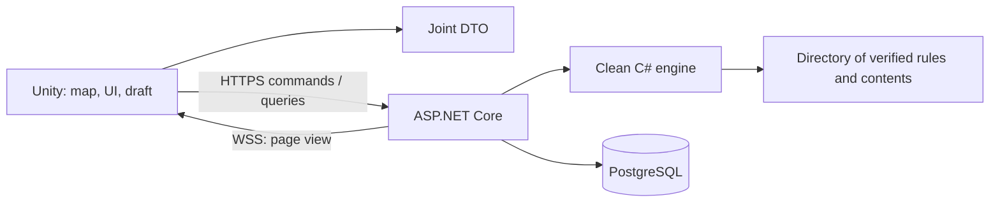
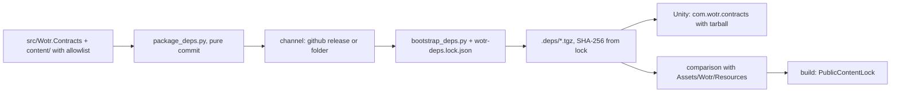
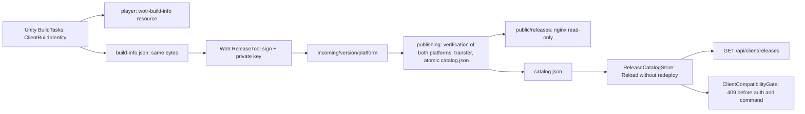

<a id="architektura"></a>
# Architecture

The Unity client presents the player's role and prepares intents. The pure C#
engine resolves rules on the server. ASP.NET Core persists the result before
responding and sends each side only its authorized view.

<a id="planowane-obserwowanie-i-replaye--obs-00-2026-10-16"></a>
## Planned observing and replays — OBS-00 (2026-10-16)

The [design](server/OBSERVERS-REPLAYS.md) describes future OBS-01–OBS-06
and REPLAY-01–REPLAY-07 (R33/R34). The following is not code acceptance:

- Room membership/role, player side and viewed perspective are separate.
  Server limits of 2+16 and role changes restricted to Waiting are atomic.
  The host may be an observer, so a room does not require an occupied player
  seat; observers have renewable membership with an expiration time.
- An observer receives a read-only projection of the selected side's knowledge,
  including its hand, history/reports and authorized updates. This is neither
  the complete MatchState nor a route to commands/preview or the opponent's
  hand for a player.
- Unity uses a shared Play/Observe/Replay board with interchangeable read
  sources. Viewing modes do not start move controllers, drafts, automatic
  decisions or player-seen; previews remain interactive.
- The current snapshot and journal are insufficient for reversing historical
  state. A new game records both sides' projections after every committed
  decision, in the same transaction as state/receipt. History and reports are
  incremental, with their effective position; rules/RNG are not executed again.
- A completed game provides a versioned `.wotrreplay` file containing indexes,
  state chunks and offline descriptions. The server retains the recording as
  long as the game; the client keeps its own local archive independently of the
  account and source server. Older games without frames have no replay available.
- The replay player accepts lower revisions and applies a history/report cutoff;
  seeking or changing perspective cancels stale reads and effects. Autoplay waits
  for the step's presentation, including sequential effects on both tracks;
  manual navigation does not replay gameplay events.

The registry determines status and work order; this request
creates documentation and tasks only.

OBS-01 (2026-10-16): room observers live in `room_observers`, with a lease based
on the database clock, rather than in `RoomState`. Every membership change
(`RoomStore.Roles`) operates on `LockedRoom` under the room row lock, making
the 2+16 limit and rejections atomic. Details: [T08-LOBBY](server/T08-LOBBY.md).

OBS-02 (2026-10-16): an observer reads a game only through `/api/observe/{id}`.
`MatchObservers.Watching` is the common access rule for the board, history,
reports and socket. `Projection.Observe` builds the selected side's view without
options, decision tokens or preferences; `MatchReader` passes that side to
history queries. This projection is the basis of REPLAY-01 recordings.
Details: [T07-TRANSACTIONS](server/T07-TRANSACTIONS.md).

REPLAY-01 (2026-10-16): `MatchFrames` records a frame containing both sides'
views after every public change, in the state transaction (`match_frames` table).
History is not copied into frames; it remains in `match_events` with its revision.

REPLAY-02 (2026-10-16): `ReplayExporter` provides a completed, recorded game as
a `.wotrreplay` v1 archive. `ReplayArchive` writes frames in chunks, both sides'
history, battle reports and the card catalog to a temporary file; the manifest
with SHA-256 checksums comes last. Export does not run rules.
Specification: [REPLAY-FORMAT](server/REPLAY-FORMAT.md).

OBS-04 (2026-10-16): the client sends the role when joining (`JoinRoomRequest.Role`,
`?role=Observer`) and sends role changes (`/role`). `WaitingRoomScreen` has
“Take seat” and “Remove” for each seat, plus an audience row.
After start, `WaitingRoomController` routes the observer to `observe` instead
of the player's board.

OBS-03/OBS-05 (2026-10-16): the client has Observe mode alongside Play.
`MatchReadRoutes` selects player routes or observer routes with a perspective
for the connection, history, details and reports. `ObserverSession` assembles
the observer board without `TurnInteraction`, a command sender, drafts,
automatic decisions or read markers. Switching sides uses `MatchConnection.Rebase`
(a new generation and counters reset to zero) and `ActionLogController.Reset`.
`RevisionHub.Watchers(match)` reports the number of open game streams
(players and observers) for resource checks in OBS-06 acceptance.

REPLAY-03 (2026-10-16): the client reads `.wotrreplay` through `ReplayArchive`
(v1 validation and individual-entry reads with checksum validation) and stores
files in `ReplayLibrary` (`persistentDataPath/Replays`, using a temporary file
and a move). File selection is behind the `IReplayFilePicker` adapter.

REPLAY-04/05 (2026-10-16): `ReplaySaver` downloads a file to the library from
the end screen in `MatchSession` and `ObserverSession`. `ReplayLibraryController`
handles the library page in the menu and before login. `ReplaySession` plays
the file on the observer board: `ReplaySource` (frame chunks, 3 in memory),
`ReplayHistory` (Log up to the step revision), and `ReplayReports` (reports
after a battle ends).

REPLAY-06 (2026-10-16): presentation effects are separate from player commands.
`GameSounds` accepts `ICommandEvents` (`NoCommands` for an observer) and a mode
without personal sounds; `BoardScreen.ApplyQuietly` shows a new reference
point without animation.

REPLAY-07 (2026-10-16): REPLAY-07 documents overall
acceptance; migration order 012 → 013, package versions and usage instructions
are in [OBSERVERS-REPLAYS](server/OBSERVERS-REPLAYS.md).

<a id="moduły-i-kierunek-zależności"></a>
## Modules and direction of dependence



Layout: `src/Wotr.Domain`, `src/Wotr.Contracts`, `src/Wotr.Server`, `tests/`, `unity/Wotr.Client`, then `content/` data and configuration `infra/`. T02 creates projects; build commands and verification limits are described by [DEVELOPMENT](DEVELOPMENT.md).

Rules modules after T11:   `Turns` manage the phases and costs, `Politics` activation/progress of nations, `Armies` reserves, recruitment and stack limits. `BoardRules` index constants graf/ID/names and the definitions of nations once. T32-SETUP adds Versioned `content/fate-setup.json` module `Fate` and reading `Region(state, id)` / `CurrentRegions` including Fate, New Cities and Dynamic Kings. `SetupRegions` retains the original affiliation of the scenario for scoring. The caps are indexed once; the request for a national neighborhood reviews at most 105 regions once to calculate options, not once per figure. Planners retain full configuration. Public `BoardProjection` Disconnects overwritten definitions, and Unity updates only these entries and restores withdrawn caps. Traders check intent before mutation, and providers build categories of legal choices from the same rules.

- Unity: pinned `6000.6.0f1`, map 2D, UI Toolkit. Change of version requires decision and control of
  the builds of both platforms.
- The tools in `Assets/Wotr/Editor` separate desktop configuration, synchronization of the public
  manifest of data, profile/menu editor and build execution. The common preprocessor also includes
  standard Build Profiles. Scenes Main and profiles are re-versioned; tools do not open or replace
  the user scene. Fullscreen Window/naïve resolution is common to CLI and editor. Details:
  [DEVELOPMENT](DEVELOPMENT.md).
- Server: . NET 10 LTS , ASP . . NET Core; installation SDK is part of the T02. SDK 9.0.304 does not
  set the target version.
- DTO shared: .NET Standard 2.1, without dependencies on Unity and the entity of the database. The
  engine does not have to be executed by the client.
- PostgreSQL, modular monolith, Docker Compose for backend and base. No need to run Unity process on
  the server.
- HTTPS: configuration, command, query and recovery. WSS: revision information and safe projection.
  After the break, you can download the full projection instead of reconstructing the missing
  packages.

<a id="stan-partii"></a>
## Stan game

T05: `MatchState`/`StateCodec` save version, stable ID and stack `ResolutionFrame` with waiting back. `GameEngine` checks command before copying the status and downloading RNG; traders do not get RNG in validation. From QUAL-01 the first step of this validation is the contract of the structure of `CommandShape`: the explicit `null`, unknown enums and too long values give `MalformedCommand`, before any rule, history or receipt reads the value ([T07](server/T07-TRANSACTIONS.md)). `DeclineReactionHandler` plays suspended decision. A specific phase cycle is added by T10, a full cards T14 interpreter. The factory shuffles four decks but does not select cards in setup (BASE p.14, step 8); the first selection takes place in the 1 phase. Earlier, after authentication, requests pass through account budgets (QUAL-02, `GameRateLimits`, `UpdateSocketBudget`): command and preview windows to the account in the batch, reads and rooms to the account, tho-currency and sockets to the account; exceeding is 429 without receipt ([T38](server/T38-DEPLOYMENT.md)). Approved receipts are permanent and domain rejections limited: at most 32 to the account in the batch and removed when the batch passes to a newer revision (QUAL-03, [T07](server/T07-TRANSACTIONS.md)). The PostgreSQL pool has a clear budget for the process, and the transient database error gives 503 `ServerBusy` and the socket closure code 1013, never 500 (QUAL-05, [T38](server/T38-DEPLOYMENT.md)). The client uses atomic view relative to the version: `MatchConnection` only moves it when each viewer has applied the view, and the presentation error is the status of `DisplayError` with no secrets diagnostics, not losing the network (QUAL-09, [SCENARIOS](https://github.com/jpolaczek/wotr-client/blob/abb3f838530e143a221e7c25cd557dcde434c6de/docs/ui/SCENARIOS.md)).

`MatchState` includes configuration and versions, turn and phase, player authorized to the current decision, map, policy, units with durable ID, characters, decks/r oz/usage, dice with origin, Rings and chips, Fellowship, pool Hunt, active effects and settlement stack. Unit identity and dice cannot disappear after aggregation in UI.

`ResolutionState` defines the action, already paid for resources, completed steps, the current time window, waiting for a decision and return after a reaction. These are serializable values with the version, not delegates, corutines or indicators to Unity objects.

There is no assumption that “the move is performed by the owner of turn”. In battle, Hunt and the responses the decision can be given to the opponent. Both clients know the public context, but only the right one can send the right choice.

<a id="transakcja-komendy"></a>
## Command transaction

T07: [protocol and test limits](server/T07-TRANSACTIONS.md). The server separates `Persistence`, `Authentication`, `Endpoints`, `Realtime` and `Randomness`; the structure rules are given by [CODE_QUALITY](CODE_QUALITY.md). Migrations are executed by transaction under migration block with the version register.

1. Authenticate the session; fix the player and access the game.
2. Check `commandId` within the game and player. The same identifier and payoad returns the
   preserved result; another payoad with the same identifier is rejected.
3. Block the batch record update or use conditional revision. Check `expectedRevision` and
   `decisionId`.
4. The engine checks the phase, page, cost, targets, limits and the current response window. The UI
   preview is not proof of legality.
5. Perform automatic effects until next decision or end of batch. Draw only through the server
   interface RNG.
6. In one transaction, save the new status, pending decision, events, spent draw results and receive
   command. Do not publish the result before the commit.
7. After the commit, send notifications; their loss does not change the result. The client recovers
   the receipt or the current view.

The lost transaction cannot reveal to the client a draw that has not been saved. The repeat of command after a successful commission does not take a new randomness. The versioning also protects from two clients of the same player.

UI-11 allows one clear exception to the validation of the revision of gry/okna: `SetCombatCardPolicy` sets its own preference for the current battle, with private CAS and the version of the hand. It uses the same transaction and receipt. The setting itself does not change the public revision; the game response called by setting it already changes it. `AutoDecisions` is responsible for the range, expiration and projection, `BattleCommands` performs the automatic "No card" in the usual continuation. `HandRules` is a common limit of hand mutation. WSS directs private signals only to the owner's accounts and reads both versions without dessertizing the full snapshot.

Unity separates the small `BattlePolicyControl` from `BattlePolicyInteraction`. The controller has an independent sender to recover the setting, but the block shared with game approval. The setting never goes to the loss draft or card; after changing the private version itself, this draft remains.

<a id="zapis-i-zdarzenia"></a>
## Recording and Events

T37 introduces snapshot v2 and open v1 migration: the directory of the ordinary decision commands and suspended return is refreshed without the rules being executed. `TurnDecisionCommands` is common for migration and window creation. Reading does not change revision or database record; v2 fixes the next command. `StateCodec` checks the header and the basic structure, and endpoint returns the safe code without serializing the exception. [Scope and evidence T37](server/T37-HARDENING.md).

`CommandFingerprint` separates the re-version canonization from the frozen `LegacyCommandFingerprint` shapes. The default values of DTO are cache on type; the arrays keep order. The re-ceipt comparison is still under the lock of the match against the engine and RNG. No payoad command or fingerprint reaches the opponent by projection or history.

Starting point: current snapshot plus permanent domain event log and receivers. Full event judging is not a condition for MVP. Each approved decision creates a permanent checkpoint; the local selection of the target does not require writing as a game decision.

Records must also contain covered approvals of cards, partially settled Hunt, selected losses, reaction windows, active decision shortcuts and pending choices during preparation. The correspondence party does not require an active state-keeping process in RAM.

Backup includes the database, versions of content needed for recording and configuration of implementation. Migration has fixtures with states in the middle of action. In the absence of compatibility, the server explicitly refuses to read; it does not initiate a new batch under the old ID.

T38: [Compose and service](../infra/README.md) split Caddy, backend as user `app` and PostgreSQL . Only proxy ports are published. Backend acknowledges X-Forwarded-For/Proto only from one configured IP ; exception HTTP for local GET health. Readiness checks the database, instead of identifying the running process with readiness. Secret files are outside Git; the role of the application does not have SUPERUSER/CREATEDB/CREATEROLE. `Hosting` includes transport configuration, database secret, and health, without mixing them with the domain. Backup retains the dump, the actual image of the backend with content and hashy manifest. Restore creates a new base and refuses to overwrite the existing one; switching the server is a separate, open-ended administrator step. `WOTR_DATABASE` select a Compose database when you start without changing the secret. Backup takes the name from the running container and binds it to its image instead of always copying the initial `wotr` The replacement of the container during the copy leaves it without a manifest, so it is not ready for restore.

DIST-04 ( [D15](DECISIONS.md) ): production on Omary adds to the same Compose `infra/compose.production.yaml` Caddy stays only in the local profile; the entry of the game is nginx ( `web` , alias `wotr-web` ) in the network `portfolio-ingress-wotr` Nginx takes the address of the guest from `CF-Connecting-IP` only from private addresses, overwrites `X-Forwarded-*` and is the only proxy trusted by backend. The game page is static and reads `/api/client/downloads` from the same original. Release files serve a separate nginx ( `downloads` ) with its own network, no route to backend and base, only `public/releases` read-only, with transfer limits; certificate and record DNS maintain `certbot` and `ddns` . .

T35: [correspondence](server/T35-CORRESPONDENCE.md) separates `MatchIndexStore` (limited header pages), `CorrespondenceStore` (summary and read progress) and endpoints HTTP. The list does not dessertize the snapshots or calculate the whole batch options. SQL selects public fields and its own decision type; the `(konto, ID)` indices support stable pagination. The `updated_at` field remains internal because private preference can also change them.

003 migration adds `match_reads`, separate from the game state. Ack blocks the revision reading for a short transaction, checks the scope, then saves the maximum of the current and indicated revision. It does not change the snapshot or publishes the signal to the opponent. `HistoryProjection` shares the visibility filtering and history limitation for board and optional return summary. GET does not confirm the reading and resumes the engine. The current decision still opens the usual projection reading and only resolves the authorized command.

<a id="projekcje-i-sekrety"></a>
## Projections and Secrets

T06 implements Domain side policies through public projections to Contracts. Test states Council/Kings explore the privacy of future features; do not include these expansions productively. Public list dice hides the dice score yet nierzuconej/usuni. Alien covered selection card has only the approval tag.

`PlayerView` builds the server from the perspective of a specific player. Full `MatchState` is never DTO. A list of legal options, error message, preview and history use the same visibility policy. The administrative log with secrets does not go to the application or normal operating logs.

A test comparing two states differing exclusively with the enemy's secret should receive an identical public view, unless the rule reveals the difference. Specific cases: the reverse of the selected card combat is public, its front before disclosure is not; the hand limit causes a covered discard; the Council variant hides versions of the Companion parts; Kings hides the values of the assigned chips according to the variant.

<a id="dane-reguł-i-efekty"></a>
## Rules and effects data

T04: `content/base-board.json` is embedded as Domain resource and read by `BoardCatalog`, with graph validation, ID and component configuration. Shared `BoardData` does not require Unity or serializer. `content/map-geometry.json` is a separate presentation data. Client can read the same JSON by Newtonsoft, server by System.Text.Json.

The directory has stable identifier independent of title and graphics. card contains a page, deck, number, edit, source, condition, event effect and combat effect. This is done by the typed C# operations and public reaction windows, not any text script.

T14:   [performance of effects](rules/T14-EFFECTS.md) static separation `CardCatalog` / `EffectCatalog`, typical steps and conditions from the saved `EffectExecution` Cursor is part of the existing `ResolutionFrame`; cost, nested frames, recoil and army surplus will survive the reboot. `GameEngine` resume the registered follow-up after command; does not execute scripts from payload. `EffectOptions` specify candidates, without generating a combination. `ActiveEffects` is responsible for modifiers and termination, `CasualtyRules` split event/battles and participants from the rear guard left behind.

T15 adds the `Fellowship` module: `TravelRules` checks geography, `CompanionRules` plans groups, `FellowshipFlow` fixes decisions/return, and Commands/Options/Preview uses these rules. The 14 directory comes from SRC-02 and loads once. Initial ID Companion are still in `FellowshipState`; the outright `CharacterState` is created when the composition is left. The recording does not contain delegates or an imaginary secret route of previous movements.

T16 separates `HuntRoll`, `HuntPool`, `HuntDamage`, `HuntRuntime` and their contracts. The cast, reroll, victim and selection of tiles use only the saved RNG. The stack can intertwin Hunt → Effect → Fellowship → Hunt; `CanContinue` selects the upper frame owner instead of depending on the one-time order of the call of the handlers. The nested return does not end the paid action. The catalogue of effects is one singleton DI; the test definitions do not go to the production directory.

96 cards metadata are read and indexed once. [Manifest](../content/implementation-manifest.json) separately binds events programs and battles with tests; `EffectManifestTests` compares both parts to the actual directory. Individual T21 packages add verified card in `Domain/Cards`, sharing programs of the same combat effects. New write fields have neutral default values; compatibility of historical contracts verifies T37. UI cards integrates separate UI-06.

T21-FP-CHAR-01 adds a grouped selection to the existing effect step: the server returns Companion separately and the missed dice, and validises one set containing one item from both groups. It does not create a product of the combination. The choice and cost are one transaction. Public response conditions have a public type of `PublicEventCondition`; only such condition can affect the omission of the public window without reading the opponent's hand. The Hunt tile cycle includes separate states of `spent` and `return-after-action`, closed by ending the entire action.

Extensions modify the setup, available components, and certain rules by a public integration plan. The substitution table solves Lords/Kings/Fate before shuffling. A conflict without a conclusive source is a configuration validation error, not a "last file wins".

<a id="klient"></a>
## Client

The current UI-80 opening contract separates `RuntimeTooltip` and interactive windows: text on hover/fokus uses only projection metadata, and click or Enter/Space opens the panel. The map area on the hover only stands out. Class names with `Hover` remain historical file names; they do not mean consent to the automatic opening of panels. Descriptions of subsequent tasks below retain the history of architecture; clearly marked old entry mechanisms do not replace the current contract or evidence in the register.

`ActionDraft` is local and reversible for approval. The server can return a preview of known effects, but does not reserve the cost. Each approved command returns with the current projection or error requiring refresh.

Animations play the difference of views. They do not control the engine or pay the cost. The revision checks the current status of the draft: it retains the legal choices and means what needs to be improved. It does not automatically replace dice, card or the target.

UI-08 separates `Presentation/FellowshipDraft`, `TravelDraft` and `FellowshipSummary` from `UI/Fellowship` (elections, status of Fellowship, context of Hunt) and the tag on the map. Static character names are indexed once; the version is allowed to be displayed only on the basis of the projection of a given page.

UI-21 moves the same tray to contextual `FellowshipPanel`, without a separate sender. `FellowshipActions` and `TravelActions` select from the projection a specific cost, portraits and end of the route; controllers handle the gesture and transmit the finished draft to the common `CommandSender` Ordinary travel groups use Stepwise with UI-16, travel imposed and the Council retain their own contract. With a mass collection of flight targets, the map distinguishes legitimate regions; from UI-73 end approves re-click of the site, without handle ✓ The preview has a separate opening state preserved under a historical name `HoverState` It doesn't change the draft or the camera. `FellowshipRoster` saves the buttons when changing the selection and does not play private versions of the opponent. Portraits of forced separation are also available after removal figures of the current composition Fellowship, on the basis of a pending decision option.

T18 adds `Domain/Battles`: procedure recording, legality of participants, combat program catalog, Leadership, throws, loss plan, move after battle, runtime, command, options and projection. battle is the frame of the same stack as Events/Fellowship/Hunt, and special loss of its own frame; return does not repeat cost or RNG. The effect directory shared by DI also records battle programs with many initiatives. The recording only contains data of continuation, never delegates or client code. Legal attacks return candidates and one group limitation, without generating all of the subsets of figures.

T19 retains this stack for four `BattleMode`: Field, Siege, Sortie, Relief. `StrongholdRules` separates the transitional shelter from the established siege and only after both losses settles control. `StrongholdCommands` publishes the right election and mutually validates it. `UnitReduction` supports the same physical exchange of elite at loss and cost of extension; `TerritoryRules` shares control and release of the garrison with movement. An event eliminating the army can end siege in the changed region; the current battle field is waiting for the end of the loss of both parties.

Sources of technical decisions: [support .NET](https://dotnet.microsoft.com/en-us/platform/support/policy), [profile .NET In the Unity](https://docs.unity3d.com/6000.6/Documentation/Manual/dotnet-profile-support.html), [WebSockets In the ASP.NET Core](https://learn.microsoft.com/en-us/aspnet/core/fundamentals/websockets?view=aspnetcore-10.0). In T02 we check the compatibility of the real environment again.

<a id="postacie-i-reakcje-t20"></a>
## Characters and reactions T20

T20 groupes the rules of the character in `Wotr.Domain/Characters` : the directory defines the capabilities and statistics, `CharacterEntry` plan for entry/transition, `CharacterLifecycle` update version and dice the next recovery, `CharacterCosts` check one-time Mouth costs. Planners are common to validation, legal options and preview. `CharacterReactions` provides programs of the same stack of effects as card . Hunt keep the group leaving Fellowship Hobbits with original location and progress; does not reproduce it from its current position after disclosure. `CharacterState.Id` remains constant, and `DefinitionId` defines the current version. Any future effect eliminating the character should benefit from `CharacterLifecycle` or `HobbitDeparture` for intra-forms Fellowship .

battle closes the round full-time Continuation/retreat and the possible cost of extension siege. `NextRound` separates the end of this round from the preparation of the next one, so that the Sorcerer and the required rejection cards can safely stop the stack. Grey uses the one-time end tag of the action program by analogy. There is no separate second reaction mechanism for the character.

The flight projection calculates a common list of legal regions once for all Nazgûli/Witch-kinga; Mouth uses BFS with a limit of three edges. Folders are indexed after a stable ID. The input preview performs a deterministic plan on the state copy only on request, without drawing and without rebuilding the entire UI. The client keeps the map's target controls in the cache; at a large range hides their labels and highlighting regions directly.

<a id="klient-po-t09"></a>
## Client after T09

[Integration Unity](https://github.com/jpolaczek/wotr-client/blob/abb3f838530e143a221e7c25cd557dcde434c6de/docs/ui/T09-INTEGRATION.md) separates `Application`, `Networking`, `Map`, `UI`, `Presentation`. Static geometry has an index, armies are updated after ID; the camera does not result from batch revision. The session is memory; HTTPS/WSS and sessions tested with the real local Kestrel and PostgreSQL. The screen controller manages the cancellation of tasks. expansions in the lobby have dependencies validation and an open start block for unimplemented modules.

UI-07: `Presentation/AttackDraft`, `BattleDraft` and `BattleSummary` separate the plan, local undoing and description of the server preview. `UI/Battles` contains separate components of the context of both forces, losses, attacks, other decisions and reports. The existing tray and transport remain common; no second client of modal rules or screens for subsequent steps of battle. `LastBattleRound` is a limited public snapshot presentation, not a source of legality.

T21-FP-CHAR-02 extends the selection steps by the state of minimum/maximum and the description of the dependence in the projection. `EffectChoiceDraft` supports general groups, dependants and alternatives; it does not know the names of cards. `EffectFigurePicker` switches the bookmarks of nations at a large number of figures, without changing the selection and without scrolling. `CardChoices` remains the mount of controls, without the rules of the game.

`ICommandPreviewProvider` allows the dealer to describe the effects of legal command without performing it. The effects are transferred to the correct step of the directory: the same directory supports selection, validation and description. We do not simulate secret draws for preview purposes. Hunt has a saved stage before selection; the Staff settlement returns to the existing end of movement. Additional range of card is given to the separation procedure, not the exception in Unity.

T21-FP-CHAR-03 adds `EffectChoiceStep.Chooser`: the owner of the program and the action payer may differ from the person making the specific decision. `Pending.Owner` and private `EffectSelection.Owner` indicate the actual selector. Eagles saves the region and ID covered Nazgûli in `EffectExecution`; the draw ends before the Shadow withdrawal window. The reboot returns the data of the continuation, without re-executing the previous step.

`CompanionJourney` saves a fixed level or bonus and an exception to the end of traffic in siege Common `CompanionRules` / `TravelRules` service command, options and preview. `FellowshipFlow` opens the separation or movement of one group on the same stack. does not list the combination Companion Or all the routes. BFS Stops at Stronghold   Shadow Unity uses the same group controls and maps; presentations Region/ActionDie direct selection to existing maps/pool   dice.

T21-FP-CHAR-04 is secreted `ArmyTarget` / `ArmyLossRules` of losses battle The common planner validates figure, number of hits, degradation and fate of commanders; `EventLossProcedure` preserves the objective, results and source without creating battle.  `DestructiveEvent` openly allows the commanders of the destroyed army to be removed, ordinary `Event` keeps the exceptions to date. After application figures additional conversions are made dice forms; this also applies to ordinary losses battle Except for getting it. Stronghold remains in `StrongholdRules`.

`EffectWait.FreeEvent` suspends Enty on the selection of Character/Decline. Catalogue checks printed terms and private hand, free cost does not have ID dice. Nested event has a return to parent, and `IsEvent` forces control of the army limit also after the free event. Only the original paid event ends action and opens the proper Grey reaction. `RecruitmentRules.EventGarrison` is a joint recruitment law in field/garrisons; Grey Company performs the replacement before controlling the lone commanders.

T21-FP-STR-01 : `RegionProtection` is the common validation of the entry/ attack/retreat Army. `MovementRules.Plan` checks it also at source because a working copy board does not contain effects or hands. `DiscardProtection` nuclearly takes three resources; does not open a partially paid procedure. `ActiveEffects.EndAction` separates the conditions checked all over action After immediate disposal, ujawnieniu/deklaracji. `DiceRules.CompleteCost` Not later than after the end of Last Battle Hunt . `EventLossProcedure.Cause` distinguishes the loss of ordinary event from the explicit exception of Ents/Dead; the default value retains the semantics of older records. `LimitCombatDiceStep` and `AdditionalCombatHitsStep` share the implementation of Ents and Strategy. Client indexes protected regions once per projection; map render uses `HashSet` , a card on the table, he groups after source/owner.

T21-FP-STR-02 : `Armies/ArmyEvents` store the type of operation in the overarching event frame. `ArmyEventMovement` plans a permanent group and the entire route on a copy board ; uses the same relocation, control, borders and politics as the usual movement. The only exception is that the only way to pass and exit the garrison is to be immediately. `ArmyEventOptions` calculates limited length routes at most two, without a combination figures ; test the feasibility of a full available group or group with the unit left behind as a rear guard. command again undergoes full validation. Help uses `BattleRules.Attack` and the existing stack back Parent; reduction in number dice is a force field of all battle independent of reset round modifiers. Client splits `EventArmyDraft` , `EventArmyChoices` and `EventArmySummary` ; Route edition updates existing controls and map.

T21-FP-STR-03 : `RecruitRegionStep` jointly check the reserves and legality of the region; two implementations determine the coast with the army and Rohan with Companion . `RecruitEffectStep.Count` limit candidates to the equivalent number needed figures any type, without numbering the combination. All indicated figure approve one command ; the subsequent steps and the final surplus retain the continuing. `ChargeStep` uses filtered participants and `BattleRoll.Special` , does not copy the loss procedure. `EffectChoiceDraft.Placements` shows publicly known recruitment sites already in the local draft .

T21-FP-STR-04: `RecruitTogetherStep` submits independent reserves of nations into one choice with separate limits. The constructor rejects groups of the same nation: dividing the common reserve between regions requires another operation. It does not create a combination of figures, it only combines limited lists of candidates. `RecruitEffectStep.RequiredKind` limits Brand recruits to regulars; `RecruitRegionStep.AllowBesieged` explicitly disables the garrison for Éomer. Joint recognition of the role of Companion has been moved to `CharacterRules.IsCompanion` so that card recruitment does not depend on the router. Three sets of scripts of the server use a common setup and play card.

T21-SH-CHAR-01 : `HuntProcedure.TileRule/DamageRule` They store semantics of selection and injury of the event, instead of checking ID cards in the contractor. Filter works after replacement, before Shelob throws and fixes injuries. Protection and capabilities conditions Guide check the possibility of reduction; Gollum retains separate ignoring of standard Reveal. Hunt with Stronghold creates a new frame with simple rules. `BattleLeadership.Nazgul` filter live participants and available points after cancellations; `NazgulLeadershipStep` (generalised in the package 02 ) creates a linear list of points, without generating a selection combination. In the database the list has the highest 10 components ( 8 The Commission has also concluded that the measures provided for in this Regulation are in accordance with the opinion of the Standing Committee on Plants, Animals, Food and Feed, 2 Witch-king Points). six programs cards remain in a separate `Cards/ShadowCharacterCards01` .

T21-SH-CHAR-02 : `HuntDamageRule.RandomCompanionFirst` forces draw only after security windows and Guide ; does not disable normal reductions. `HuntRuntime.BeginRoll` save `Rolled` , without setting `Movement` , increasing progress and cost-making FP The failed throw ends the frame before selection. `NazgulEventTravel` opens `EffectWait.NazgulTravel` and resumes the same card au `MoveShadowCharacters` ; uses a common `ShadowTravel` with Nazgûla filter and a clearly allowed empty list. Normal movement still requires dice and at least one group. In each call options and index figures are created once; we do not list a group or cost combination Leadership . `NazgulLeadershipStep` has a typical effect CombatBonus/RerollBonus/OpposingDicePenalty. `BlackBreathStep` calculates the targets from current live participants and the preserved reroll hits. dice is deducted after a five-limit, regardless of the unlimited force of the army.

T21-SH-CHAR-03 : `HuntPurpose.CompanionSeparation` distinguishes Breaking from injury Hunt Serialized `BeforeRoll/Roll` postpone RNG to complete Crebain reaction; `CasualtyEffectsPending` launches Worm after selecting a new Guide The declaration has its own frame `FellowshipProcedure` , retains full route and phase decision to the end of Balrog and additional fortresses. `TableCardRules` remove together card and its active effects, and `BattleTableCards` makes Balrog available as a public combat candidate without being carried to hand. The commitment keeps the origin private until the disclosure of both cards ; the projection of the number includes this candidate through the entire window, protecting the confidentiality of the selection. The limit after Sorcerer is checked at the end of the battle Not between rounds.

`BattleRound.CancelledAbilities` and `CancelledLeadership` save separate effects of Words of Power. Captain and White Rider read the current state of the round; presence and level of the character remain separate facts. Durin’s Bane range is once designated a set of regions with real edge of map graph, without multiple search of routes. The new effects of cards are small steps in `Cards/`; the procedures of Hunt, travel and combat retain responsibility for continuations and common non-conversions.

T21-SH-CHAR-04 : `ShadowArmyEvents` extend the same procedure movement/attack required figure and optional completion. Option data distinguishes the route from one/dw Moves without extra dice ; the client continues to use the joint drafts. Grond adds the recorded minimum rounds and the public ban of the first card FP , automatically omitted only in the absence of Companion Jerkír saves the permission in the paid event frame and consumes it once and for all action . `PoliticalReactions` preserves the cause/nation/region to the end action ; the preview shall calculate the consequences on the decoupled public copy. `SaveCorrections` corrects the wrong read Stider symbol in older records without changing its identity or the course of the written decision. Dreadful army groups are indexed before counting candidates; no combinatorial calculation of subsets.

T21-SH-STR-01 : `ShadowStrategyCards01` group six programs without expanding the interpreter by identifier cards . `ShadowArmyEvents.Siege` share three rounds of Gronda and Uruk-hai, with a separate condition figure It's a source. `BattleLossProcedure.Voluntary` reduces the cost chosen figure ; `ArmyLossRules` Still performing the only validation and mutation of losses. `EffectExecution.AppliedHits` carries the paid cost to the next step, so Onslaught can settle an additional attack after losing his army. Denethor uses a public modifier and expiry condition, covering both roles FP In battle Choice figure Stormcrow indexes region in option; client filteres already received figure without rebuilding the panel on each selection.


T21-SH-STR-02/03/04: `ShadowMarchRules` builds independent routes of up to four initial armies. The Gather/Lengthens goals are set at the beginning of action; the execution on the copy of board is sequential and includes released siege. The validation of the entire plan precedes the change of the authoritative state and the stack limit follows all marches. Corsairs has its own landing module and `BattleLanding`: movement and possible excess precede battle, and the fixed tag distinguishes battle in the already occupied region from the usual attack. The garrison is available outside the participants of the incoming army.

`RecruitmentBatchStep` uses `RecruitmentPlan` and the public amounts nation/region/rodzaj. calculates the largest possible allocation without imposing the order of regions at the common reserve failure. `EffectChoiceStep` has separate validation, execution and preview operations of the type payload. This allows recruitment to use the actual ID figures and the existing record of the effect frame, without coding pairs in artificial identifiers. The client separates draft, control of the plan and view; the selection of figure updates existing controls. The new cards programs are still part of the Cards module, transport to the server, and the local draft to the client.


T30/T33: `MatchFactory` group once `DeckComposition.Build` by page and deck, then shuffles four completed letters. Plan before RNG check 96 busy base slots, uniqueness ID/replacement bath, availability cards and exact numbers cards In four decks. `ContentConflictException` contains only a public slot and a source rule; the composition does not receive the state of the party. bases/Lords/Kings uses one availability table, the same as validation of the play. Balrog Lords has a public `replaces` in metadata instead of a separate condition ID There's no rival separate list of Lords. T32-CARDS adds six explicit Fate substitutes, including an exclusion corresponding to two cards Kings. The record contains a shuffle result, without re-folding the deck at the reconnect.

`Fate/Cards` shares the programs by liability: movement/politics, recruitment and two variants of Monsters. Common `RecruitmentBatchStep` calculates the allocation from the common reserve, and nested `EffectExecution` saves the selected variant and region. It does not add new protocol, the interpreter of the text cards or Unity dependencies in the domain. Client loads six public descriptions and uses existing draft clicked figur/region. Six combat conditions use the same verified programs as the base.

T32-GIMLI separates the physical `FigureId` from the default `BaseId` and `AlternateId` from the Council group. Two sets of versions (with Fate/without Fate) are indexed once. `CharacterCatalog.Companion` solves the default obverses of Fate for the yet unseparated figure without creating a second entity; the fixed version has priority. `FateGimli` declares ID, homeland, identity for cards and the Guide reaction. Other behavior still belongs to the common Politics, Council, Hunt and Battle. The client receives only permitted versions and charges public names without counting a private selection.

T31: `KingsDismay` manages physical token and public waste-shoot window, `DismayCommands` Validation/opcjami/preview. `TurnFlow.BeginActions` is a common discard border; Lore returns to this border respecting the written refusal and single use. We do not re-cause throw or discard queue. `KingsCouncilEntry` extends entry candidates without copying the costs of dice and the legality of regions. `CouncilTokens.Spend` jointly saves consumption and limit of turn, separately from the specific token effect. Sequence Corruption uses the same permanent frame as the ordinary try and West event.

<a id="ui-12--powrót-i-własność-zasobów-klienta"></a>
## UI-12 — return and ownership of client resources

`Application/ClientFlow` switches the screens, `LobbyBrowser` manages limited list pages and rejects old responses, and `MatchSession` binds one screen to the transport and decision controller. `MatchSeenTracker` confirms only the revision displayed. Lists, lines and summaries are in `UI/Rooms`. `Persistence` unbundles permanent file access, command log and draft queue. It does not know Unity or a domain full state. Disk operations use Task.Run and one critical section; rendering does not wait synchronously for I/O. Local draft, receipt and authoritative view have separate life cycles.

<a id="preferencje-interfejsu-i-diagnostyka-ui-13"></a>
### Interface Preferences and Diagnosis UI-13

`InterfaceController` manages one screen container and the settings overlay. `ClientFlow` only reports the settings open. `InterfacePreferences` saves the local version configuration of scale/movement by PlayerPrefs; no tokens, hand or authoritative condition are found there. `FocusIndicator` is the overlay outside the button text tree and tracks geometry only during focus. It does not rebuild the view or capture the event of the indicator.

`Runtime/Diagnostics` exists only in Editorze/Development build. The clear argument `--wotr-profile` launches the presentation load from the projection exported by the test, without connecting to serwerem/kont. `FrameProfile` collects to previously assigned arrays, releases the meters and serializes the result after the measurement. The usual start passes through `ClientFlow`. The tool is not an endpoint or an alternative rule engine.

<a id="interakcje-i-sekwencje-ui-14ui-24"></a>
## Interactions and sequences UI-14-UI-24

Client breakdown: gestures (click/double-click/drag), local selection, legal targets, openly opened panels, text `RuntimeTooltip` and existing command transport. Information on hover/fokus uses only safe projection and local metadata; it does not call API or authoritative rules. Stable controls and differential changes limit the conversion of UI. The input versions described at UI-15–UI-72 are the history of implementations; the current opening contract is defined by UI-80.

UI-15 implements `ActionDieContext` and `ContextArmySelection` in presentation and a separate `ActionContextInteraction` controller. `HoverState` is independent of Unity and selection; `RegionViewIndex` builds a dictionary with `PlayerView` without private versions of Companion. `RegionHover` supports input and position, `RegionHoverPanel` stable figure, and `PopoverPlacement` avoiding overlay. The panel rebuilds after changing the content, not when changing the selection or the cursor movement. `DraftInput` binds double-click/drag with the party, revision and decision; the controller decides the effect of the gesture. Transport and rules are not the subject of preview.

UI-16 implement `Turns/Sequences` : `ActionStepRules` validises a single step, `ActionSequences` performs and closes it action , `ActionSequenceOptions` design other options, `ActionSequencePreview` describes the ending. Serializable `ResolutionState.ActionSequence` store cost/bud Cot and waste figures/sediments independent of the response stack. Individual handlers only delegate public `Stepwise` ; historical command Conclusive and frames cards keep their own path. Shared Planners movement/recruitment/dr The sheaths remain the source of legality. figures are small and limited number of components; options do not list subsets, and movement filteres used ID by the collection.

Every step uses a regular transactions/revision/receipt ; no separate recording path was added, or RNG . `TurnFlow.FinishAction` refuses to complete until the sequence has been closed, which protects the moment of politics, excess and Vilya. After the closing, there are existing sequels. Public `ActionSequenceView` is openly mapped, without raw frame and initial candidates; options only at the owner's. 2/snapshot 3 keep reading snapshots 1/2 Migration does not perform action . The historical corps preserves 28 old files and adds a separate snapshot `paid-army-step` v3; details of tests in UI-16 .

UI-17 : `ContextArmySelection` store a single unsent warehouse in the draft, and `ArmyActionTargets` combines legal march and attack targets with server options. The target click of the object defines command without choosing its name. `ActionContextInteraction` handle gestures; `TurnInteraction` is still the only path to send/receipt. `ActionProgress` are stable symbols and Finish at dice . `MapCanvas.ArmySelected` distinguishes the side and the garrison from the site; `DraftToken` preserve these features also in dwukliku/drag. RegionHover only allows the rectangle to be deployed by map, not by rules. figures copy the draft keeps Stepwise, and revision/ID decision cuts off Undo previous saved step.

The UI-80 correction stabilizes geometry before the first choice of figure: the selected multi-functional die reserves the existing 32-pixel line ActionProgress as `visibility: hidden`, without symbols, budget and hit-targets. The line reveals the actual budget only after the selection of the application; without the selected cost it does not take place. TurnInteraction sets the planning style already when selecting dice, so the first click of figure does not change the padding of the lower tray or the available area of the region panel.


UI-18 : `CardActions` selects only the exact cost of the context and `CardContextInteraction` separate pin/discard from a two-click, drop, waist and the purpose of the nation. `CardCostPicker` reveals server variants of special cost at dice ; the public conversion Jerkíra and token Denethor retain their own fields of payoad. `DeckView` reads only public numbers and player options. Fixed objects `HandView` change selection without redevelopment of the hand; miniatures have a common grid instead of different lists in each phase. Historical UI-18 open `CardInspector` by hover 200/150 Ms. From UI-74 panel requires clicking or Enter/Space , retains an independent pin and the common opening signal limits unattached inspections to one. No hover calls API A single complete selection of effect uses an existing sender; sets retain one approval.

UI-20: `MusterActions` uses a specific dice and only its server options. `MusterContextInteraction` directs gestures to a common sender; it has no transport or optimistic deployment. `RegionRecruitPalette` is a stable element of the settlement preview, and historical `PoliticalTrack` used common time hover and four fixed fields; the current `PoliticalPanel` opens with a click/Enter/Space. The checker does not rebuild or change the draft when the raid is in progress. `TurnDraft.Ready` distinguishes the single step of Stepwise from the older atomic plan; readiness and warning effects benefit from the existing endpoint preview. The budget and closure of the sequence continue to result from UI-16. The capabilities and tokens are not automatically treated as a regular Muster.

UI-25 replaces `NationStatusStrip`/`PoliticalTrack` module `UI/Politics`: `PoliticalPanel` maintains constant lines and the enemy filter, `NationTrackRow` draws position/activity and legal next goal, `PoliticalHover` currently supports public opening, selected nation and closure. The name comes from the historical opening after invading in UI-25. The nationality of nations comes from a dictionary built once from the public BoardData; it does not require a new field in the projection. Each row has its own ID goal, and the tag changes the position only after receiving the projection.

`Presentation/PoliticalActions` translates current options to Muster, the openly elected Council or Narya. `PoliticalContextInteraction` validizes the gesture in the current view and transmits the draft to the existing EditSelection/sendera. Recruitment stays in MusterContextInteraction Objectives cards In CardContextInteraction There's no command no activation or new client rule. Hover does not request preview, does not pay the cost and does not rebuild UI ; from UI-80 can only show metadata by RuntimeTooltip The panel and the targets remain stable during drag.

UI-26 removes a separate inspection mode of the nation from BoardInformation. Information, selection and target are in Politics. `DraftInput.DragChanged` reports the source once after the start of the drag and `null` after the end/cancellation; `PoliticalPanel` uses this only for the preview of the target. It does not edit the draft or run the network preview during the drag. The highlight is one line and returns to the open choice after the cancellation. The same controls, without new transport, rules or optimistic shift, are updated.

UI-27 separates the mode of policy presentation from the availability of the current legal option. `PoliticalActions.UsesPanel` also recognizes an incomplete AdvancePolitics/Council draft; no cost runs no other view. Removed `MusterChoices.Politics` and the old track style. DecisionTray omits the policy form also for direct rendering of the reconstituted draft. Policy continues to validate click/drop by AdvanceOption; presentation does not grant additional legality.

UI-19 : `RegionalBattlePanel` is the owner of the panel's location and opening only. It carries a stable tray between the bottom bar and the region; `BattleContextInteraction` maps the final gesture on the existing sender. The scope of the opening is game/battle , independent of draft and revision. New battle does not open the panel or move the camera. `BattleDraft.CycleLoss` changes the ordered set of operations without moving the changed elite at the end; transport and domain remain unchanged. The panel location is converted after opening, resize or camera, not after its own move or each frame. The objectives of the map include the panel as an obstacle. card The only way to fight is to use the open CardId ; its interactive preview from UI-74 requires clicking/ Enter/Space.

UI-22 expands client contexts without changing the rules or network contract. `ComponentActions` transforms current ActionOption in a specific owner, location and exact cost; re-downloads the current entry on activation. `ComponentContextInteraction` directs these components to RegionHoverPanel , the pool of entry or TableEffectsView Views keep controls according to stable key, controller makes a choice through existing EditSelection/CommandSender. BindCost binds the skill symbol to ActionDieContext , and ordinary army and travel controllers keep AbilityId . Command, legality, randomness and recording still belong to the server. The sovereign preview uses data PlayerView and historically named HoverState ; from UI-74 open it click or Enter/Space and UI-80 limits the hover to the text.

From UI-73 canvas map fills Root under HUD, and the stage limits the panel area. The geometry of markers and previews does not determine the size of the map itself. The resource pool increases the width only with more than eight visible dice; the simple configuration retains the decision tray space.

The location of previews responds to the actual change in the size of the content, with tolerance of one unit to round geometry on a fractional scale. This prevents loops: shift → minimally different height measurement → new location. There is no cyclical update of the map based on the mouse position.

UI-23: `Presentation/DecisionAttention` solves navigation only with its own `PlayerView`; `UI/DecisionNotice` points it with a button and a map symbol. Apply does not move the camera, selects the candidate and does not send command. Click reads the current context again. `DraftInput` binds each pair PointerDown/PointerUp (also without token and with capture) to the party, decision, revision and connection generation. Cancellation sends PointerCancel to the source and releases the capture before the controller is changed. Local sketches can be edited offline; shared Submit still requires connection and fresh projection. The missing cost is not replaced automatically.

UI-24 separates `Presentation/TurnSummary` from the orchestration preview/komend. `TurnInteraction` refreshes the contexts and existing controls, and then independently requests the current preview; the response still requires a compatible generation and revision. `MapDraftOverlay` distinguishes the next adjacent steps from the mass flight targets, without further searching for legality. Changing the width of the route panel and the order of portraits is just a presentation.

`InterfaceController` has one layer `UI/RuntimeTooltip` , shared for the game and settings. In UI-80 read only text `tooltip` appropriate object: without transport, domain, text field values or loading karty/historii. `rich-hover` identifies the owner of the extended panel, but only shares its own metadata; does not open `CardInspector` , `RegionHover` or other panels. The site does not become a source of description. The inaccessible own control keeps the information unchanged `enabled` . .

From UI-114 The same root has `UI/PressFeedback` : from PointerDown to release means class `pressed` nearest `Button` or element `pressable` under the indicator (also Enter/Space on a focus control). action nor changes draft ; cursor output, drag control from `DraftToken` The cancellation and unbuttoning take the state down. `Styles/Interaction.uss` (imported last in `Wotr.uss` . Draws a state: reduction by 1 pt, tint or variants `pressed` schedule with `graphicalassets/ui` . `MapCanvas` runs its own `PressedRegion` And he draws it as `MapRegionEmphasis.Pressed` ; the selection of the region continues to take place after the exemption in the same region.

UI-115 transfers the battle rules to `Styles/Battle.uss` (one window width) and builds forces with `BattleForceView`: `BattleContext` creates `PortraitMedallion` (sylvet from `FigureArtwork`, initial from code, seal of removed capability), one figure to nation and type with number, `BattleStatMedallion` ×4 with server values, garrison shelf only at figure outside battle; `RegionalBattlePanel` adds pass from the mode scene, `BattleStages` from the ribbon with icons. Graphics in `graphicalassets/ui/src/battle/` (SVG), portraits and bitmap backgrounds are UI-120. UI-117: `DiePips.Illustrated` turns off the eye painting and displays the `die-pips-N` wall class; `Styles/Battle.uss` maps it and states (`battle-pips-hit`, `battle-pips-rerolled`, `.selected`, `.pressed`) to variants `battle/die-N-*`. Hunt (`HuntDieFace`) continues to paint meshes. UI-118: `BattleLossChoices` imposes `FigureArtwork` on loss buttons (text becomes an order and glyph badge), adds state and nation crest overlay and hit seals counted with `BattleDraft.Damage`; cycle logic and preview unchanged. UI-119: `BattleChoices.IconFor` maps the type of decision to the icon, and `BattleReport` wears the `battle-chronicle` class (frame, header, parchment pages, round tab) unchanged in requests, texting and reading. UI-120: `Map/Figures/PortraitArtwork` (atlas + JSON, key with `DefinitionId`, sprites once, missing = null) and `UI/Battles/BattleSceneArtwork` (mode texture or null) are optional; `PortraitMedallion` and `RegionalBattlePanel` replace placesholder only with the available resource, without USS references to non-existent files.

Hover opens text after 200 ms, the focus of the keyboard outside the gesture immediately. The layer has `PickingMode.Ignore`. Each PointerDown, drag, pan, wheel and cancels the text; the focus from pressing does not open it during the gesture, and PointerUp does not require reopening. Departing, changing the source, decks, nullification of an object or loss of focus of the application also cancels the pending opening. Esc extinguishs the description without `StopPropagation`: the same key supports the active window or `BoardEscape`, while maintaining protection against repeated key in Settings/BoardEscape.

Tooltip has one timer of delayed opening; open text checks the actuality and geometry of what 50 ms, closed does not work in each frame. `Dispose` releases callbacks, watcher capture and focus subscription. Rendering in Player does not rely on editor hints. Previous variant UI-74 opened `RuntimeTooltip` after clicking/release; it remains a historic stage and its results do not confirm the new behaviour of UI-80.

UI-28 : ActionDieContext .Supports describes the normal category of the selected dice Allows filter server options, ArmyFace determines the normal cost of traffic (Army before Character at Will). BindCost shows the use from the draft and saved ActionSequence limits context to its wall. Removed ActionFacePicker Special CardCostPicker maintain open capabilities and a separate style. Controllers share the possibilities in parallel; route the map and MapDraftOverlay use the prepared intent to choose targets. Policy does not require a category and does not grant any activation. DieHints reads only public condition dice and the recipients options; update the tooltips when rendering state/choice Never in PointerMove .

UI-29 introduced `UI/Cards/HandDrawer` with historical HoverState and common area kart/CardInspector. From UI-74 The hand opens openly and remains open after the cursor has left and the focus of the application has been lost. Esc/Close closes it without deleting the unsent selection; excess cards keeps your hand visible until the end of the decision. Keeping the mouse protects the source of the drag. The controls remain in the tree, without being rebuilt into PointerMove Bookmark and open panels are obstacles to the map. `CardInspector` has two stable blocks full text, and `CardPlayButtons` update cost/ikon Only when the value changes. `CardActions.Costs` filter current options of the same dice ; the selected wall goes to the current payload. `CardContextInteraction` direct Play, two-click and drop to existing draftu/sendera. No domain status, transport or own validation of rules has been added to the layer of the hiver.

During the `DraftInput.DragChanged` drag, it suspends the temporary preview of cards and HandDrawer maintains the source. The completion or cancellation unlocks the inspection, but the release itself does not open the panel or tooltipu. The size of the CardInspector text is checked when changing the content or geometry; the height takes into account the rounding of the PanelSettings scale. The change of the legality of Play only refreshes action, without remeasureing the rules.

HandView grid converts columns after changing the number of cards or the width of the container. Rounding down and a unit stock prevent third row at 125%; the hover itself does not create controls. CardInspector responds to the size of the stage to prevent the full text from hitting the dock. The dense pool of dice also expands without expansions, regardless of the number of cards in hand.

UI-30: MapMarkerVisibility holds only the zoom threshold and the region viewed. RegionHover shares identifier with the map after opening/close, without API. Selected forces result from the draft. MapCanvas indexes stack positions at the change of projection; LayoutMarkers does not search for free space throughout the screen. The visible source outlines use HashSet. The tags remain constant controls also when hidden.

UI-126 : Army tags are always visible; `MapMarkerVisibility` selects only the level (token or figurines on the stand, 1,3 ×/ 1,2 × Matches). `ArmyMarker.From` counts strength per nation, `ArmyMarkerText` builds a tooltip, `MapArmyArtwork` arrangement base game , silhouettes, coats of arms and number, and images choose `Styles/Armies.uss` . . `MapCanvas` keeps its strength in the rows of regions ( `regionMarkers` , converted at the projection) and arranges a government without allocation at the panorama; the government of the region opened in the panel does not bypass the panel, this panel bypasses `MarkerBounds` . .

During the army/figures/recruitment RegionHover drag, it retains geometry, saves the pickupMode controller, extinguishs and transmits drop to the site; ending or canceling restores the exact modes. The cover of the focus of the focus of the focus of the map. The historical UI-30 then deployed the target handles; UI-73 removed them for backlight and gesture on the site.

UI-31: `CardFlow.Discard` opens another decision before resuming an existing continuation until the hand exceeds six cards. This supports recovery, cost of action and nested effect without new recording path. `CardContextInteraction` sends a single ID with a double click through a common sender. Single click this preview; it does not build a hidden aggregate draft. `HandDrawer` shows the remaining excess, and `DecisionTray` does not add a Confirm. From UI-83 hand can also be closed during the discard. The scope of gesture still includes the match, revision, decision and era of the merger.

UI-32: `UI/Windows` supports only local header positions and gestures. `WindowLayout` is owned by `InterfaceController` and passes through `ClientFlow` to the next `BoardScreen`; we do not save it in PlayerPrefs or snapshotach/draftach. `FloatingWindow` binds support to a stable root, so the redevelopment of the content does not create further controllers. The metadata of the header exclude Button/Toggle/TextField/DraftToken from moving. `DraftInput` passes the handle without building the gesture of the game. The panel takes over the indicator only to move; Esc, the loss of fokusu/capture and disconnects release it.

The items are limited to the map area, except for the dice trays. The geometry change again limits the saved position; the camera and the projection do not move it. Clicking the Cards/Politics tab keeps the panel open; closes it ×/Esc. The preview open with the default anchor. Draging its header is an open attachment. Opening another inspection does not close the fastened window; tooltip is not a sliding window. Reset in Interface removes the positions of the entire session, also closed windows.

UI-33 : `HuntReports` collects public facts while implementing the rules. `HuntRuntime` gives the identity of the procedure, `HuntRoll` record both stages of the projection and the transitions engine/effect The public departures of the characters are recorded only after they are revealed. `GameEnding` captures the report before removing frames. The usual ending occurs before the automatic transition to the next akcji/tury.

The report stores only the safe DTO as the existing LastBattleRound. Projection returns a deep copy. `HuntReportStructure` checks the additive fields on loading; the old record frame without the report index does not create a fictional story. No layer of transport or parsing messages in the domain. Unchanged stages do not create new snapshots; the report refers to one string rather than the entire batch history. Field and tiles indexes use existing folders. Entries also exist for automatic box.

UI-34-PANEL split Fellowship au `FellowshipStatus` (public status/tor ), `FellowshipControls` ( action Existing `FellowshipRoster` (conformation of the appropriate projection) and `FellowshipPanel` (opening, geometry, host trays). status/action Once the panel remembers the last ID decision, not review, so GET/reconnect does not undo the closure. `FellowshipContextInteraction` distinguishes the costs with open window without choice dice and still uses the existing sender. Opening by the decision indicator does not center the map; the Location is a separate navigation. No new DTO .

UI-34-ROUTES extends `MapDraftOverlay` by the named end declarations/disclosure; the Fellowship controller transfers it to the existing `TravelActions.End` and sender. The map layer does not send commands and does not set roads. `TravelDraft` openly prepares the one-piece rule to remain; `FellowshipDraft` undo/is local draft without removing server duty. Preview adds `PoliticsChanges` by the `PoliticalRules.FellowshipActivation` query, sharing the settlement rule and locking with activation. It does not perform effects or copies of the state.

UI-34-GUIDES keeps the Change guide mode in the existing kind of draft, without the second decision machine. `FellowshipActions` checks server options; portraits may remain interactive to view despite lack of candidacy. `FellowshipGuideText` separates the description of capabilities from the rules, recognizes the public identity/disclosed version and does not reconstruct the Council from the catalogue. `SingleRoute` share the final gesture, undo and Cancel with location. Forced groups after reset play the existing `DraftGesture.Choose` There are no new ones. DTO , Sender nor engine dependence on Unity.

UI-34-HUNT secreted `UI/Hunt` : window, assignment, score of the throw, tile and report bar. `HuntActions.UsesPanel` and `FellowshipActions.UsesPanel` separate indicate the host of the existing tray. Regional routes remain at Fellowship ; Guide In Hunt uses common `FellowshipRoster` in the Eye. Controller Hunt transmit local gestures to the existing sender, with validation busy/owner/options and recovery of the receipt. From UI-88 click dice switches it directly into `Payload.Ids` ; intermediate `HuntAllocationDie` removed. Reconcile removes illegal choice without choosing a replacement.

The tile and status controls are fixed, dice/portrets buffered after ID; the selection does not play a throw or report. `HuntDieFace` draws known meshes, without symbolic fonts and RNG. Static tile names have indexes in views. The report reads only UI-33; text history does not control presentation. The runbar makes available further known entries without scrolling the form. Window retains Close according to ID decision and position with UI-32; the open window moves the existing window to the top. No changes to the server contract were made.

UI-50 split in HuntDiceStrip solid summary block from dice After the initial phase of treatment, the patients were treated with recombinant human erythropoietin. ID Change in number dice does not play bonus labels; change selection does not play tree. Public nullable MovementBonus and EffectBonus come from HuntOptions of the same amount as HuntRoll An older report without ingredients fails to fake the knowledge of their source. dice recognizes itself after the typical Rolled in the current HuntId , never after the story text or empty list before the draw. Inspection dice allocation of shared funds DieHints with a pool and retains physical ID and the website.

UI-34-RESPONSES adds stable `HuntResponsesView` objects and small functions `HuntResponseActions`. Selection of `HuntChoice` remains local to click tile/dwukliku/drop; all paths end in a common sender. Token answers are separate from the Elven Ring resource and does not carry ID from the victim. The previous `DraftInput` protects the decision limit and the era of the connection. Tooltip and preview share a description of the known effects; they do not draw and copy the domain state. Legality and order still come from projekcji/preview. After selecting the tile earlier throw is available in the report, so the current decision is located in the Eye. There is no new DTO or the second tray.

UI-34-MORDOR extends only public DTO Fellowship by nullable `MordorAttemptedThisTurn`. `Projection` calculates it from existing current writing turn; domain does not depend on presentation. `FellowshipStatus` has one permanent indicator of three states and six fields of track. Older projection without the field remains unknown, the game result removes the reminder. No state format changes, new draw or status playback by scanning history.

UI-34 integrates uncertain receipt with contextual tray host: `TurnInteraction.RevealRecovery` shows window once for `CommandId` When the answer is uncertain, it changes phase/In the The owner does not hide the Check result. Manual closure is not undone by subsequent projections. This is a presentation of the existing sender, without a second record or retry command.

UI-35 completes presentation indexes by `BoardPresentation.HuntTiles` used by route context. Player diagnostics have separate `HuntProfileScene` : public DTO , existing controller, measurement of actual gestures and refresh, without connection or command. Load data is created only in Tests/Editor. The control of the historical corps separates the new additional report Hunt from the unchanged hash rule state; does not update the game pattern automatically.

The default position of the hand and the card preview remains anchored to the window edge until the user moves it with the header or keys. `FloatingWindow.defaultAnchor` distinguishes this from the player's remembered position; changing the width of the content or scale does not block the default panel in the old position. The other windows retain the existing anchor logic. The focus does not draw the outline: UI-191 (user decision with 2026-10-16) removed `FocusIndicator` and `InputModality` from UI-35/UI-122. acceptance UI-35 included focus behaviour and hand-wide availability.

Historical UI-35 separated the open HandDrawer closure from CloseTransient at PointerLeave and Application.focusChanged. From UI-74 the open hand retains the state after both events; UI-80 extinguishs textual information with them. Loss of focus of the application also cancels the ongoing gesture.

Benchmark Player has its own input stream in DesktopProfileInput. On the overriding visualTree blocks independent events runtime/hardware, and during Tick it passes the right events through existing controls. It does not bypass hit-test, controller, or Assertion of the renditioned result. Isolation and diagnostic data exist only in Editor/Development during the open --wotr-profile; the utility client does not contain them.

UI-47-CONTEXT : `RegionViewIndex.Occupied` uses the index of the current public projection (units, characters, regional marker Fellowship Cost PointerMove remains O( 1 ), without searching the directory or network. Historical UI-47-CONTEXT distinguished by temporary hover and open open by clicking/focus. UI-74 `RegionHover` shows panel only after clicking/ Enter/Space And the invasion only distinguishes the area. `TurnInteraction` retains priority of the active target action but also provides an inspection to the waiting player. `FellowshipControls` hides his own operations Free Peoples before Shadow ; public state and portraits remain in separate components. Other operations arise from their own decision/options server. Hostile objects remain legitimate targets of Dismay and other openly allowed effects.

UI-38 split `Domain/History` (facts of steps taken and continuation), `ActionLogProjection` (disconnected safe) DTO ), warehouse/query/cursor and reading endpoints. GameEvent remains the source of history; Unity does not play it from the current stacks. `MatchEventStore` saves the index in the same transaction as snapshot and receive, also when creating a batch. Migration 004 does not rebuild the entire base at startup. `events_indexed` converts the old batch to full index at first recorded; earlier GET uses only the Events of her snapshot. identifier and the order of visible events remain consistent in both paths. The page reads using the position index, a single action Group index; public order in revisions count after the visibility filter. Headers are created from allowed steps, without full archive in PlayerView .


UI-39 : `ActionCommandCatalog` and `ActionCommandText` They're clearly classifying everyone CommandKind Unknown command He doesn't get a replacement entry. `HistoryCapture` exists only during accepted Execute, collects the actual payment before conversion dice and budget before closing the sequence; rules do not read this instrumentation. `ActionBoardChanges` compares public domain objects at the border command , complementing the facts of the producers. PlayerView neither text. Indexes units/characters are created once at the border; there is no search of the entire collection for each removed object.

The manufacturer of traffic, cards , losses, battles and Hunt They save data before losing context. Losses retain order and origin of the replacement, as the end-state difference will not detect Regular deleted and reused in the same decision. Public snapshot Battle ignores its own card and the choice of reroll; snapshot sovereigns ignores private inspection permission. Private steps have OnlyFor - I'm digging. DTO They disconnect all nested letters from established facts.

HistoryId new entries is a fixed party hash, revision, visibility range and order in this area. It does not depend on commandId or RNG; private steps do not move public ID/rodzic. Legacy retains the hash of the former position. The SQL index and the reading of the unidentified snapshot benefit from the same HistoryId, with the previous flipback.


UI-40 : `BattleReportProjection` is composed of public facts only of a permanent log. `BattleReportStore` reads related groups action In RepeatableRead , after the player's location has been authorized; migration 005 index context BattleId The report is not part of the PlayerView or a source of legal options. Division of Contracts / Domain.History / Server.Persistence / Endpoints retains the independence of the rules from transport and UI - Dude. LastBattleRound is preserved as `LegacyBattleRound` at first accepted command ; checking the existence of the round starts with the end of the story, without an additional copy of the list. We do not play RNG , cards or missing rounds.

<a id="ui-41--odczyt-historii-w-kliencie"></a>
## UI-41 — reading history in the client

`Application/ActionLogController` manages only GET: separate models All/You/Opponent, the cursor new/older steps and the generation of filters and details. MatchSession ends its life-time when changing the batch. The controller knows no sender, draft or MatchSeenTracker. The cache contains only allowed ActionLogView, not PlayerView and does not record on the disk.

`Presentation/Activity` merges stable ID and historical facts; `UI/Activity` renders common card, window and virtualized list. List mounts viewport + small stock, retains the ID/offset anchor and controls after ID; does not create elements for the entire history downloaded. The merge only sorts the steps of affected groups, then calculates the order of headers. The update does not change the unchanged copy of the attached card.

`ExplicitlyDisplayed(ActionLogView)` only occurs after a complete rendering card Open-click. Forwards exactly shown steps/wersj ed without confirmation of alerts in UI-41 ; router and readout develop UI-42/UI-43. Enter/Escape inside history, they don't approve draft games.

<a id="ui-42--wersjonowany-kontekst-historii"></a>
## UI-42 — a versified context of history

`ActionDetailLoader` separates the cards/report reading from Log page. `ActionOpenRequest` carries ActionId, StepId, version and filter. Request generation and batch range reject late replies; the version from the click also limits the battle report. The report cache has the limit of 12 version. Offline can be opened complete saved read; missing report requires Retry and does not emit display confirmation.

`ActionContextModel` uses only the saved facts. `ActionContextRouter` attaches the common card UI-41 to the mechanics host; calling outside Log does not open the log. `MapActionOverlay` draws the saved routes and a separate attack sign, without DraftToken, picking or changing the selection. Stage number corresponds to the card. Legal targets, drag and you extinguish the layer. The camera changes only when opened openly, according to the area free from card and Log; calculations use the requested window position before the next layout of UI Toolkit.

Historical BattleId leads to the endpoint of UI-40; archive Hunt selects HuntChainId from the facts. `BattleReportVersion` does not move later rounds or enter into the earlier version. The common `ExplicitlyDisplayed` signal still requires complete, fastened and mounted card. UI-43 will connect local read confirmations to it.

<a id="ui-43--powiadomienia-i-lokalny-dowód-odczytu"></a>
## UI-43 — notifications and local reading proof

`ActionNoticeController` takes accepted steps through the existing endpoint actions with the Opponent filter, regardless of the Log opening. The first readout passes the pages, the next use the after cursor. The model groupes stable ID according to BattleId or ActionId; the re-GET/WSS does not create duplicates. The session release invalidates the response. Public descriptions and ID, without snapshot of the game, are sent to the bookmark model.

Since UI-303 (2026-10-23) the controller reads new steps from the same endpoint with the **All** filter, so automatic consequences (`Actor=null`) and shared Battle/Hunt steps reach the client; the first load adds the newest All page (its cursor continues the All feed) to the opponent's history, still read backwards with the Opponent filter, so it costs one page more rather than the whole All history. The bookmark model still keeps only the opponent's steps, so the pennants and read proof are unchanged. The All pages feed the client's `OpponentPresentationModel`, which turns authorized `ActionFacts` into presentation cues for the playback (client OPPONENT_ACTIONS_UX §9.1). The server contract, filters, visibility and paging are unchanged; the client consumes no new field. `OpponentActionFixtureRecorder` (test project, runs only with `WOTR_RECORD_OPPONENT_FIXTURES=<folder>`) records the client's EditMode fixtures per viewer from the real engine and `ActionLogProjection`.

Since UI-304 (2026-10-23) the client's `PresentationPlayback` sits between the views the connection accepted and their application: a newer revision can wait for its history (at most 1 s) and the opponent cues of that revision before the board, the decision, the sound and the seen marker take it, and every new command is held meanwhile. The server is unaffected: views, commands, receipts and history keep their contracts and order; a held client still sends nothing, and the server's validation of `ExpectedRevision` and `Decision.Id` stays the only authority. The client stays dormant (applies at once) until a presenter registers.

`NotificationReadStore` captures only ID steps with a complete, open summary. `LocalMatchFiles` stores a separate notification-read record, 1 version, in the serwer/konto/partia. range Asynchronous atomic recording merges the tags under the file lock; parallel entries do not remove the previous proof. Disk error does not block commands; no correct writing means unread entries after reboot. Other device has independent recording. We do not save tokens, cards, tiles or game state. MatchSeenTracker remains separate.

The click captures ActionId/StepId/version and the UI-42 loader limits the response to this version. Ack only covers the steps shown by the opponent; the update during GET is unread. The gold tab does not use history: reads the current own Decision and opens the existing host. All command continue to pass through DraftInput and one sender and server validation.

<a id="ui-44--jeden-gospodarz-decyzji-bitwy"></a>
## UI-44 — one decision-host battle

`RegionalBattlePanel` continues to carry the same DecisionTray; there is no new sender. Historical UI-44 used `BattleWindowHover` until the time of the hiver and the common area of regionu/okna/karty. From UI-74 battle opens openly and the class preserved supports the closure by Esc. The closure or repeated projection does not change the draft. New BattleId closes the previous context. Normal RegionHover omits this active region, pan/drag omits previews.

`BattleContext` presents participants from BattleForceView. Public figure remaining in the source/region are described separately by `BattleForceText`; they do not increase the displayed server force or Leadership. The `BattleStages` bar only explains the stage; it does not perform the state transition.

`BattleCombatHand` mounts its own EligibleIds in the active Combat window. Miniatures have the same DraftToken/CardActions/DraftInput as other card. CardInspector stores preview read mode: normal hand during Combat and card already required/reported do not receive active Play. Full text and single active Play with a single selection use a common controller. The reverse does not receive hidden CardId.

History router opens the current panel only with compatible BattleId and places separate card Recorded action next to it. The senior identifier remains archived. All elections, private policy, receipt and server validation retain the existing limits of T18/T19/UI-10/UI-11.

The low logical screen of the pool's own resources is occupied by two columns; the map and window battle retain the place without changing the decision. Full view of card rises over the host. The common test allows scroll only in indicated containers of history, never in election panels.

<a id="ui-45--rzuty-i-autorytatywne-podglądy-strat"></a>
## UI-45 — castings and authoritative loss previews

DiePips is a common mesh renderingr used by HuntDieFace and BattleDieButton. BattleRollText describes the natural result, separate modifiers and server hit flags; the client does not count hits from the total of wyniku/bonusu. BattleDiceStrip retains the source pages of the attack and the selection of the authorized dice. The spreadset continues to pass through the existing TurnDraft and sender.

ArmyLossPreview adds to ActionPreview the facts of the planned operations from the existing ArmyLossPlan. BattleLossChoices updates the budget and tooltips from the protected generation response and revision in TurnInteraction. It does not perform local reserve simulation. BattleSummary uses ReplacementId/From, because re-use of the same regular in the same region may not change Places. BattleLossText is just preview formatting. Approved ActionLossFact remains a separate story; the preview does not save anything.

<a id="ui-46--raport-bitwy-i-koszt-przedłużenia"></a>
## UI-46 — battle report and cost of extension

BattleReportController download existing BattleReportView au MatchId/BattleId. Generation RequestVersion rejects responses after the closure, reopening or opening of another report; Dispose completes transport together with the session. BattleReport store the selected version and round, regardless of the new PlayerView Log passes its limited version of the report without re-release GET Renderer BattleReportDetails uses only recorded facts and compositions BattleContext without TurnDraft ; dice history have no interaction tokens. Scrolling is limited to the content of history, header and selection of rounds are constant.

BattleSummary separates the cost of ExtendSiege from the settlement of hits. Public type figure and legal type RemovedIds/Placements distinguish between the exchange of elite, lack of regular and regular power by weakness of sovereign. We do not change the rules or DTO.

<a id="integracja-i-układ-ui-47"></a>
## Integration and UI-47 layout

`BattleCardPlacement` in the UI/Battles module coordinates the automatic position of the card preview and the width of the battle window. The positions saved by the player have priority; the change of the anchor does not save automatic motion as user choice. We respond to geometry/Close, without rebuilding the tree to PointerMove. `MapCanvas.MarkerBounds` also includes Fellowship, so the positioning of the panel protects its clickable tag. A clear click inspection hits the top. From UI-126 `RegionHover` actually transmits `MarkerBounds` viewed region to `MapPanelPlacement.Near` as a window obstacle.

UI-129: `InGameProjection.Availability` joins `RecruitmentAvailabilityProjection` (inscription `recruit` to its own nation). The reasons for this are from `RecruitmentRules.Blocker`/`MusterBlocker`, which also uses the validation of the Buster, so the rule and its explanation have one source.

Historical UI-47 separated in CardInspector focus from focus keyboard during PointerDown, blocking the temporary overlay until the end of the gesture. From UI-74 inspection is public; UI-80 blocks only the text RuntimeTooltip, which also does not participate in the hit-test when opened.

Measurement ActivityProfileScene uses the same ActionLogModel , Virtualized list and card I'm not sure what the client is. 5000 public repetitions DTO measures presentation; actual pagination 120 commits check separate test HTTP/WSS/PG. Results acceptance : UI-47.

The battle target is not repositioned during the card drag. DragChanged sets the lock before closing the hand preview; Up/Cancel restores positioning. This prevents the legal target from being moved during gesture.

<a id="ui-49--układ-i-odczyt-hunt"></a>
## UI-49 — Layout and Reading Hunt

`HuntPresentation` describes the current object, title and owner exclusively from the projection. `Hunt.Stage` is the point of resume of the engine, so it is not interpreted as the opponent's private decision. `HuntPanel.DecisionHost` transfers the same tray to the response section; recovery receipt indicates a new parent, without a new sender. The main object gives way to portraits in the decision of the Guide, and the assignment does not display the old tile.

HuntReportStrip has three durable, focusable labels. Go back to view familiar entries, does not change the game or draft. New entry retains read older page; end view follows further steps. The number of items is constant, tiles names indexed once. Results H01/H02: UI-49.

MAP-12: public geometry `contours-2` is a client resource, independent of the catalog of rules and snapshot of the party. `scripts/export_map_geometry.py` import proven paths, common edges and working anchors; validate intersections, ownership of sections, 105   ID and all 232 legal contacts. Export/report have SHA-256 sources; `--check` compares reproducible bytes. DTO   `MapGeometry.cs` separates rings, holes, 323 the edges with origin and one open transformation. No data of the hidden batch can be found here. `BoardPresentation` validates and indexes geometry once; shares it between views, and the overlays of nations continue to change only metadata. `MapContourValidation` / `MapContourTopology` stop an incompatible resource without returning to the old geometry; `MapContourData` uses cache ranges and stable Ordinal draw on the line. `MapCanvas` Draws the same rings, including holes. Source (x,y) goes into (x− 335,y− 40), client 1632×1338 Transformation PNG maintain proportions SVG.  Colours/area/cache renderer belong to MAP-13/MAP-14, full measurement to MAP-17.

<a id="ui-56--opisowy-odczyt-partii"></a>
## UI-56 — descriptive reading of the batch

`Views/InGameProjection` provides a descriptive readout from separate projections of effects, resources, sovereigns and dice. `ActionAvailabilityView` separates the cost/target/limit conditions from its current window. It is created only for the viewer authorized to use the given resource or action; the public objects of both pages are still in the existing lists. No current option is used to replace diagnostics. There are no new commands, full status endpoint, change the writing pattern or access to RNG.

The calculation uses common rules RingRules, SovereignAwakening, CorruptionRules, CouncilTokens, KingsPolitics, LordsDiceRoll and KingsDice. The conditions of the Ruler separate the source from the cost, limit and window. The existing providers calculate its full available operations on unplugged copies of up to three walls; the projection reuses the result without a second series of copies for diagnosis. The copies allow you to explore your own premises beyond your own action, but do not share RulerTokenActions in a foreign window.

MilitaryVictory.ScoringRegions and Threshold are common for winning and scoring. Points use the setup of Fate before dynamic White Hand overlay. The projection does not call Check. CardTextCatalog indexes verified texts of four modules once; the new projection does not require scan of the catalogue in Unity frames. The effects store separate terms of each effect and the typed targets. This includes card table without modifier and apparent weaknesses of the Corrupted Sovereign. The characters' sources retain the public version; Council and private selection of the tiles are not used for descriptions of the opponent.

<a id="ui-51--prezentacja-odpowiedzi-i-reakcji-hunt"></a>
## UI-51 — presentation of responses and reactions Hunt

HuntResponseActions calculates only the known arithmetic of the existing PlayerView; HuntResponsesView maintains three fixed objects with the existing DraftToken. Visibility/rights continue to result from its own ActionOption. HuntTileView distinguishes the tile type from the description of the unknown value. HuntReactionDescriptions in the domain maps stable ID registered reactions to short texts, without the second source of legality. HuntReactionPresentation and HuntReactionView renders the existing EffectChoiceView in CardChoices. Inspection of the version of the character uses only projection; selection does not create new elements or decisions.

The historical inspection of the UI-51 reaction bypassed its own Hunt panel and maintained its hiver without attaching. Since the UI-74 inspection and panel remain open after the cursor leaves, and the UI-80 text does not change their condition. The then CardPackNetwork test included another Mithril/Axe, inspection and click, and the BattleLayout/FloatingWindow checked the pinned positions.

<a id="map-13--klasyfikacja-wspólnych-granic"></a>
## MAP-13 — classification of common borders

`MapBorderCatalog` and `MapStyle` are public DTO in Contracts. Version `borders-1` binding 323 paths `contours-2` with 360 separate ranges of segments and SHA-256   geometrii/audytu. Scope `[fromSegment,toSegment)` uses existing points MAP-12, without second geometry. Passage/River/Impassable/Coast/Lake/Frame do not change the domain graph. Tool control and loader require exact 232  przechodnich par;  50 additional physical contacts do not gain movement. The source and cuts of each path are in MAP-13-BORDER-AUDIT, inserts in sources/map13-review.

`MapBorderOrientation` designates the normal page `(-dy,dx)` from the direction of common sections of the rings; it does not use the middle of the region that may lie on the wrong side of the concave border. `MapBorderData.Bands` reads the current RegionDefinition.Nation. Two different nations give separate bands, identical nations/Neutral field alone white, and barrier/water/frame do not receive the band. Military ownership Control is not the argument of this operation.

BoardPresentation loads and validates geometry, directory and pallet once per process. ID indexes and targeted episodes are created once; the colors are parsed once. The graphing or new revision of the game does not read JSON, does not have resources and does not scan topology. The right grids, connecting the bands in nodes, layered terrain and the cost of the renderer belong to MAP-14/MAP-17. The directory does not transfer the status of the game, secrets or new client privileges.


<a id="ui-57--effects-przy-źródłach"></a>
## UI-57 — Effects at sources

Effects use public PlayerView.Effects/TableCards ed UI-56 . . EffectsPresentation builds an index of sources after the owner and SourceId and local targets exclusively from typical Targets; TargetId which is a condition of expiry shall not become an address on the map. TableEffectsView/EffectEntry maintain the identity of the lines between projections; EffectSourceDetails separates effects with different expirys. EffectsHover only deals with visibility, and FloatingWindow the position of the attached window. MapEffectsOverlay update groups after projection, positions after change cameras/geometry ; tags are pickup-ignore. EffectsScopeBadges groups influences in the nation, Fellowship or headline for global impact. RegionViewIndex does not treat the effect itself as a busy region. Legal removal still comes from ComponentActions .For, passes common TurnDraft/DecisionTray/CommandSender And it's validated on the server. The only tray is being transferred to Effects. DecisionHost ; does not form a second draft Close retains the cost, and the re-projection does not open a self-opened window.

<a id="ui-52--następstwa-w-istniejącym-przepływie"></a>
## UI-52 — Consequences in existing flow

HuntActions/HuntTileView/DecisionTray distinguishes between Companion removal and location on the map. No new command or local settlement Stop, Eye or victory is created. FellowshipPanel receives a compact pass state during Hunt. FloatingWindow for Hunt/Fellowship does not remember the automatic anchor; WindowLayout continues to save the open drag. After recovery, the UI is activated by the same sender; tests are waiting for the query to be completed, not only for the check result button to disappear.

<a id="ui-58--wspólny-szkic-decyzji-zasobów"></a>
## UI-58 — Joint draft Resource Decision

ResourcePanel transfer existing DecisionTray ed DecisionHost ; has no own sender or separate payoad. ResourceContextInteraction supports physical selection dice and tokens, a ResourcePresentation restricts host and Council application to its own legal options. Neutral draft Council has Kind=null and CouncilTokenId ; TurnDraftSession saves it also without dice . ActionContextInteraction suspends normal applications dice to choose use; DraftReconciliation removes only illegal costs without replacing others. ActionPoolView retains existing controls while changing the explanations of Availability itself and refreshes the tooltips; changing resources continues to rebuild their pool. DieHints/ExpansionLabels/ResourceInspector use source data UI-56 .

<a id="ui-53--wersja-alertu-i-historyczne-polowanie"></a>
## UI-53 — Alert and Historical Version Hunt

ActionOpenRequest . IncludeConsequences is only a local read guide. Alert extends the clicked step by automatic entries without the actor from the same revision; another decision remains outside the read version. The public Log retains the exact version of the specified entry. Endpoints, filters All/Opponent , DTO And the record is unchanged. HuntArchivePresentation selects the facts saved by ChainId , without reference to the current PlayerView . HuntReport - I'm not. HuntArchiveSummary In ActionCard shows the source, throw, tile or its missing and score, without callbacks gameplay. cache/GET saves selected StepId ; Generation Guardian rejects late reading of the previous action The failed reading doesn't confirm the alert.

<a id="ui-60--wynik-na-planszy-i-dostępność-podglądów"></a>
## UI-60 — score on board and preview availability

VictoryPanel is a separate informational view without a sender and command. VictoryPresentation format only public MilitaryVictory and Winner/Victory ; does not play scoring or order wins. The older view without breaking keeps available PlayerSummary . VictoryPoints and gives Breakdown unavailable, not fictional sources. VictoryScoreColumn maintain regular regional controls and only update them text/widoczno • sorting of short list occurs at the projection, never in PointerMove . VictoryHover uses the open opening/close slabs DrawerHover ; historical UI-60 used time 200/150 ms and focus to show the whole panel. The only durable end message is on board ; semantic label Victory-reason moved from DecisionTray to Victory. Banner. The tray itself does not duplicate the result and does not offer action ; Receipt of uncertain ending command it still has its existing recovery mechanism.

The Fellowship system's regression revealed the cover of the region's portraits by pinned window. RegionHover raises the new/re to the top of the open, without changing the state of the game or the order of the windows at the same preview. The FellowshipGroupsHuntAndMordorFitBothSizesAndScalesWithoutScrolling test uses a real hit-test and checks the selection of all seven characters in four layouts. Results and previous failures remain in UI-60.

<a id="ui-65--własny-wykaz-postaci"></a>
## UI-65 — own character list

`Views/CharacterRosterProjection` is a clean, only own reading of the names of characters. It indexes figure by a catalog identity and creates one entry after a stable FigureId; it does not change the public Charters list. `CharacterRosterEntries` calculates normal/Council candidacy once per page, indexes them after DefinitionId and uses the common cost of CharacterEntry. The constant source descriptions are in CharacterEntryDescriptions, outside Unity. There is no new service, endpoint or persistent state; GET does not require RNG.

<a id="map-14--renderer-konturów-i-zachowywane-warstwy"></a>
## MAP-14 — contour renderer and retained layers

Default MapCanvas uses contours geometry- 2 and classification of borders- 1 . MapRenderer separates texture paper/area , water, fill interactions, pass limits and end barrier layer. Native Painter2D in separate MapVectorLayer retains the mesh; pan/zoom transforms the common container. Only the region changes when selecting. Nation changes only updates the appropriate one MapBorderVisual Control draws a separate symbol at settlement . MapCanvas leaves tracers, draft/history effects UI-57 and legend over geography; all graphic layers have Picking Ignore. Popup legends when opening becomes the last child of a container board , above the siblings of the map; closing and unsetting the map shall not leave a cover.

MapBandGeometry loads once border-bands-1 and checks SHA-256 with three source directories and match sections ranges. Offline clippings to the owner are not a hit-test geometry or a source of legality. Their generation does not enter the UI frame. The paper export removes only the old uniform boundaries, retaining both MAP-10 retouches. The import texture and the playback procedure are in [MAP-14-RENDERER](sources/MAP-14-RENDERER.md).

Development-only MapRenderProfile captures the actual BoardScreen image in Player and measurements for four resolutions/scales. It does not use accounts or server commands. Normal startup still uses ClientFlow; the profile starts only with the explicit --wotr-map-review flag. Measurements and acceptance: MAP-14. SaveToVectorImage is not used because of offset normalization and the cost of copying geometry while moving the camera.

<a id="ui-59--jeden-gospodarz-decyzji-suwerena"></a>
## UI-59 — one sovereign decision host

SovereignPresentation sets the target with its own Decision/CorruptionAttempt or legal draft przebudzenia/usuni. SovereignPanel maintains portraits according to Id and moves the existing tray to one DecisionHost. SovereignInspector maintains public fields and tiles according to the safe identifier projection. Do not read CorruptionAttempt. OwnChoices; private election supports the existing tray of its own decision. Unknown amount remains ? and explanations of permissions come from Availability UI-56.

The new own ID opens the right target once. Close retains draft and its cost; an inspection of another portrait hides the target controls instead of moving them. DecisionAttention and DecisionNotice lead to the host also when CorruptionRemoval interrupts the existing battle. The expected Battle does not add its own controls to this host. The automatic result refreshes the open preview without another window and does not control the camera.

SovereignPlacement takes visible worldBound of other panels BoardScreen and permanent abbreviations, including Toggle legends of the map; open legend is a soft obstacle. Candidates on the edges of obstacles do not overlook narrow intervals; permanent controls take precedence over distance and floating panels. The requests for changes of geometry are merged into one calculation, without scanning in PointerMove . FloatingWindow retains manual positions; automatic positions are not saved as user selection. Own sovereign context releases empty bottom dock space, retaining full pool dice Common lines of cost, overt progress and controls do not duplicate the contents in the tray. Private tiles support existing CorruptionAttemptChoices ; independent public inspector still not reading OwnChoices Rules, DTO , legal options, sender, randomness and recording have not changed.

<a id="map-15--wspólna-obsługa-interakcji-na-konturach"></a>
## MAP-15 — Joint Contour Interaction Support

`MapCanvas.HitTest` conducts a point through `CameraState.ToBoard` to the `MapContourData` index; the same transformation designates the anchors of the renderer, markers, target, route and overt navigation. `TurnInteraction.ChooseRegion` and `DraftInput.Token` transmit identifier region to the existing controller. The geometry layer does not calculate the legal action from physical contacts. In Minas Tirith/Lamedon the common mountain edge does not give a legal target, and the drop retains the resource and selection without command.

The point exactly on the common border has a deterministic choice of the first `regionId` in the order of the original. Ocean and internal rings do not return the region. The actual clicks at the edge use samples removed by one unit of board to not make the expected owner dependent on the error of rounding the screen transformation.

New `MapContourInteractionTests` and `MapContourNavigationTests` have 7/7 PASS ed HTTP/WSS/PostgreSQL ; cover both projections, gestures, reconnection and other revisions during the drag. Change of revision does not move the camera and the old gesture does not endpoint command Renderer MAP-14 did not require a runtime adjustment; the production paths still share the code with existing target families. 13 family, point sources and accurate XML are in [MAP15_INTERACTION_COVERAGE](https://github.com/jpolaczek/wotr-client/blob/abb3f838530e143a221e7c25cd557dcde434c6de/docs/ui/MAP15_INTERACTION_COVERAGE.md) .

<a id="ui-54--odbiór-polowania-i-integracji"></a>
## UI-54 — acceptance Hunt and integration

The action Alert selects the name `Context.DefinitionId` according to the public tiles index, cards and the public versions of the character, and the physical die only describes the written `Before`/`After` from this step. The lack of libraries/fact gives a neutral kind of context. It does not read the current state of the game or the private versions and does not print the technical ID kafla/ko. UI-54 attaches this to two editor tests and the real SH alert after the approved Mithril exchange.

`VictoryShortcut` watches the geometry of the visible hand and selects the available space for the constant shortcut in the lower pass map. It does not move pinned windows or save the automatic position in `WindowLayout`; when the hand closes, the shortcut returns to the right. Prevents the last card from BringToFront constant UI in the smallest arrangement.

<a id="ui-66--wspólny-podgląd-imiennych-postaci"></a>
## UI-66 — common preview of names

`CharacterRosterPresentation` separates its own OwnCharacterRoster lines from the public inspection of the opponent's Characters. `CharacterRosterPanel` maintains entries by FigureId and moves the existing button between sections; the change does not create the second figure. `BoardCharacterIntegration` combines roster, portraits of regions and Awakened with one CharacterInspector. Other sovereign states remain in UI59, without copying the decision host.

`DrawerHover` is a common open-air mechanism for Characters/Effects. Historical name does not mean to open the panel to hover/fokus; the information text supports a separate RuntimeTooltip. Pin, focus and public Location are presentation state, not command. Removing the version control when changing restores focus to the remaining version, Location or pin. Enter/Escape inspection does not approve the existing draft.

`CharacterAbilityLibrary` indexing a public descriptive resource once `character-ability-text.json` ( 43 Definitions/110 the names are visible, full description and link to cards/instructions are on hover/fokus. SourceDocument remains the trail of audit, not the text of the product. The resource does not calculate legality; conditions, costs, limits and future versions come from projections UI65 Inspector's not here. GameApi , sender or own planner action Mechanical Characters gestures are separate UI67 .

<a id="map-16--publiczne-nakładki-bez-migracji-stanu-partii"></a>
## MAP-16 — Public overlays without migration of party status

`BoardPresentation.ApplyRegions` treats `RegionOverrides` as a full current set: first restores previously overwritten regions from the base, then imposes public definitions of the new view. `MapBorderVisual` compares the nationality of both sides of the existing path. Fate rebuilds 9 tracks, White Hand 2 tracks; New Cities and military `Control` alone do not change any national band. The change of the settlement type goes to the currently drawn symbol. There is no parsing of geometry or rules of expansions inside the renderer.

Versions `contours-2` / `borders-1` / `border-bands-1` are versions of public view resources. Historical record of the 3 and local `SavedTurnDraft` and journals store identifier and elections, not piksele/wielok/camera. No migration of the scheme has been added and no correct draft will be removed. The new client's camera is matched to current anchors, and revisions, paid sequences and receipts remain the property of the server. Controlled test saved before MAP-12 verifies these limits after the actual server/PostgreSQL reboot, rather than by the DTO base.

<a id="ui-61--pomoc-kontekstowa-i-wyjaśnienia-dostępności"></a>
## UI-61 — Contextual assistance and accessibility clarifications

Local Index Presentation/Help keeps public themes, symbols and sources. HelpAvailability format server ActionAvailabilityView (also own FutureVersions.Entry/CouncilEntry and tokens Ruler/Dismay linked to the sovereign viewed), without duplication of rules. UI/Help separates the stable host, stable lines and adapter shortcuts to existing panels. The visibility of the topics depends solely on Configuration; not immediately, secret versions of the Council or draws. role/match removes old explanations. Navigation and lines keep controls, configuration updates after changing flags. Help is not available GameApi , sender or TurnDraft . .

Historical UI-61 retained the cursor/fokusu input at the re-show of the current card; Close zeroed the exposure identity, and the output had the 150 ms bridge. The earlier regressions checked both paths without changing FloatingWindow. From UI-74 card is opened openly, so leave/blur itself does not close it.

<a id="przygotowanie-towarzyszy--ui-68"></a>
## Preparation Companion — UI-68

`CompanionSetupPanel` is the host of the existing `DecisionTray` only for its own FP/CouncilVersions. `TurnInteraction.RefreshContexts` transmits the tray to this panel; the decision change returns it to the current host. The panel does not have API, sender or rule copy. Opens once for ID decision, Close and Esc retain draft, and tab and DecisionNotice open the same host.

`CompanionSetupChoices` maintains locally compared figure, regardless of payoad `CouncilDraft`. Change of portrait mentions only two card; refresh the selections does not play the panel. Stats and full tooltips capabilities come from public CharacterLibrary/CharacterAbilityLibrary. Options, required choices and base optional values come from server projection. One ✓ uses existing preview, journal command and receive. Later homelands remain a separate decision of the server and scope UI-69.

Host setup sets its own flex-bases trays, independent of horizontal dock. cards labels have tight spacings and the lower bar retains the height of the full pool. UI68 tests measure both areas, actual hit-test and reboot before and after recording. acceptance and historical failures: UI-68.

<a id="ui-67--akcje-ze-wspólnego-panelu-characters"></a>
## UI-67 — action from the common Charters panel

`CharacterRosterActions` link identifier current/future obverse with its own stable FigureId , without a local interpretation of legality. `CharacterRosterContext` keeps the controls ComponentActionView and one host of the existing DecisionTray for EnterCharacter/UseCharacterAbility. There's no sender or API Current map and list use the same TurnDraft , ActionContextInteraction and TravelContextInteraction . .

The new context of the character opens the inspector once; refresh/reconnect does not undo Close. An overview of another figure does not change payload and gives a Resume link. The source of the reaction is solved by FigureId also after the Grey transformation into White; the reactions are still with Hunt/bitwie/Druynie. The Council travel uses an openly selected token and an existing group draft without creating dice. Server options, cost and budget remain the only source of performance. The contracts or the write model have not been changed; the plan and actual verification results are separated in UI-67.

<a id="ui-62--kotwice-historii-i-nawigacja-do-hosta"></a>
## UI-62 — History anchors and host navigation

`Presentation/Activity/InGameActionContext` is a local projection of a fixed, limited to the requested version of ActionLogView. It indicates Effects, resources, sovereign or Victory; it does not extend DTO and does not read the current options for history reconstruction. The selected step may include the following automatic facts of the same revision with Actor=null. The lack of saved winner remains a lack of result, also when reaching the point threshold.

`InGameResourceText` formats known cost identities, and `ActionCardText` solves public sources from common directories without adding the current version of the sovereign. `ActionContextRouter` uses the same card history; the reaction attaches a pool to the saved actor, not to the owner of the parent action. The model goes linearly after the open steps of action. The re-presentation of the same request does not restore the model or UI.

`DecisionHostNavigation` opens the real parent of one tray. `DecisionNotice.Open` is a common recovery input and character response links. The opener battle still indicates the region, also with the pre-assigned host; the automatic Apply does not move the camera. Hunt/Druynia/Sovereign retains their own camera policy. The network tests UI-62 are divided into history, the second device, draft and reboot the receiver; the final evidence and the history of the re-reviews are in UI-62.

<a id="menu-przy-planszy--ui-70"></a>
## Menu at board — UI-70

`UI/Menu/BoardMenu` contains Resume/Settings/Help/Games and a transparent cover of all clicks outside the panel. It does not stop MatchConnection, alerts or projections. `BoardEscape` supports one push in order: gesture, visible window, actual local selection, Menu. The required empty form and paid cost ActionSequence are not a choice to withdraw. Settings remain the property of InterfaceController, and its preferences and WindowLayout retain the current durability limits.

`Application/BoardExit` checks the stable set of draft, action and politics. `LocalMatchPersistence.RecoveryError` includes separate draft and both CommandJournal; Flushed itself does not mean success. The journal remembers the failed local I/O and the unchanging copy of command. Retry only repeats I/O. ClientFlow closes the session only after re-checking Ready in the same sequel; Dispose on the proven output does not add a redundant write.

`ILocalMatchStorage` is a narrow local border I/O. Production LocalMatchFiles continues to record atomicly and separate server/account/match; it does not record certifications or authoritative projection. Controlled test errors do not replace HTTP or PostgreSQL with an atrap.

Central Esc also ends FloatingWindow drag by existing PointerCancel owner before other trickle/bubble handlers close the panel. MapCanvas.CancelPan releases accurate post-capture and retains the current camera; another PointerMove does not continue the old master. Two regressions Play retain the second pinned panel and active die and check the actual down/move/Esc and no further shift.

Settings opens after the focus transfer from the closed Menu; the scheduler checks the navigation number and the presence of the panel. The passive observer Esc only works with the included board and on its Settings; KeyUp The common root also ends pressing after the focus return. acceptance UI-70 has 20/20 Play and 15/15 with the corresponding Editor in full 516/516. The results of the I/O failure, the receipt and four systems and the previous failures are in UI-70; this does not change the server or the rules.

<a id="map-17--odbiór-renderera-i-pomiar-rzeczywistego-klienta"></a>
## MAP-17 — acceptance renderer and real client measurement

Development-only `MapRenderProfile` receives a secure PlayerView from `MapAcceptanceScenario` export, without any confirmations or access to hidden status. Profile orchestration, `MapProfileScene` and `MapProfileMemory` have separate responsibility. The scene refreshes the actual BoardScreen and TurnInteraction offline; repeated projections have only a monotonous envelope of MatchId/Revision, with unchanged game data and legal options. The network and durability are checked separately by real server sessions.

Historical profile of MAP-17: 36 workloads include camera, hiver, highlight, post-traffic status and Fate (9 changed bands) and White Hand (2). Other runs have zero redevelopment/repaint static boundaries. Texture memory, first charging managed memory, and global Player counters are distinct; public API does not isolate native UIR buffers from the map. The report does not interpret global Mesh Memory=0 as zero geometry cost.

acceptance detected too high card and Victory tab over the last line. `CardViewportLayout` now matches padding and width to measured text and toolbar; it retains a fixed width between projections, Pin status and saved position. The existing `VictoryShortcut` allocator now includes Cards.Root; it moves the tab while maintaining access to it. The server data and auto-open panel policies have not been changed.

Full results, platform boundaries and evidence describes [report MAP-17](https://github.com/jpolaczek/wotr-client/blob/abb3f838530e143a221e7c25cd557dcde434c6de/docs/ui/MAP17_ACCEPTANCE.md), with a secure Player profile.

<a id="ui-69--prywatne-rozmieszczenie-council"></a>
## UI-69 — Private deployment of the Council

CompanionSetupPanel supports two separate contexts of ID: Versions/Guide and CouncilHomelands in the first phase of Fellowship. CouncilHomelandPresentation filters the page and the owner before reading the candidates. Choices maintains stable portraits, and Portrait presents the current version and icon of the nation with OwnCompanions. PointerDown selects the source before capture drag; change CharacterId does not rebuild the button. CouncilDraft and DraftGesture retain one local set, and legal targets come from the projection.

One ✓ send ChooseCouncilHomelands also for an empty list. Only the server reveals versions, deploys figure One departure transfers the same tray to a separate tray ResourceDecision   Shadow, where the final click selects the token. Two or more does not create an artificial selection window. Both stages have the current command log, separate commandId and read the receipt after reboot. acceptance:  UI-69.

acceptance UI-69 confirms one sender path and separate receipt of both decisions in five generations of client/server; country controls retain their size with selectors limited to a private host.

<a id="ui-71--utrwalone-wersje-postaci-i-gospodarze"></a>
### UI-71 — fixed versions of characters and hosts

`CharacterActionFacts` formats only returned ActionFacts. The change retains the saved Before → After and edits both obverses; it will remain in the same place not presented as a move. Private Targets are only developed for ChooseCompanionVersions. The guide uses the saved version of figure, and in its absence shows the identity itself. It does not reconstruct the version from the current roster.

InGameActionContext recognizes the preparation of version/homelands, the change of the Guide and the public release of the version in Fellowship. Fellowship anchor remains behind the earlier contexts of Hunt/bitwy. ActionContextRouter makes available the same card history with open Fellowship or its short-lived version. Gold context still uses the actual parent of one tray, and history preview does not create command, does not rehost the form and changes draft. New Playparts separate the history, hosts, reboots and devices; the common EntryChecks contains only gestures and real client ratings. The DTO, rules, RNG, sender, and receipt format.

acceptance UI-71 : 33/33 the required Play methods, 13/13 Full Editor cases 542/542 , 7/7 PNG and 399/399 unchanged domain cases in full 3726/3726 PASS . Separate fresh HTTPS/WSS dragons are credited with trusted CA ; Unity tests benefit from HTTP/WS/PostgreSQL. Accurate filters, reusing identical methods and limits: UI-71 . .


<a id="ui-63--wspólny-pomiar-interfejsu-partii"></a>
## UI-63 — common measurement of the batch interface

DesktopProfile retains the default set of legacy ( 56 cases); optional suite in-game adds 32 Mounting BoardScreen/TurnInteraction offline, in-entry insulation and FrameProfile they're all shared. InGameProfileScene coordinate the load type, InGameProfilePanels conducts cycles Effects/resource the/Victory, InGameProfileHelp help and dense views, a InGameProfileKinds validizes the set of inputs. There is no second transport, preview, command No drawing. Controlled public clone DTO changes Corruption 2 ↔ 3 and revision; after rendering-end the actual text and the preserved identity of sources, pools, portraits and navigation Help is checked.

InGameProfileScenario exports only Projection.For. Fixture preparation is separated from the gesture driver and from the rules tests. The first Warmup click can close the automatic Fellowship preview, preserving the phase, ID decision, revision and camera. It does not take the step of the measured sequence. Results and limits of acceptance: UI-63.

FloatingWindow retains its written coordinate when another clamp differs by less than 0,1 logical pixel. The comparison is made separately for each axis with the open Pixel unit; Auto/Null/percentage still receives the calculated position. This prevents the position from being coupled with the rounded height of card in Yoga on the 125% scale. The actual Battle→Card reproduer and drag regression, reset and full text test the behavior.

<a id="końcowy-odbiór-ui-63"></a>
### Final acceptance UI-63

UI-63 preserves the division into an authoritative domain, projections, presentation and diagnostics. Help/Effects/Victory have separate responsibility and do not overwrite manually recorded items. FloatingWindow stabilises subpixel axle adjustments while maintaining Clamp/Restore and conversion Auto/Null/%. Development diagnostics use projection, actual gestures and control renderu/to the reliability of the controls; it does not become evidence of performance command sources of reports, isolation and builds are connected by summing SHA .

<a id="ui-72--pomiar-characters-przygotowania-i-menu"></a>
## UI-72 — Measurement of Characters, Preparations and Menu

The `board` set extends the existing DesktopProfile by this types in four systems. BoardProfileScene coordinates sequence; separate small classes lead thecharacters inspection, choice of version/Guide, homeland, Menu over losses of battle or reroll Hunt and waiting for Shadow. Do not change the path of the set of legacy and in-game or authoritative rules. DesktopProfileInput, actual events of pointer/keyboard and FrameProfile remain common. The click requires a hit of `panel.Pick`, and the check after the rendering checks the requested object/wersj, selection, host and cost. Unmodified portraits retain the identity of the controls; phase, revision, ID decision and camera remain controlled after each gesture.

BoardProfileScenario prepares the inputs only by `Projection.For`. It uses normal Lords/Council/Fate setup and real home decisions, losses and reroll. battle can remain an active ancestor of nested loss decision; reads take into account this contract and rejects the pre-attack condition. Exports do not contain MatchState, decks, draws or private enemy choices. Separate tests check completeness, roundtrip, invariability states/RNG and projections waiting Shadow. Driver works offline on these projections: local comparison, draft or inspection are not command and do not replace server test.

The metric includes 120 warm-up frames, 360 samples and 24 actual gestures handler/render-end per case. This is the number of gestures, not unique state changes: e.g. re-inspecting the sole portrait in the Lords setup remains the correct click. BoardProfileDriverTests checks all 40 sequences also in the Editor, without the Player's measurement declaration. acceptance and current results: UI-72.

<a id="ui-73ui-76--mapa-ekranu-inspekcja-i-ruch-figurek"></a>
## UI-73–UI-76 — screen map, inspection and movement of figurines

The map is an independent first layer of the entire BoardScreen. Panels remain in the board-stage between HUD-ami; MapPanelPlacement converts their anchors and occupied areas from the map layout to the parent. CameraState limits the cover, zoom and pan to the graphic rectangle. MapEdgePan watches the indicator and starts the clock only at the exposed edge; controls, capture and focus loss do not move the view. Decisions do not pass through the camera mechanism.

RegionHover retains a historical name, but is responsible for a clear preview and independent gentle distinction of the site. Interactive previews of the object's families open clicks or Enter/Space. From UI-80 separate RuntimeTooltip gives only text after Hover 200 ms or seal of the keyboard; does not open the panel and wait for a click. Drag/cancel removes a pending or visible description, and Esc passes to an active window. Full layer contract is described above. The map only sends a selection after a compatible release of the same region. The new projection invalidates the incomplete press by the existing DraftInput. MapDraftOverlay stores legal and scheduled regions; it does not create target buttons or route lines. The server remains the owner of legality.

FellowshipHuntLayout is solely responsible for the location of two open panels. It preserves their separate models, decisions and sketches. Automatic pair has a common upper edge; conscious offset unscrews the window to the session, and Reset restores the pair. GeometryChanged saves only the changed coordinates, with subpixel tolerance, without rebuilding the contents in the frame.

Map/Figures releases an illustration directory, a public snapshot of stable ID, a calculation of changes and a presentation of motion. Atlas is named JSON; Sprite are cached, texture does not retain a copy of CPU. Animation aggregates groups with a common known source/target; cartridges do not capture the input. Shifting affects only adopted subsequent projections, does not change the status or sender. The first snapshot, reconnect and revision gap do not restore the road; hidden progress of Fellowship does not reveal the supposed fields. Reduced motion leaves a brief touch of arrival. acceptance aggregate and actual results belong to UI-77.

UI-79 distributes the public track status reading (`FellowshipTrackState`), existing status controls and fixed cell/markers (`FellowshipTrackRow`). It does not add command to move the token or local solution Hunt. The drawing boundary0–12 does not restrict the domain value; the final field retains accurate reading. Mordor uses only the public MordorStep. `FellowshipArtwork` loads once called recty/sprite separate atlas; the image aspect ratio does not affect the geometry of the operation. The change of the projection updates existing labels and tags, without rebuilding the entire window or working on any frame. The guide still comes from the public version, and private versions of the Council are part of the correct projection of the composition.

UI-78 replaces constant lower heights HUD a natural layout. ActionNoticeBar assess visibility after changing groups, status and DecisionNotice No scheduler. RegionHoverPanel cache's the width of the composition at the Build; RegionHover uses it in the position, retaining the maximum for a small viewport. It is a presentation without additional network readings or state mutations.

The own pool uses the OwnResourceColumns/Reserves groups in real flow. In short frame and context, the dice and Locations/Tokens sovereigns form two columns; the height includes a higher column without absolute offsets. The change of the stage geometry refreshes the location of the open region, not the camera. The smaller intervals retain the size of dice, the reserves and budget symbols.

The frame of the indicated story uses CameraState.TryFrame: sets a common pan range for the raster covering the screen and public anchors in the free area next to karty/logu. When the minimum cover is not enough, it increases zoom within the limits of the target. The inoperable layout leaves the camera; it does not move the attached window. FreeArea takes the actual board-stage and Frame is activated by consciously opening the new saved action, without repetitions at the usual Refresh or restart of the same inspection.

The UI-77 traffic profile has a separate `FigureMotionProfileScene` adapter, compiled exclusively in Editor/Development. Plays subsequent public projections exported after the actual command; does not perform these commands twice. The new cycle closes the preview and the Guide window, while maintaining an authoritative decision. Measurement of the inspection uses the existing Inspection button, checks Pick and down/up terrain, and Esc closes the information. It does not transmit the raw Enter to the draft approval shortcut. Fixture with the required Guide also checks the recycle after the open panel. Measurement is about animation and open inspection; the layout with the open Guide has separate component tests.

<a id="ciągłość-przewijania-i-rozpoznawanie-kliknięć--ui-81ui-82"></a>
## Continuous scrolling and click recognition — UI-81/UI-82

`MapEdgePan` takes four symmetrical boundaries. Pick for the exact outline tries to be minimal inside the viewport; the external width of pass is 4 physical pixels, converted by the panel scale. The clearly marked fixed controls/HUD provides this pass, and the insides of the controller, windows, menu and settings retain the lock. figure, the descending map does not stop its own scrolls under a stationary indicator. Enter can restart the movement; pressed buttons, capture, focus loses and output stop it. Pick the cut point bypasses the cache Unity by PickAll(inner, null), because on the 125% scale, the common basket could keep an empty score outside the panel. The list of results is not allocated. Timer remains active only during navigation; it does not play the entire HUD.

`DraftClickSequence` separates a series of completed clicks from the active press/release In `DraftInput` The identity includes token, Action, Side, Garrison, pointer, position and decision range. The global device counter does not in itself represent a two-click object; count1 means a fresh series, and the lack of a counter uses a window 500 ms; change of target starts a new gesture. Time and tolerance 6 points protect against connecting remote clicks, and the growing counter respects the longer system double click window. Crossing the traffic threshold during the second push permanently cancels this pair, but allows you to start drag of the object that supports drag. The change of the scope blocks another quick click in the same place, also without the token or when the new control replaced the removed card Local cycles strat/reroll they remain supported.

`CardInspector` assigns only token content Event/Combat own card, whose discard offers safe projection. Header, handle and buttons have their own operations. Both discard surfaces use `CardContextInteraction` and common sender; server, rules and costs do not receive parallel path. Test `EngineMouseInput` launches PointerState, conversion InputForUI, Pick/capture and ClickDetector in the attached Unity; does not declare entry by mouse of the operating system.

Local choice of Hunt answers does not trigger a new search for window position. `RefreshVisibility` anchors them only when changing visibility; existing callbacks of geometry, viewport, pairs with Fellowship and `Window.Restore` are still responsible for actual layout changes. This preserves the second click area without avoiding collision and without additional cache positions.

<a id="odrzut-wobec-starszego-backendu--ui-83"></a>
## Rejection to Senior Backend — UI-83

`CardContextInteraction` before changing the draft checks the minimum legal option of DiscardCards. The minimum larger than one means an old contract of aggregate discard. The existing channel notice/status tray shows the need to upgrade the server; there is no POST or a replacement collective selection. Cancellation of the old preview and increase generation protects the message from late response. Domain rules remain unchanged.

`HandDrawer` remembers the last ID automatically opened its own decision in terms of match and page. Visibility is due to the overt Open/Close, not from the excess alone; the next Apply of the same decision respects the closure. The new decision opens the hand once, and the tab retains Discard N. There is no new manager, rebuilding cards or expensive search in any frame.

<a id="fizyczna-granica-ekranu--ui-84"></a>
## Physical Screen Border — UI-84

ClientBootstrap.Update transfers the Input legacy position to MapScreenPointer only for the current ClientFlow map. It does not search for the map in the UI tree. Sampler rejects the inactive application, no mouse and coordinates outside the window, reverses the Y-axis and uses RuntimePanelUtils. ScreenToPanel. This allows navigation to see the limit rejected by selecting the Unity panel, and simple clicks continue to pass the unchanged path.

MapEdgePan retains one motion timer and controls windows, capture, buttons and cover. The still active sample does not repeat Pick; CameraState.CanPan uses an existing clamp and rejects the reached limit before turning on the timer. The constant cost beyond the edge includes only entry reading, point transformation and simple comparison, without playing UI. The old synthetic profilers do not run native sampler. The separate Development-only MapEdgeProbe allows you to observe the physical input without ClientFlow, API and game commands.

<a id="panele-przy-krawędziach--ui-85"></a>
## Edge panels — UI-85

BoardEdgeLayout folds existing controls into the left panel and the right column. Opening the left panel openly closes the other two, without checking the pin. FellowshipPanel/HuntPanel have the Docked mode: the visibility status is due to the presence of the projection, the position is determined by the column flow, and BringToFront does not change the order of siblings. FloatingWindow is not created for the pinned to the edge panels; old positions remain ignored.

BoardEscape omits fixed panels for one Esc to continue to support inspection, unsent selection or Menu. HelpContextLinks also recognizes a normal panel header independent of the moving handle. BoardMenu opens the existing VictoryPanel; MenuOnly mode hides a shortcut on the map. Projections, sender, decision hosts and authoritative entries do not change.

UI-85: the right column reaches the physical bottom of the screen, and HUD dice reserves its width. The extended Hunt response expands the column; in the absence of height the cards net extends to the left of Cards, above HUD. Geometry changes the presentation, without closing the hand and without changing the draft.

<a id="ilustrowany-górny-pasek--ui-86"></a>
## Illustrated upper bar — UI-86

`UI/TopBar/TopBarView` folds the bar from the existing controls BoardScreen  (Phase,  OpponentDice, Connection, Menu.Toggle), decorative frame and shade. Shadow is the first child `board-stage` So it's over the map, but under the docked panels. `topbar-compact` changes only when the geometry changes when the width passes through the threshold 1340 pt; this is not frame work. `UI/TopBar/OpponentSummary` creates five chips once and changes only different values and tooltips when projected. The numbers count pure `Presentation/SideResourceCounts` (Spent by `SpentWith ?? Owner`).  `ActionPoolView` for the opponent adds the page signature instead of the counter text; the pool snapshot no longer depends on the number cards, so a match card does not rebuild dice Or loses focus.

Appearance gives `Resources/Wotr/Styles/TopBar.uss`, imported at the beginning of `Wotr.uss`; old bar rule removed from the main sheet. Textures are loaded by the importer USS by `resource("Wotr/Art/UI/...")`, without search in the code. Sources of graphics, pallet, directory and renderer are in `graphicalassets/ui` ([README](https://github.com/jpolaczek/wotr-client/blob/abb3f838530e143a221e7c25cd557dcde434c6de/graphicalassets/ui/README.md)); output in `Resources/Wotr/Art/UI` reflects source categories. Projections, sender and rules unchanged.

<a id="lewa-listwa-i-górna-oprawa--ui-87"></a>
## Left strip and upper frame — UI-87

`BoardEdgeLayout` as furniture owner board adds the icon to each tab and inserts the icon to start `.panel-header` docked panel; panels do not know the graphics. `NationTrackRow` place the coat of arms in the left indentation of the name label, so the column width (shared with the axis legend) remains 82 Title Effects has veracities like other panels. Appearance gives `Resources/Wotr/Styles/LeftRail.uss` imported by `Wotr.uss` ; left strip rules with UI-85 The rules of the panels have a prefix `#board-screen` to make the imported sheet not lose draws with panel rules in `Wotr.uss` (e.g. `.effects-panel.compact-effects` ). states ( `selected` , `legal-target` , `selected-effect` ) are declared openly above the frame. Projections, senders and logic of panels unchanged.

<a id="przydział-polowania--ui-88"></a>
## Allocation Hunt — UI-88

`HuntActions.ToggleDie` add or withdraw die In `Payload.Ids` with the option limit (no silent swap); `Allocate` It's a drop on the Eye. `HuntAllocationDie` In `TurnDraft` , `DraftSnapshot` , reconciliation and cancellation; an old snapshot with this field is desserted without error. `HuntAllocationView.Eye` is a regular `VisualElement` ed `DraftToken` (drop target), a `HuntPanel` no more Ok click event. Server, contract `AllocateHunt` (List `Ids` , min/max ) and projections unchanged.

<a id="podokna-zamykane-z-rodzicem--ui-89"></a>
## Doors closed with parent — UI-89

`UI/Windows/WindowFamily` keeps the links of the window → the parent window. The parent designates the ancestor of the opening button belonging to the `BoardEscape.Roots` (one list of closed windows board ). `CardInspector.OpenedFrom` , `ContextHelpPanel.OpenedFrom` and `BattleReport.OpenedFrom` report the opening button (report only when open openly: `ShowFrom` from the log, ⁇ from the map buttons; the charging of history by `Show` does not change anything); `HandView` transmits its button as `origin` ( `EffectEntry` ed UI-94 ). `BoardScreen.AttachFamily` connects events with family (help pinned is not closed). The parent's visibility check works in the panel schedule which frame only with existing connection: several transitions after ancestors, then `Pause` Inline style takes precedence over calculated one that delays the style course. Panels have not received new closure events; projections and senders unchanged.

<a id="prawa-kolumna--ui-90"></a>
## Right column — UI-90

`BoardEdgeLayout.DockRight(panel, icon)` inserts the header icon just like `DockLeft` . . `FellowshipStatus.StateRow` (state and place) belongs to the status, but it is hosted by a button `focus-fellowship` in the header `FellowshipPanel` ; `FellowshipStatus.Compact` is given information on whether `FellowshipRoster.ShowsGuide` . . `HuntPanel` has a label in the header `hunt-idle-count` ; style shows it and hides an empty body only in the right column in the state `hunt-idle` Looks good. `Resources/Wotr/Styles/RightColumn.uss` imported by `Wotr.uss` , with prefix `#board-screen` how to `LeftRail.uss` Projections and senders unchanged. From UI-98 `DockRight` replaces `DockDropdown` and the panels lie in `Edges.CornerPanels` . .

<a id="ręka-na-pergaminie--ui-91"></a>
## Hand on parchment — UI-91

`UI/Cards/HandCard` That's one. card : button-slot (name = ID card , `DraftToken` Classes `hand-card` , `playable-card` , `card-armed` ) with a high school `hand-card-face` , rolled and full (the full one has a hand width constantly, so the text does not flow during movement). `HandView` counts the grid 2 columns ( 3 with more than 6 card ), development card au hover/fokus , holds the state of arms with the key context (revision, kind of draft, die ) and disarm on pressing outside card ( `VisualElement.Contains` does not include the item itself). The second click goes by `BoardScreen.CardFinalized` ed `CardContextInteraction.Play` , the same path as the two-click. `HandDrawer.Docked` holds the hand; `BoardEscape` First, it disarms card And he's missing his steady hand. `ActionSymbol.InkClass` Draws the symbol in ink. Appearance: `Styles/Cards.uss` .

<a id="podgląd-lewej-listwy--ui-92"></a>
## Left strip preview — UI-92

`UI/Windows/LeftRailPreview` belongs to `BoardEdgeLayout`  (`Edges.Preview`) and supports three bookmarks by their `Open` / `Close`, no change in the panels. Tracks the cursor over the page and panel and focus, wraps the preview after 140 ms body animation 130  ms (`edge-panel-entering`), a  `Unroll` animates every opening (`SelectLeft`).  `BoardScreen.SuspendPreviews` disables hand previews and slats on drag time. Styles: `Styles/LeftRail.uss`.  UI-98 removes the curtain and `Pin`.

<a id="obwódka-fokusu-na-licu--ui-93"></a>
## Focus circuit on the Lic — UI-93

`FocusIndicator.OutlineClass` (`focus-outline`) allows focus element to point the descendant to the scratch; the `HandCard` lico has it. Lico captures the indicator only in the developed state (`Expand`/`Collapse` switch `pickingMode`) and in the rolled-up click it hits the slot itself.

<a id="treść-karty-w-effects--ui-94"></a>
## Content of card in Effects — UI-94

`EffectSourceDetails.Show(source, ended, configuration)` add under ranges `EffectCardText` (parchate with type, text of the event by `CardLibrary.EventText` and section of the fight), when the source is card ed `CardLibrary` The signature of the amendments shall include the text card So the refresh of the projection without change does not rebuild anything. `CardTextFormat` gives one sound of the kind and the header of the fight for `HandCard` and Effects. `EffectEntry` only selects the source; `TableEffectsView` no longer depends on `CardInspector` Profile driver `InGameProfilePanels` selects two sources instead of opening and closing the window card . `EffectsReadingWidth` (model `CardViewportLayout` ) after changing the geometry of the panel compares its bottom with the height of the stage ( `board-stage` ends at the bottom pass ) and only when overflowing extends the panel with steps to 55% scenes, adding class `effects-wide-reading` ; expansion alone ensures no oscillation. `EffectSourceDetails.Rebuilt` , changing the payment mode and the size of the scene return to the width of the strip. Styles: `Styles/LeftRail.uss` .

<a id="płynny-ruch-drużyny--ui-95"></a>
## Liquid movement Fellowship — UI-95

`MapFigureMotion.Apply` Skip `Present` when the new projection of the same game has no moves, and each ongoing flight `Holds` current `BoardFigureSnapshot`  (figure still in the goal). Without flights, behavior is like in UI-76 (clearing the visibility of the arrival). `FellowshipTrackRow` holds the tag and `+` in pass Track, sets `left` / `width` from the layout of the selected field; class `track-marker-gliding` (passing) `left`,  `.motion-enabled`) is removed when the geometry changes pass So it's only a new state.

<a id="wydanie-bazowe--ui-96"></a>
## Base Edition — UI-96

`Wotr.Server.ReleaseScope` reads `Wotr:Release:Expansions` from container DI (lausely to see the configuration of the test host); valueless expansions are only disabled in Production. `RoomStore` transmits the range to `RoomRules.Configure` / `CanStart` and `RoomState.View`; common `RoomRules.Unavailable` ♪ give ♪ `ExpansionsUnavailable` before `ContentNotImplemented`.  `ConfigurationRules.IsBase` belongs to the domain. Client: `ConfigurationEditor.Render(..., expansions, ...)` without expansions shows “Base game” and possibly return the older table to base game Engine, projections and batch records expansions unchanged; the sovereigns of Kings do not rise in the projection without Kings.

EXP-01 (2026-10-19) turns the switch into a set of released modules: `ReleaseScope.Read` takes
`Wotr:Release:Modules` (ids from `Wotr.Contracts.ExpansionModules`; an unknown one stops the server, which resolves
the scope at start) and falls back to the `Wotr:Release:Expansions` alias and then to the environment default.
`ReleaseScope.Offers` asks `ConfigurationRules.IsValid` (variants need their modules) and checks each module of
`ExpansionModules.Of(configuration)` against the set. `RoomRules.Configure` no longer treats named rooms differently.
`RoomState.View` fills `ExpansionsAvailable` and `OfferedModules`; `RoomStore.ListPublic` reads
`rooms.state->'configuration'` into `PublicRoomSummary.Configuration`. Details:
[T08-LOBBY](server/T08-LOBBY.md#release-per-module--exp-01-2026-10-19).

<a id="panel-kości--ui-97"></a>
## Panel dice — UI-97

`Presentation/DieDescriptions` submit a short description (`Title`,  `Options` per wall and side, `State`,  `Summary`,  `Tooltip`);  `DieHints.Describe` adds only the list to use legal now, and `ExpansionLabels.DieDetail` is one row `Summary`.  `UI/DieFaceIcon` (classes `die-face-<face>`) replaces `ActionSymbol` on dice   `ActionPoolView` That they get. `die-free` /  `die-shadow` The meters have an element. `pool-count-icon`, Class Rings `pool-ring` Appearance: `Styles/DicePanel.uss` (import in Wotr.uss) and rules dice the opponent in `Styles/TopBar.uss`; the width of the variants of the layout remain in Wotr.uss. Graphics: `graphicalassets/ui/src/dice/faces`.

<a id="zakładka-drużyny-i-polowania--ui-98"></a>
## Bookmark Fellowship and Hunt — UI-98

`BoardEdgeLayout` builds in `Edges.Dropdowns` ( `board-dropdowns` , under the belt, in front of the stage, above the hand) tab `Edges.Corner` ed `FellowshipPanel.Status` and `HuntPanel.Tab` and a full form container `Edges.CornerPanels` with both panels that cover the tab. `UI/TopBar/EdgePlaque` folds the elements of the plates (classes `edge-plaque` , `plaque-emblem` , `edge-plaque-open` ); `FellowshipStatus.Summary` builds a plaque with atlas symbols Fellowship , a `UI/Hunt/HuntBoxView` public dice in Hunt Box ( `Counts` on the tablet, `Root` in an empty panel Hunt ). `OpponentSummary` No counter, Hunt.

`LeftRailPreview.Add(..., group, holds, kept)` supports left and right groups: swaps `Clickable` tabs for development, distinguishes the focus of the keyboard from focus after pressing, restores only the panel of its own group and stops the panel hosting the decision ( `holds` , then `kept` ); `Show(key)` expands the panel with the control inside the tab. `Busy` (from `BoardScreen` : `WindowFamily.HasOpenChild` and the character inspector) suspends the roll-up until the window open from the panel is visible. `FellowshipPanel.Held` and `HuntPanel.Held` = docking and `UsesPanel` ; visibility is `Held` or opening, and class `edge-permanent-panel` on the supported panel allows `BoardEscape` I'll skip it. `FellowshipControls.Offers` Lights up the sign. Style: `Styles/TopBar.uss` (belt) 44 pt) and `Styles/RightColumn.uss` Projections, senders and server unchanged.

<a id="stos-powiadomień--ui-99"></a>
## Notification stack — UI-99

`UI/Activity/ActionNoticeStack` replaces `ActionNoticeButton` and the overflow list: renders `ActionNoticeModel` groups as a banner front, older layers and stamp with number, and the local set of read pairs (group, step) hides the open banner before card confirms the steps. `ActionNoticeBar` submits a decision indicator, stack and re-entry; `Overflow` and `More` are hidden for older requests. `ActionCard` draws the symbols with ink costs. Styles: `Styles/Notices.uss` (stage, pergaminal card). Model, controller, projection and server unchanged.

<a id="ikonki-powiadomień-i-prawy-klik--ui-100"></a>
## Notification icons and right click — UI-100

`ActionNoticeStack` draws unlabeled flags (`notice-pennant`, `notice-layer-*`, seal). `ActionNoticeBar.Adopt` moves `Log.Toggle` and `BattleReport.Open` as icons (`notice-icon-button`). `BoardScreen` no longer builds the order `map-controls`; `Help.FocusFallback` points to the Menu button.

Location card is `ActionLogPanel.PositionCard` (measure, `CardBounds`). `FloatingWindow.Forget` and `WindowLayout.Forget` remove the remembered position of the stretched card. `MapActionOverlay.Frame` returns whether the frame has been successful and `ActionContextRouter.Frame` selects the largest pass around card that can hold it.

`MapCanvas` turns right click without dragging to `RegionInspected`. `Inspecting` mode removed from map, `TurnInteraction` and diagnostics. figures motion profile reads region via `BoardTerrainInput.Inspect`, and help profile opens Help from Menu.

<a id="płótno-mapy--ui-102"></a>
## Map canvas — UI-102

`Map/MapCanvasLayout` loads `Resources/MapCanvas/map-canvas.json`. `BoardPresentation.Canvas` shares it like geometry. `MapTerrainVisual` draws two quads: `margins.jpg` under all canvas and `terrain.jpg` above the map rectangle. `MapRenderer` no longer has a `map-water` layer.

`MapCanvas.CanvasBounds` limits the camera and `TerrainBounds` further describes the map for `Fit`, tag thresholds and diagnostics.

Resources are created in `scripts/export_map_canvas.py` (`scripts/requirements-map-canvas.txt` requirements). `MapTerrain.png` from MAP-14 was transferred to `graphicalassets/maps/terrain-map14` as an export input.


<a id="baza-podziału-repozytoriów--dist-01"></a>
## Repository division database — DIST-01

The `claude/dist-01` branch connects UI-100-UI-111 to `master` (`e81f5b7`), the DIST plan (`codex/distribution-tasks`, `600158f`) and the received MENU-08/MENU-09 (`codex/menu-tests`, `4924cdd`). Each path used by the build, testing and release assigns to the client repository or server [MONOREPO_DEPENDENCIES](release/REPOSITORY_SPLIT.md). The code is still in monorepo; the transfer of Contracts and public content to the packages belongs to DIST-02, and the division itself to DIST-03.

The Sovereigns section remains part of the `CharacterRosterPanel` (UI-101). `BoardEdgeLayout` no longer sets the `has-sovereigns` class: its rules reserved a place for the former portrait bar above the map and after UI-101 pushed portraits outside the panel. Test `KingsCardNetworkChecks.Layout` waits until the tray stops waiting for the server (`Tray.enabledSelf`), and then measures the rebuilt buttons.

`MainMenuScreen.RequestMoreIfNeeded` checks the scrolling range only on the next UI Toolkit tab. The schedule works before the layout, so the lines shown in the same frame had an old range (`highValue` 0). The full first page looked at the short and immediately loaded the second, contrary to the principle of MENU-09: further pages after scrolling to the end. The list shorter than the view continues to charge the following pages itself.

<a id="zależności-klienta-od-serwera--dist-02"></a>
## Client dependencies on the server — DIST-02

The server owns Contracts and canon content; the client consumes them as pinned artifacts, without paths to `src/` and `content/`:



Public content is not imported as a Unity package to not duplicate resources: Unity sees only tracked copies in `Resources` with their `.meta`. Bootstrap checks them against the archive, and build against SHA-256 in lock. The revision is `bootstrap_deps.py pin`, which updates the lock, Unity manifest and copies, removing only files managed by the previous pin. The channel is not part of the player's installation; it concerns developers and CI.

<a id="dwa-repozytoria--dist-03"></a>
## Two repositories — DIST-03

`wotr-server` includes Domain, Server, Contracts, canonic content, migration, infrastructure, server testing and central documentation; `wotr-client` — Unity, presentation, graphics, documentation UI, testing and client packages. Client depends solely on the server by the pinned archives in `wotr-deps.lock.json`: Contracts (UPM), public content and — only for testing — published server and seeder. The limits of paths, commit maps and link diagram are described by [REPOSITORY_SPLIT](release/REPOSITORY_SPLIT.md). The limits of modules in the code have not changed: Domain remains pure C#, the server is authoritative.

<a id="wydania-klienta-i-zgodność-wersji--dist-05"></a>
## Client releases and version compatibility — DIST-05



`src/Wotr.Releases` is a library without ASP . . NET and databases: a model of manifest, signature and directory, rules, verification of upload and published files, and `ReleasePublisher` (file lock, move version directory, save through temporary file and `rename` Cryptography is derived from BouncyCastle .Cryptography; repository does not implement Ed25519 . . `src/Wotr.ReleaseTool` It's thin. CLI this library and goes to the server image ( `/app/release-tool` ) without a private key. On the server `Releases/` separate configuration ( `ClientReleaseOptions` ), read the directory ( `ReleaseCatalogStore` ), policy ( `ClientCompatibilityPolicy` ), middleware ( `ClientCompatibilityGate` ) and endpoint ( `ClientReleaseEndpoints` ).

Decisions:

- gate runs before the login, authentication and WebSocket upgrade limit, so the incompatible client
  does not touch the session, batch or RNG. The minimum comes from the directory, the protocol range
  from the server code (`ProtocolSupport.Current`).
- `ReleaseCatalogStore` reads `catalog.json` at most once on `RefreshMilliseconds` (default 1000 ms)
  and recalculates it only after changing bytes. When reloading it checks the signature and SHA-256
  of each announced manifest and the size of the package; the full hash parcel counts the operator's
  tool. A directory that does not pass the verification does not replace the last valid one.
- The releases are unchanged: re-release of the same version, overwrite the signed folder and delete
  files on withdrawal are not possible. Withdrawal changes only the folder; the minimum must
  indicate the announced release.
- The server does not redirect to files and does not mediate download; the addresses of manifests
  and packages lead to a separate download host, so the download does not require session token. The
  client does not follow the API redirects.
- The client has one identity generator in the editor (`ClientBuildIdentity`). `BuildTasks` deposits
  it on build time in `Assets/Wotr/Generated/Resources` and the preprocessor stops the build without
  identity. Runtime reads the resource (`ClientIdentity`), and the editor calculates the developer
  identity with `release/version.json`. The public key of the publisher is pinned in
  `ReleasePublisher`; verification of the collected manifests in the client performs DIST-07.

<a id="minimum-z-terminem-i-instalatory--dist-09"></a>
### Minimum term and installers — DIST-09

- The 2 schema directory stores `scheduledMinimum`. The applicable minimum counts the
  `ReleaseSnapshot.Minimum(now)` snapshot from the `TimeProvider` time, so gate and the directory
  switch exactly on time, without waiting to change the file. The file is ordered when the operator
  next command (`Settle`) is requested.
- The operator tool reads, organizes and saves the directory under the same lock; term rules (≥ 5
  minutes, higher version, announced release) checks before recording, and `CatalogRules` Keeps the
  consistency of each reading and recording.
- Manifesto schema 2 describes the update package and the installer; the verifier checks both files
  (size on overload, full SHA-256 in tool). The shutter retains the installers for `GET
  /api/client/downloads` and the offer of the notified version for repair (`installed`). The 1
  diagram remains legible.
- Contracts have a copy of the manifest model (`ClientReleaseManifest`); the test compares field
  names with the server type and accurate reading of signed bytes.

<a id="scenariusze-testowe--test-01"></a>
## Test scenarios — TEST-01

Test mode (R31) plays a real game by the same rules, projections, history, reports and WSS. No separate engine or storage is created in memory.

```text
TestScenarioCatalog (Wotr.Domain) ⁇ Create(matchId) ⁇ MatchState
C grains = FNV-1a(scenario identifier)
TestSessionStore ⁇ transaction: owner's account blocked
⁇ removes the previous test batch (receipts, events, matches → cascade)
⁇ technical account testseat-<owner> (Shadow, no login)
⁇ INSERT matches + test_matches, sit session
⁇ TestSessionView ⁇ client (two tokens, Switch side)
```

Decisions:
- **Two accounts instead of circumventing the rules of the pages.** Each query calculates a page
  from the account, so the technical account keeps this model unchanged in `MatchStore`, history and
  notifications. The owner always has Free Peoples; the script specifies the page that starts.
- **The test party is not saved by a batch.** It lies in the database only for session time: the
  list of games does not show it, and the start, reboot or exit deletes it with all data. The owner
  has a maximum of one test batch; the blockage of the account line ranks simultaneous starts.
- **Repeatability.**The builder gets a random source with the seeds from the script id, so the same
  version of the server always builds the same state. Draws during the game come from the server as
  usual.
- **Technical account limits.** identifier `testseat-` stops `TestSeatGate` outside `/api/matches`.
  Standardized name `#…` is unavailable for a valid user name, and login omits `technical` account.
- **`Wotr:Testing:Scenarios` is enabled in Development and Testing by default. Production needs to
  be explicitly enabled (`WOTR_TEST_SCENARIOS`); since D19 (TEST-08) the production server enables it
  for every signed-in account, and a start counts against the account's room budget (`rooms`).

## Base-game object choices — UI-244 (2026-10-17)

Every base-game decision has one host that owns its choices. The coverage matrix (`docs/ui/interaction-inventory.json`,
section `base_coverage`, generated by `scripts/base_ui_coverage.py` from the base implementation manifests and the
card programs' steps and presentations) maps both uses of the 96 base cards, the base card reactions and the 14
base characters' entries and abilities to 18 decision families. For each family it records the current and target
host, the objects the player clicks, the cost, the commit gesture, a justified exception and the owning task
(UI-245–UI-251 or an existing baseline). `--check` keeps the section in step with the code. The client reads the
same families from the decision's kind and presentation (`DecisionRoutes`), so the console status reopens the host
that owns a decision; a choice no object owns yet keeps the generic list as its fallback. No protocol field,
window manager or client rule engine is added.
