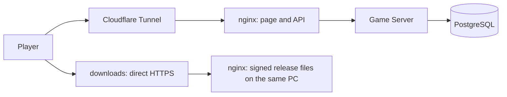

# Distribution WoTR: repositories, installer and updates

## Document status and attachment

Source: user's agreement with 2026-10-12 and the order “write this plan into the trays”. DIST-00 receives documentation preparation. DIST-01–DIST-08 describes future implementation; their status is only in Register. The creation of the cleavers does not require implementation, push, publication or migration of the active server. It does not change the rules or current release restrictions to the database.

Requirements: R06/R07/R09–R14/R21/R23–R30. The existing T38/T39 received a local package and release candidate with open postponements. The new acceptance requires installers (from D13 without system signature), actual update of the installed application, Windows runtime, both macOS architectures and Internet access. Changes with 2026-10-14 describes section D13 at the end of the document.

## Decisions agreed

- Two code repositories: votr-client and wotr-server. The server publishes contracts and canonical
  public data as a versionized client relationship.
- No separate launcher window. The messages and download progress are in the game; the auxiliary
  process replaces files after the application is safely closed.
- Downloading an optional package requires consent. The set-up is allowed as long as the server
  supports the given version. Checking small metadata does not require confirmation. From D13, the
  required version of the client is downloaded without question and the player can fix the current
  installation (see details in D13 below).
- Public download page without logging in. Account is needed for the game.
- The server, database, page and all packages remain on their own PC with Linux. We do not use R2 or
  any other external installer storage.
- Game and page: game.<domain> via Cloudflare Tunnel to nginx. Files: downloads.<domen> without
  Cloudflare proxy, directly to nginx by public IP obtained from the operator. The tunnel itself
  does not replace this path for packages.
- One channel table, full packets, Windows x64 and macOS Universal Intel/ARM64. Without delta
  updates, automatic downgrade, new matchmaking or expansions feature.

## Repository and shared data

Before separating, fix an accepted base commit containing menu, regression and received changes UI . In the main register MENU-08 it is still in progress; acceptance the isolated branch does not automatically change this entry. DIST-01 requires a coherent completion/integration of the project first. Check the candidates from the branch codex/menu-tests of which 33c3d19 and 4924cdd ; import agreed documents MENU-09 with real history, instead of declaring them implementation not to wait for all future UI , but set a clear cut-off point for accepted work and agree to transfer uncommitted changes.

wotr-client includes Unity, presentation, graphics, client tests, building, installer and updater. wotr-server includes Domain, Server, Contracts, canonical content, database, migration, infrastructure and server tests. Domain is still pure C#, and the state and randomness remain authoritative on the server side.

Contracts maintain compliance with .NET Standard 2.1/Unity. Server publishes UPM .tgz packages and manifests of origin: version, commit, SHA-256. Client has a lock indicating accurate artifacts; bootstrap dependencies download them before opening Unity/CI. No server checkout or latest branch is required. Public content comes exclusively from an existing all-list; keep stable ID and Unity .meta. Full state, seedy, migration, database and secrets do not go to the client's package.

Each repo has an independent build and CI. Client integration uses a fastened server image and a separate seeder artifact, running only test. The central task registry, ROADMAP and work history are local working files of wotr-server, not in the repository (2026-10-17). Client documentation has one owner in votr-client; links between repositories identify repo, commit and path. DIST-03 adjusts validation and workflow to these links, without copying editable statuses. The old monorepo remains archive only after acceptance new checkouts.

DS01 Base (DIST-01, 2026-10-13): `claude/dist-01` `155a7e0` connects UI-100–111 with `master` `e81f5b7`, this plan and MENU-08/09 with `codex/menu-tests` `4924cdd`. MENU-08 is `done` based on Codex record from this branch. The owners of monorepo tracks save [MONOREPO_DEPENDENCIES](REPOSITORY_SPLIT.md).

DS03/DS04 (DIST-02, 2026-10-13): the client taps in `wotr-deps.lock.json` Contracts 0.1.0 and public content 1.0.0 (commit `030fe94`, SHA-256 archives). `scripts/package_deps.py` builds repetitive packages, `scripts/bootstrap_deps.py` downloads them before Unity and rejects other bytes, unknown versions and lack of access. Destination channel: private releases `jpolaczek/wotr-server` (publication in DIST-03).

Current public baseline (QUAL-14, 2026-10-17): the client lock pins Contracts
`0.10.0`, public content `1.0.11`, and test server/seeder `a68ceee8bbc7` from public
`jpolaczek/wotr-server` releases. `bootstrap_deps.py fetch --anonymous --test`
disables every credential source and verifies the four exact sizes and SHA-256 values.
The normal developer bootstrap may still use an explicitly configured private or
file channel; it never silently replaces a missing public package with cached bytes.

DS10 – DS12 ( DIST-05 , 2026-10-13 Contracts 0.2.0 and public content 1.0.1 Contract, refusals and file formats describes [CONTRACTS](../CONTRACTS.md#wersje-klienta-katalog-wydań-i-zgodność--dist-05) Operator's orders and transition period describe [infra/README](../../infra/README.md#katalog-wydań-klienta--dist-05) The publisher key (key id) `95ffc109e1bb9b15` ) is outside the repositories; the client attaches a public part of it. Verification of the collected manifest in the client and UI update executes DIST-07 , a host `downloads.<domena>` DIST-04 .

## Hosting and support PC

The target Compose includes PostgreSQL, server, nginx and cloudflared. Split the private database network, tunnel route and virtual download host. The public download host only provides approved static files; it does not open API or database. Nginx has read-only access to the published release directory.

For game.<domain> Keep HTTPS/WSS on the player side, public trust in nginx in ASP.NET and correct rewriting of headers only on a trusted cloudflared route. Support WebSocket upgrade, heartbeat and reconnect. API, sessions and current release directory cannot be supported from the old cache.

For downloads.<domen> public IP, DNS-only, 443 redirect and certificate automatically renewal by Certbot DNS-01 with Cloudflare token limited to the required zone. With public variable IP, configure the update DNS. Do not use certificate validation override. Nginx provides Content-Length, Range/206 and transfer resume; check the load of the connection with simultaneous download and game.

Secrets are outside Git and the public directory. Keep the existing copy/restore mechanism, the identity of the active base and the receivers. After the PC service is restarted, they return automatically; switching PC means the inaccessibility of both addresses. Public IP, domain, router and administrative access are the conditions of acceptance DIST-04, no reason to block independent code work.

au au DIST-04 ( [D15](../DECISIONS.md) ): `game.<domena>` This `https://wotr.example.test` through a common portfolio tunnel (without cloudflared in the stack of games), and the files are under `https://downloads.example.test:50443/` Because the operator blocks the incoming 443 Download limits: 8 MB/s for connection, 4 connections to the address, 8 Total; measurement with four downloads did not change the game response time. Configuration and runbook: [infra/README](../../infra/README.md#produkcja-na-omarchy--dist-04) .

## Versions and public interface

The client version (SemVer), the server version, protocol, public content, rules and writing scheme are separate identifier. Each client has built-in ClientBuildInfo: version, commit, platform, protocol and data versions. The build-info file next to the archive does not replace information available in runtime.

GET /api/client/releases is available before logging in. It accepts the platform and version of client/Minutes; returns the latest compatible release, minimum supported version and URL signed manifest. Manifesto specifies the version, platform, size, description of changes, URL full package and SHA-256. The signature of Ed25519 includes the exact bytes of the manifest. The client has pinned public key of the publisher; the private key remains in the environment of issuing, outside the repo and download server.

The game requests and the WebSocket handshake transfer X-Wotr-Client-Version and X-Wotr-Protocol-Version. The server executes the compatibility before command. The old client receives 409/ClientUpdateRequired; the too new unsupported protocol 409/ServerUpdateRequired. Health, the directory and files remain available without a compatible session of the game. Network or directory fails to manage the new version. The current ZIPs require a single installation; the transition period and rejection of clients without headers must be clearly described and tested in DIST-05.

The game accepts packages only from approved HTTPS addresses distribution and after checking the signature, platform, size and hash. It does not transfer session to download host and does not execute the code indicated by any server configuration.

## Installation and update flow

Velopack is the basis for installer and auxiliary update process. SDK and vpk have the same pinned, verified version. DIST-06 includes startup integration Unity Mono, required Windows bootstrap and native parts of both macOS architectures; does not assume compatibility based on the same example of SDK. Automatic use of the downloaded package on startup is disabled.

Windows: Setup.exe, default user installation, shortcuts and install entry. macOS: .pkg/.app Universal. Until further notice (D13) without Authenticode and without Developer ID/notarization; macOS ARM64 requires ad-hoc signature of all executable files, also helper. System signature moves DIST-12. Check Unity entries and run both architectures. Do not require installation of development tools at the player.

Keep company/product/bundle ID and the location of persistentDataPath. Data, settings, sketches and journal are outside the directory of the replaced application; uninstalling it will retain it by default. The data are not full game status or a copy of the passwords. Restart may require re-loging; we do not add auto-login.

Update states: Idle → Checking → Available → Downloading → Verifying → Ready → PreparingRestart → Applying. Error and cancellation have their own message and legal return/retra. Checking metadata occurs at startup, reconnet, what 15 minutes and manually by Settings. Do not check more frequently with every UI refresh. Updater does not work in Editor and unmanaged test builds.

Available (optional edition) shows the version, size and description: Download update / Later. Before consent, it does not download a piece of the package. The required edition or scheduled edition as required is downloaded without question (D13). During the batch, the optional edition gives an unblocking notification. Consent is for a specific issue; the download may continue in the background, with progress, cancellation and resumption. Later remains available until the server supports the client. The required update has kept new online commands since the minimum, it does not close or reset the batch.

Ready gives Restart and update. Before closing, complete the existing local record path and keep the pending journal with the original commandId. Do not send LeaveRoom/CancelGame as an update result. If you fail to write, stay in the application with Retry. Installation starts after all processes of this installation and under one lock; it does not kill other clients. Do not run a watchdog swap before the local write readiness.

The transfer, hasha, signature, space shortage and incompatible architecture do not replace the working version. The interruption of the swap itself requires a proven restoration of the complete installation or repair with a signed installer. After rebooting, the normal reboot recovers the batch/receipt without double movement or release of resources; the tests during battle and Hunt are crucial.

## Publication and recovery of the issue

Pipeline (from D13): tag in votr-client → GitHub Actions (tests, build both platforms, Velopack packaging, Windows smokes N → N+1, draft GitHub Release) → command of the publisher on Mac (verification of artifacts, signature Ed25519 manifestos, upload to new unchanged directory) → verification of completeness → atomic release announcement and optional minimum with the operator's deadline. The server detects publication of an approved directory; it does not scan random files or announce any commit. Providing a client version does not require a return implementation backendu if its compliance range has not changed.

The minimum can be raised only after the availability of the tested packages of both platforms. Keep the previous packages and a compatible image of the backend to be played. The defective release withdraws from the announcements; the amendment is issued with a higher number, without automatic downgrade. The withdrawal of the backend is subject to the database and snapshots' compatibility with T38. No automatic migration or database reset is performed when the client is updated.

## Coverage and order

| ID | Required behaviour | Owner |
| --- | --- | --- |
| DS01 | A coherent commit base menu and accepted works UI. Database: `claude/dist-01` `155a7e0` (2026-10-13). | DIST-01 |
| DS02 | Two repositories with history and a map of origin. Made 2026-10-13: `wotr-server`, `wotr-client`, maps in `docs/release/history`. | DIST-03 |
| DS03 | pinned, re-enlisted contracts without a server checkout. Lock: Contracts 0.1.0 (2026-10-13). | DIST-02 |
| DS04 | Only allowed public content and stable ID/meta. Lock: public content 1.0.0 (2026-10-13). | DIST-02 |
| DS05 | Independent CI and integration with the attached backend image. Client: pinned archives `wotr-server`/`wotr-seeder`; in the new checkout EditMode 640/640 and full PlayMode 566/567 + replay of the unstable 1/1. animation test | DIST-03 |
| DS06 | One task registry and correct links between repositories. Register in `wotr-server`, links `wotr-client:` and pinned links. | DIST-03 |
| DS07 | Linux, autostart, public site and game via tunel/nginx. | DIST-04 |
| DS08 | All packages on PC, direct HTTPS and resume download. | DIST-04 |
| DS09 | Trusted proxy, secrets, backup/restore and availability after reboot. | DIST-04 |
| DS10 | Separate versions and application identification in runtime. Made 2026-10-13: `ClientBuildInfo`, one client generator for the player resource and `build-info.json`, a manifesto from the same fields. | DIST-05 |
| DS11 | Compatibility enforced by HTTP and WebSocket. 2026-10-13: version headers, 409 `ClientUpdateRequired`/`ServerUpdateRequired` before auth and command, transition period for ZIP. | DIST-05 |
| DS12 | Public directory, manifest signature and safe announcement. Made 2026-10-13: `GET /api/client/releases`, Ed25519 (BouncyCastle), `Wotr.ReleaseTool` with atomic directory. | DIST-05 |
| DS13 | Windows installer for a regular player (from D13 without Authenticode; signature in DIST-12). | DIST-06 |
| DS14 | MacOS installer of both architectures (from D13 ad-hoc, without notation; signature in DIST-12). | DIST-06 |
| DS15 | Consent and postpone optional edition, progress and required upgrade. | DIST-07 |
| DS16 | Safe reboot with decision-keeping,journal and data. | DIST-07 |
| DS17 | transfer/substitutions errors, block multiple instances and repair. | DIST-07 |
| DS18 | Actual installation and N → N+1 on all platforms. | DIST-08 |
| DS19 | Two players over the Internet, full party, reconnect and restore. | DIST-08 |
| DS20 | Controlled publication and instructions for subsequent releases/repairs. | DIST-08 |
| DS21 | Minimum date: catalog, gate by time, operator commands. 2026-10-14: diagram directory 2, `ReleaseSnapshot.Minimum(now)`, `minimum --at`, Contracts 0.4.0. | DIST-09 |
| DS22 | Automatic download of the required and scheduled version, without permission, with installation on click. | DIST-07 |
| DS23 | Repair of the installation of the current version of Settings (`installed` offer with DIST-09); once staged, the repair's ready package is dropped, so the repaired game does not offer it again (DIST-14, 2026-10-17). | DIST-07, DIST-14 |
| DS24 | Releases built in CI with tag, that smokes Windows N → N+1. | DIST-10 |
| DS25 | One command from the publisher on Mac: verification, signature, upload, publication, check. | DIST-11 |
| DS26 | Instructions for the first installation of the unsigned application and page buttons from the directory. | DIST-11 |
| DS27 | Install guard (2026-10-18): only a newer version installs, the same one only as a repair; the package's own version equals its manifest's; the copy Velopack applies is hashed again against the signed SHA-256; `--wotr-self-check` writes only a new `.json` at an absolute path. | SEC-01 |

DIST-01 → DIST-02 → DIST-03 After DIST-03 parallel DIST-04 , DIST-05 and DIST-06 From D13: DIST-09 au DIST-05 ; DIST-10 au DIST-06 ; DIST-07 au DIST-05/06/09 ; DIST-11 au DIST-09/10. Collective DIST-08 After all DIST-01 – 07 and 09–11 . DIST-12 (system signature) is postponed and does not block DIST-08 . MENU-08 is an external dependence DIST-01 . DIST-00 He's not a parent.

## D13 — Changes with 2026-10-14

The user's decisions with 2026-10-14 ([D13](../DECISIONS.md)) change part of the above plan. When the text is conflicting above, this section applies.

| # | Decision |
| --- | --- |
| U1 | Required version: Automatic download in background without question; installation after safe recording and clicking "Restart and update". |
| U2 | Optional version: unchanged — Download / Later, zero bytes before permission. |
| U3 | Repair (Repair) of the current version of the Settings. |
| U4 | Minimum time: by date clients download and play; from date gate rejects older versions. |
| U5 | Build in GitHub Actions; installers without system signature; Update integrity = Ed25519. |
| U6 | Ed25519 key on Mac publisher, except CI and server. |
| U7 | acceptance Windows: external tester and smokes in CI. |
| U8 | The required update can always be rejected: “Decline and quit” saves the local state and closes the game without installation; on the next start, the selection returns. |

### Modes updatera

Priority: RequiredNow > RequiredSoon > Repair > Optional; ServerBehind It's not taking anything. RequiredNow is derived from the status of the directory or response 409 `ClientUpdateRequired` ; RequiredSoon from a planned minimum higher than the client version (download with random delay 0–10 The download is the latest announced compatible edition ( `latest` Repair downloads the version of the reported version ( `installed` ); when withdrawn, UI offers an update. Change of destination or withdrawal of target rejects the downloaded file; consent does not pass to another package. Countdown to the deadline uses `serverTime` directory; after the time limit the client suspends the new command also without connection to the server. RequiredNow has two outputs: “Restart and update” and “Decline and quit” (the same safe recording path, then shut down without installation).

### Distribution of responsibility in the client

The game code collects and verifies the package: Ed25519 manifesto signature, allowed host `downloads`, version, platform, size, SHA-256, resumption by Range, without the header Authorization and without redirects. Velopack only installs the verified file by its own update source, without its own feed. Installing the same version (Repair) uses the same path. Velopack on Windows closes the processes from the installation directory, so the game keeps the lockout of one instance; the update starts only the process with a lock.

### Pipeline publishers

1. In votr-client: `release/version.json`, `release/notes/<version>.md`, commit, tag `v<version>`.
   Change of protocol or contracts requires prior release of server and pinned contracts.
2. GitHub Actions: tag compatibility with `version.json`, EditMode, build Windows and macOS
   (GameCI), Velopack packaging, Windows smokes N → N+1, draft GitHub Release with packages,
   installers, `build-info.json` and `SHA256SUMS` (DIST-10).
3. On Mac, publisher one command ( DIST-11 ): artefact collection, control version/commitu/protoko
   slu, signature Ed25519 both manifests with installer, upload to `incoming/` , `publish` on host
   and optional `minimum --at` , then check public addresses and Range/206.
4. Repair of the announcement: cancellation of the deadline, withdrawal of the issue (after the
   minimum photo), amendment only higher version.

### First installation without signature

The game page builds buttons from the directory (version, size, SHA-256). The player instructions describe the browser warning and SmartScreen ("More info → Run anyway") and macOS ("Open Anyway" in Settings → Privacy and security, installation "only for me"). Smart App Control in forced mode blocks unsigned applications; the instruction says this explicitly. Updates taken by the game do not get quarantine marking and do not trigger these warnings.

## D14 — MVP 0.9 first on macOS (2026-10-15)

Decision [D14](../DECISIONS.md) The first release for players is **0.9.0**, directed to macOS players. Tag releases continues to build and test both platforms, and publisher signs and publishes both manifestos (catalogue requires a set of platforms). The game page shows only the macOS installer with `/api/client/downloads` , a Guide the player reserves that Windows is waiting for acceptance ; DIST-13 (Windows tester, DS13 ) removes this restriction.

### Installers after DIST-06

- Velopack 1.2.161, `packId` `WotrOnline` (permanent), title "War of the Ring Online". Platform
  release files: full package `.nupkg`, installer `WotrOnline-<version>-win-Setup.exe` /
  `WotrOnline-<version>-osx-Setup.pkg` and `build-info.json`; `SHA256SUMS` covers both platforms.
  These files accept `Wotr.ReleaseTool sign --package --installer`.
- Windows: installation of the user in `%LocalAppData%\WotrOnline`, shortcuts and install entry; own
  `Wotr.exe` responds to `--veloapp-*` hooks without running Unity. macOS: `.pkg` Universal with
  ad-hoc signature from vpk (also `UpdateMac`), installation "only for me" in `~/Applications`.
- In the game: Velopack starts before splash screen without automatic use of packages; only
  installed build release can update; `--wotr-self-check` mode for testing smokes. Bundle id macOS
  `com.WoTR-Private.War-of-the-Ring-Online` is pinned, because Unity holds player data under it.
- Apply Velopacka unwraps the package before any hook and copy of the installation, so the damaged
  package or lack of space does not change the running version (checked in CI). On Windows, an
  unwritten installation directory would raise permissions; the user installation does not have it.
- Workflow `wotr-client:.github/workflows/installers.yml` (hand and as `workflow_call` for DIST-10)
  builds release in GameCI, packs, launches the dragons of both systems and gives the artifact
  `installers-<version>`.

### Issues from the tag after DIST-10

Tag `v<version>` in wotr-client (version with `release/version.json`, notes in `release/notes/<version>.md`) launches `release.yml`: EditMode, installers of both platforms with dragon tests and draft GitHub Release with flat files (packages, installers, `build-info-<platform>.json`, `RELEASE-NOTES.md`, `SHA256SUMS`). draft does not go to players; signature Ed25519 and publication on host is performed by publisher on Mac (DIST-11).

### Release command after DIST-11

On Mac, the publishers `python3 scripts/release_client.py v<version> [--required-at T | --required-now] [--dry-run]` (wotr-server) transfer draft GitHub Release to host: file and identity control, signature Ed25519 both platforms, confirmation, `rsync` to `incoming/`, publication by `scripts/release_host.py` on host and check out public addresses (catalog, manifest, downloads, Range). Runbook: [infra/README](../../infra/README.md#wydanie-klienta-jednym-poleceniem--dist-11).

## Technical sources and evidence to be collected

- [Velopack: Integration](https://docs.velopack.io/integrating/overview),
  [Unity Mono](https://raw.githubusercontent.com/velopack/velopack/develop/samples/CSharpUnityMono/README.md),
  [instalatory](https://docs.velopack.io/packaging/installer),
  [signing](https://docs.velopack.io/packaging/signing).
- [Apple: notarization](https://developer.apple.com/documentation/security/notarizing-macos-software-before-distribution),
  [Microsoft: SignTool](https://learn.microsoft.com/en-us/windows/win32/seccrypto/signtool).
- [Cloudflare Tunnel](https://developers.cloudflare.com/tunnel/),
  [rules CDN](https://www.cloudflare.com/service-specific-terms-application-services/),
  [nginx WebSocket](https://nginx.org/en/docs/http/websocket.html),
  [Certbot DNS Cloudflare](https://certbot-dns-cloudflare.readthedocs.io/en/stable/).
- [T38](../server/T38-DEPLOYMENT.md), [T39](T39-RELEASE.md),
  [menu](https://github.com/jpolaczek/wotr-client/blob/afddaea74ae9df6e87e77503cb53e55f26f16273/docs/ui/MAIN_MENU_UX.md), [tests](../TESTING.md).

The Velopack installers/signatures documentation, for example Unity Mono, Cloudflare Tunnel, nginx WebSocket and Certbot plugin have been checked by 2026-10-12. The Mono example describes an additional Windows boottrap and ending by Application.Quit; it does not provide proof of the current WoTR nor macOS Universal. pinned versions of tools and compatibility check again in DIST-06.

External conditions are not missing rules sources in gaps.json. Their absence with acceptance is recorded as a specific block DIST-04/06/08. The test record must indicate versions, systems/architecture, commands, reports and result; Editor, Windows compilation or unsigned ZIP do not include these criteria.

From DIST-03 the document is in `wotr-server`; the division describes [REPOSITORY_SPLIT](REPOSITORY_SPLIT.md).

## D18 — first release on macOS, Linux and Windows (2026-10-17)

[D18](../DECISIONS.md) extends D14: release 0.9.0 waits for the Linux x64 client. Every tag builds,
packs and smoke-tests three platforms (`windows-x64`, `macos-universal`, `linux-x64`); the Linux
installer is the AppImage `WotrOnline-<version>-linux.AppImage` and its package
`WotrOnline-<version>-linux-full.nupkg`. The catalog announces a release only with all three
platforms, so the publisher's command and the release tool require the Linux files. The game page
offers macOS and Linux, and from 2026-10-17 also Windows, marked experimental until the owner's check of 2026-10-18
(DIST-13) and since then a regular platform; the Steam Deck runs the Linux AppImage, experimental until DECK-01.

## SEC-01 — Install guard and self-check (2026-10-18)

External security feedback asked for no downgrades outside a repair, a hash check right before installation, a
sequence or expiry on manifests, and a restricted self-check path. The owner asked for the free measures only.

- **No rollback.** `UpdatePolicy` already offers only a newer release, and a signed manifest names one version and
  platform. Since SEC-01, `InstallGuard.CheckVersions` (client `Runtime/Updates/InstallGuard.cs`) also refuses at
  staging time an update that is not newer than Velopack's installed version and a repair that is not exactly that
  version, and `AllowVersionDowngrade` is set only for a repair.
- **The package is the signed one.** The nupkg's own version must equal the manifest's version. The coordinator hashes
  the ready file before staging (DIST-07); `VelopackBridge` then hashes Velopack's copy in its packages folder, the
  file its helper applies after the game quits, and deletes it on a mismatch.
- **No manifest sequence or expiry (decision).** Replaying an older signed manifest cannot install anything, because of
  the two checks above. Withholding a newer release ("freeze") would need the catalog, which the game server serves
  over TLS; an expiry signed with the offline release key would stop every update whenever the owner does not re-sign
  in time, and an expiry signed by the server adds nothing over TLS. Revisit if releases are ever served by a third
  party (DIST-16).
- **Self-check.** `--wotr-self-check <file>` writes only a new `.json` file named by an absolute path in an existing
  folder (`FileMode.CreateNew`, so an existing file, folder or link, dangling or not, is never written through);
  anything else exits with code 2 and writes nothing. The smoke scripts delete their own previous report first.

Tests: client EditMode `InstallGuardTests`, `InstallationSelfCheckTests` and the staged-release assertions in
`UpdateCoordinatorTests`.

## SEC-04 — Pinned actions, Dependabot, CodeQL and attestations (2026-10-18)

- Every third-party action in both repositories is pinned to the commit its moving tag pointed to on 2026-10-18
  (`actions/checkout` v4.4.0, `upload-artifact` v4.6.2, `download-artifact` v4.3.0, `setup-dotnet` v4.3.1; GameCI was
  already pinned), with the version in a comment. A unit test in each repository's CI refuses a `uses:` on a tag.
- `.github/dependabot.yml`: weekly updates for GitHub Actions in both repositories and NuGet in the server.
- `.github/workflows/codeql.yml`: CodeQL with `build-mode: none` for C#, Python and the workflows (and the game site's
  JavaScript in the server) on pushes and pull requests to `main` and every Monday.
- The client's release workflow (`release.yml`, job `draft`) records a build-provenance attestation
  (`actions/attest-build-provenance` v4.2.2) for every file it drafts; the job alone gets `id-token: write` and
  `attestations: write`. The publisher's Ed25519 manifest signature (DS16) stays the trust anchor of the updater; the
  attestation lets anyone tie an installer to the tagged commit and workflow run.
- All of this is free for public repositories. Evidence of the first CodeQL and attestation runs is recorded after the
  owner pushes and releases.

## DIST-15 — What's new page and link (2026-10-18)

The owner asked for a link to a page with a short, plain note on each update (a bug fix, the new chat and so on).

- **Source:** the notes the release command already signs into every platform's manifest
  (`wotr-client:release/notes/<version>.md`, `RELEASE-NOTES.md` of the draft). The server reads them from the
  manifests it verifies when it loads the catalog (`ReleaseCatalogStore`), so the page shows only signed text of
  announced releases; a withdrawn release leaves it.
- **API:** `GET /api/client/notes` → `{ releases: [{ version, publishedAt, notes }] }`, the 30 newest announced releases,
  newest first, `Cache-Control: no-cache`, without client version headers (`ClientCompatibilityGate` lets it through
  like `/api/client/downloads`).
- **Page:** `infra/site/updates.html` with `assets/updates.js`, served at `/updates` (`infra/nginx/game.conf`); each
  release is an entry `#v<version>`. Notes are plain text: lines starting with `- ` become list items, other lines
  paragraphs, everything through `textContent` under the site's CSP. The game page links it in the download section and
  the footer.
- **Game:** `What's new` opens `<server>/updates#v<version>` for an offered, downloading or ready release (not a
  repair). Since DIST-17 it sits in the Updates row of Settings; the bar and its one-time `Updated to version …` notice
  are gone.
- **Writing notes:** one plain line per change for players (`- New: …`, `- Fixed: …`), see
  `wotr-client:release/notes/README.md`.

Tests: server `ClientReleaseScheduleTests.TheWhatsNewPageListsTheSignedNotesNewestFirst`; client EditMode
`UpdateCoordinatorTests` (arrival once, What's new on an offer, version comparison).

## DIST-17 — Updates shown only at Settings in the first menus (2026-10-18)

The owner's request: no global update display. DS15/DS22's bar over every screen (`UpdateNotice`) is removed. Only the
sign-in screen and the main menu show an update: their Settings button glows gently (`update-glow`) and carries a small,
non-interactive note from `UpdateHint` — `Update available`, `Downloading n%`, `Update ready`, `Update required soon`,
`Update required`; a repair, a failure, no release or a server behind this copy say nothing. The download, the install
and `What's new` happen only in the Updates row of Settings. The required-update window (`update-required`) stays (owner's
decision of 2026-10-18), and a required release still downloads by itself before its deadline.

Tests: client EditMode `FirstMenuUpdateTests`, `UpdateCoordinatorTests` (the note's states, the Settings row's What's
new); PlayMode `MainMenuLayoutTests` (the note on both screens in four layouts, no control moves).

