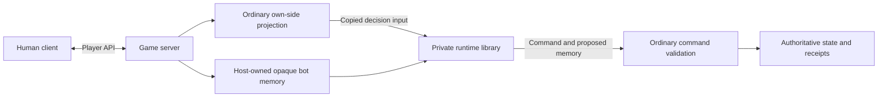

# Strategic bots as an embedded private runtime

Owner-approved architecture, revised 2026-10-27. This replaces the external bot
service approved on 2026-10-23. The private repository contains a library loaded
by the game server, not another server or network worker. Two scripted policies,
Shadow and Free Peoples, share modular mechanics. The legacy CPU remains separate
in [DEMO-MODE](DEMO-MODE.md). Neither strategic policy is ready for play yet.

## Product and ownership

- The operator installs the private runtime beside the game server. Public source,
  public game builds and human installers never contain private policies or DLLs.
- Players install only the ordinary client. The host requests CPU in the empty
  opposing room seat; normal Ready/Start, existing status/removal controls and
  multiple saved PvE games remain required. No extra service URL or bot setup UI.
- Policies are scripts, without an LLM/training service. They keep plans, notice
  opportunities, estimate probabilities and cover all accepted base/expansion
  mechanics. One strong level remains the target.
- Private code owns decisions, evaluations, hypothetical simulation and memory
  interpretation. The public host owns scheduling, projection, validation,
  authoritative RNG/state, receipts and persistence of opaque memory.
- This is implementation authorization, not release/deployment or proof of strength.

## Components and information boundary

The runtime gets exactly the game information legal for its assigned player:
current own-side PlayerView/options/decision, configuration, authorized visible
history, reports and supplied ordinary previews. It never gets a MatchState,
live engine/service/database object, observer perspective, opponent hand, hidden
orders or future RNG. Copies cross the boundary as versioned JSON, so public and
private pinned rules assemblies cannot accidentally share mutable state.
The host establishes information provenance before serialization. A matching
side field alone does not prove that an arbitrary DTO was safely projected.
Missing necessary nonsecret facts still require a reviewed shared-player contract;
in-process hosting does not unblock BOT-02 by exposing hidden continuations.

The runtime is trusted operator code in the same process. Assembly isolation and
an input-only API prevent accidental coupling; they are not an OS security
sandbox. The host never supplies privileged capabilities. Cooperative cancellation,
bounded work and bounded concurrent evaluations must be tested. A timeout cannot
safely force-abort arbitrary managed code; a stalled evaluation must not trigger
an unlimited series of new tasks.

## Modular configuration

Exactly two faction profiles select strategic objectives. There is no separate
bot class, executable or policy catalog entry for every expansion combination.
A normalized MatchConfiguration selects a shared ordered module set:

| Module | Enabled by / dependency |
| --- | --- |
| Base | Always |
| Fate, Lords, Kings | Their respective configuration flags |
| Council | Council and Lords |
| Dismay | Explicit flag, or the Lords + Kings default; requires both |
| Visible / sequential corruption | Respective variant and Kings |
| Removing ruler tokens | Variant, Lords + Kings + Dismay |
| New Cities | Variant and Fate |

The shared rules validate dependencies first. Module registration is not proof
of strategic coverage. Modules contribute candidate providers, valuations,
planning hooks and effect handling to the same two policies; explicit priorities
resolve overlapping mechanics. A disabled module cannot add choices or change
base valuation. Integration tests cover all 93 normalized legal configurations,
interaction cases and invalid combinations, not 93 independent bots.
The release configuration and accepted mechanic coverage gate actual readiness.

## Runtime boundary and room flow

The [runtime ABI](BOT-RUNTIME.md) defines a versioned describe/decide interface.
Inputs include an invocation ID, expected runtime/rules/content identities,
current own-side player information, history/reports/previews, random sampling
seed, work bound and optional opaque memory. Configuration is part of the current
player view. Outputs are one command proposal with proposed memory or a typed
no-decision/refusal. No runtime callback can commit a move or fetch a snapshot.

1. Host CPU admission reserves the empty opposite seat under the room lock.
2. The server checks the installed runtime, faction policy, enabled modules and
   accepted rules/content. Only supported policy coverage can acknowledge the
   current room version; configuration changes invalidate readiness.
3. The human uses existing Ready/Start. Starting binds a durable CPU assignment
   to the match/side and pinned runtime/policy version.
4. A server-owned scheduler reads pending bot-owned decisions and safely projects
   input outside the game mutation. Each seat has one active evaluation generation.
5. The server rechecks seat, generation, revision and decision under the normal
   mutation lock, validates the returned command with the normal engine, then
   persists its accepted result. A proposed move never authorizes itself.

Cancellation/removal and match deletion stop future work. CPU work cannot keep an
abandoned waiting room alive. Missing/incompatible runtime, unavailable policy or
failure preserves the current game/decision; never pass, forfeit dice or switch to
the demo policy automatically. Restart recovers pending CPU work without a human
refresh. No control/seat HTTP credential is required by the embedded runtime.
Previously implemented BOT-16 endpoints remain legacy, default-disabled code;
the external BOT-17 transport exists only on a local historical checkpoint branch.

## Strategic decisions and simulation

BOT-02 checkpoint (2026-11-05): [ordinary player rule facts](PLAYER-RULE-FACTS.md)
version 9 retains reviewed base/Fate/Lords/Council roots and adds Kings ordinary
phases/actions/paid steps, hand limits, Ruler die discard and Dismay choices.
Covered corruption tiles are independently sampled from the combined unknown
pool/attachment multiset under each sovereign's resistance. Known identities,
public resource uses and Fate exclusions remain exact. Each simulated actor gets
only its own ordinary projection; no live assignments, resolution stack or entropy
cross the runtime boundary.

Private `b6b62ba` / runtime 0.2.13 uses rules 0.9.0 (public `5142446`, 434 files),
Contracts 0.23.0 / content 1.0.25. Client `2142212d` pins both public archives.
Full private verification passed **1,816 C# / 17 Python** cases, no skips, zero
build warnings/errors, dependency/boundary checks and local library publish.
The 167 added cases cover ten root families across six module compositions,
hidden/visible assignments, complete awakening/corruption procedures, resource
uses, hidden permutations, invalid inputs, work bounds and cancellation.

Public regression passed **2,109 C#** cases, no skips, including 71 new projection
and six real HTTP/restart/receipt-replay cases. The owned database was removed.
Ten package checks passed after the required source commit; the initial check
correctly refused uncommitted package inputs. Client **57 Unity EditMode** cases
passed, no skips; existing unrelated Unity warnings remain. The 72-file pinned
Markdown check passed. The BOT-13 PlayMode backend was not replaced or retested.

Bounded base/Fate walks retain 303 roots / 7,564 candidate checks. Across all 93
normalized configurations and 7,440 actual-command roots, reconstruction supports
**6,181**, up from 631, with **1,259 explicitly unsupported**. Candidates at accepted
roots also match authoritative legality. This is bounded coverage, not full games
or playing strength. Exact diagnostics and current early/later copy, reconstruction,
rollout/allocation/cancellation measurements remain private.

BOT-02 remains in progress; BOT-03 stays blocked on complete reconstruction.
Active Kings corruption draws, suspended Lords Hunts, other card/battle/effect-discard
continuations and nested expansion acceptance remain. No production faction policy
is registered; gameplayReady=false. The isolated worktree passed verification and
was fast-forwarded into main; the unrelated Core.csproj edit stayed byte-identical.
Evidence is local in `.artifacts/bot02-completion/kings/`. No push, release or
deployment was performed.

Implementation checkpoint (2026-10-26): the private runtime has an internal
bounded pure-engine kernel and constrained card partition sampler. Production
reconstruction is blocked on a reviewed mapping from player information/history
to rule continuations; the current view omits suspended returns and effect cursors.
Its observation-only candidate generator now covers military choices, character
and Fellowship travel, constrained/grouped effects, Council decisions and Ruler
recruitment/token payments. Separate-route army card events use a narrowly scoped
local rules check built from public board information. The private checkpoint
passed 664 C# and 9 Python cases, including bounded own-view execution walks over
all 93 normalized configurations and targeted expansion choices. Each configuration
walk ends at its 80-command cap; these are not completed games or acceptance of the
public behavioral inventory. Full reachable-decision coverage, validated fallback, simulation
battle/Hunt/card-chain parity and performance benchmarks remain pending. Neither
BOT-02 nor BOT-03 is accepted and no production policy is enabled.

The pure policy interface remains
`Decide(BotObservation, BotMemory, DecisionBudget)`: one current command, proposed
next memory and private diagnostics. Its input is built from copied ordinary player projections and authorized history,
not a reference to the live server's `MatchState` or persistence services.

Memory records the policy/schema version, accepted progress and remembered facts.
Keep one main plan and at most two supporting plans, each with objective, stages,
assigned forces, preferred resources, completion/abort conditions and progress.
Reservations influence value, never legal availability. Reassess after every
decision; immediate wins/losses or substantial opportunities can interrupt a plan,
while small score changes should not cause oscillation.

| Shadow plans | Free Peoples plans |
| --- | --- |
| Prepare Gondor, Rohan and northern campaigns; concentrate Leadership and forces | Defend valuable settlements, delay armies and preserve useful forces |
| Select victory targets and decide attacks, sieges and redirection | Advance, conceal and heal the Fellowship with sustainable corruption risk |
| Allocate Hunt resources and position Nazgul | Select Guides, separate companions and choose Hunt casualties by future value |
| Develop Minions and future action dice; protect Shadow victory sites | Develop Aragorn/Gandalf; recognize a realistic military countervictory |
| Corrupt sovereigns and exploit expansion abilities | Awaken/recover sovereigns and support the main plan with expansion abilities |

Generate concrete legal candidate costs, splits, routes, targets and continuations.
Value cards as events, combat commitments, retained resources and discards; optional
reactions and continuing multi-step actions require purposeful choices. Include
all base/expansion mechanics in the coverage ledger, with useful-use and justified
decline/retention cases where applicable.

The private runtime consumes a pinned build of the shared pure rules engine.
It constructs hypothetical worlds from its own knowledge and public content.
Unknown hands, decks and tiles are sampled consistently with that knowledge,
never copied from the true state. Hypothetical actors also see only their own
observations; future choices cannot depend on unrevealed information.

Use exact elementary dice distributions where tractable and sampled complete
battles/Hunts for combined effects. Report objective/capture probability, losses,
survivors, character exposure, resource cost and uncertainty. Distinguish winning
a round from taking a stronghold. Do not apply a universal attack-probability cutoff.
Use bounded lookahead toward two own actions and opposing replies, with lightweight
nonrecursive rollout policies. Late-game copying and simulation cost must be profiled.

Target difficult decisions normally within 3 seconds, with a 5-second computation
deadline and an already assessed legal candidate available. Measure host scheduling and
queue wait separately. Cancellation, bounded work units, fair scheduling and visible
no-candidate errors prevent unbounded work and silent stalls.

## Opaque memory and command recovery

The runtime has no storage or network module. It accepts prior private memory and
returns proposed next memory. The public host stores opaque versioned bytes per
match/side/profile; it neither interprets plans nor sends them to human clients,
replays, events or public diagnostics.

The [BOT-18 host](BOT-HOST.md) journals the exact proposed command/ID, prior decision/revision,
evaluation generation and proposed memory before committing. An accepted ordinary
receipt advances memory exactly once; stale/rejected/cancelled results never do.
Game state, receipt, accepted opaque memory and journal result commit in one
host-owned transaction; recovery resubmits the exact pending command first. Restart and a game-ending command
must leave no uncertain memory transition. Avoid a second private database or a
new bot network protocol. Runtime/policy/memory version upgrades require explicit
compatibility and migration; unsupported saved memory must not be silently reset.

## Builds, loading and acceptance

The private artifact is a library with pinned public rules dependencies. The game
server loads it from an operator-configured path in a separate assembly load
context; public builds need no private checkout. Only strings and framework types
cross the ABI. No private strategy, runtime binary or tests enter public packages.
The server remains available when the optional runtime is absent; CPU stays unready.

BOT-17 now owns the runtime contract, modular configuration and optional loader.
BOT-18 owns host scheduling, provenance, readiness and command/memory recovery.
[BOT-19 operations](BOT-OPERATIONS.md) implement integrity-checked private library
and separate symbol packages, bounded concurrency/work, host memory-pressure
gating, persistent draining and compatible upgrade/rollback. Operators use the
existing server executable; there is no bot service or player installation.
BOT-20 tests the real private runtime with the actual server/client.
BOT-02–BOT-11 retain reconstruction, candidates, risk, plans, faction policies,
cards and expansion behavior. BOT-13 implements minimal room UI and reuses existing
opponent presentation. The seated host uses Add CPU in the empty opposing seat’s
Remove slot; Take seat remains available. Joining / Ready / Unavailable occupy the
normal readiness line. Play vs CPU opens this room, and existing Ready/Start clicks
start saved PvE only after current-configuration acceptance. All PvE saves remain
in My games beside human games and earlier demos. Invitation retries preserve
request ID/version; authoritative roster changes resolve uncertainty. No private
bot package, service settings or extra board controls enter the client. BOT-14 combines all strategy/coverage/strength and integration gates.

Public loader tests use a clearly labelled policy-free fixture; private tests
exercise the actual runtime entrypoint. Full acceptance requires real faction
policies, all player-information parity surfaces, hidden-state permutations,
stale generation/command rejection, server restart around command/memory commit,
room races, readable opponent presentation and clean public/player artifacts.
No fixture, module selector or passing build establishes playing strength.
