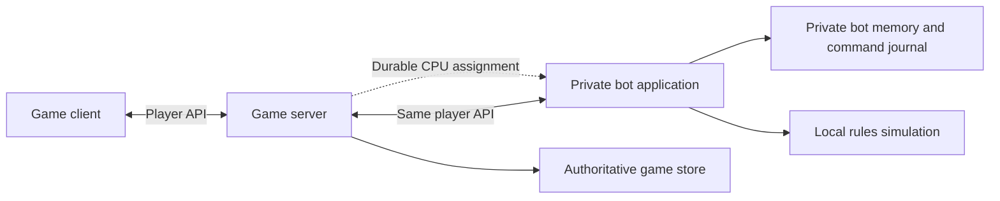

# Strategic bots as a private service

Owner-approved design, 2026-10-23. The inventory and private application foundation
are implemented; strategic policies, live service integration and behavioral
acceptance remain pending. This specification replaces the earlier proposal to
run strategic bots inside the game server and save their memory in the game's transaction.
The existing CPU is documented separately in [DEMO-MODE](DEMO-MODE.md).

## Product and ownership

- Two scripted C# policies play Shadow and Free Peoples. They maintain plans,
  recognize opportunities, estimate risk and use all supported mechanics. There
  is one strong level, without an LLM, learned model or external inference service.
- Cover the base game, Lords, Kings, Fate and their implemented variants. Actual
  availability requires both the game's release gates and accepted bot coverage.
  Warriors and other unsupported content remain outside this program.
- A separate headless application, `wotr-bot`, runs on the operator's infrastructure.
  Its repository, strategies, weights, diagnostics and deployment artifacts remain
  private. This is a specific exception to the public game repositories, not a
  change to the license or publication status of existing game code.
- The first version serves only the operator's game server. Players install only
  the ordinary game client: no bot executable, plugin, runtime, closed-source
  assembly or model is downloaded or executed on their device.
- Multiple saved PvE games coexist with human games and existing demos. Each bot
  seat has its own session, memory and knowledge. PvE results remain distinct from
  human-versus-human results. The opponent is visibly named CPU; its service has
  no separate end-user application or configuration screen.
- This design is authorized scope, not a statement that the feature is available
  or permission to deploy it. BOT-00–BOT-20 describe the remaining work; BOT-14
  is the final aggregate acceptance task.

## Components and information boundary

| Component | Owns | Does not receive |
| --- | --- | --- |
| Game server | Rules resolution, real RNG, state, receipts, seats, assignment authorization and replay | Bot strategy memory as part of a game command or save |
| Bot application | Policies, hypothetical simulations, plans, known facts and outgoing command journal | Game database credentials, authoritative snapshots, observer perspective or admin access |
| Human client | Normal UI, room requests and its authorized player view | Bot code, service credentials, strategy memory or future plans |

The bot gets the same game information as a human occupying **the bot's side**,
including that side's own hand and private decisions. It uses the same projection,
option generation, previews, visible history, battle reports and command validation.
The bot does not receive the human opponent's private information.

A worker reconstructs knowledge from the player API and remembers only facts that
were available to its seat. It reads paginated visible history after reconnect,
rather than treating a missed WebSocket notification as lost game knowledge.
No assignment message may carry an authoritative state or a privileged option list.
Missing necessary player-visible facts must be fixed in the shared player contract,
with the same visibility rules for humans and bots.

## Hosting and room flow

1. A seated human host selects **Add CPU** at the empty opposing seat before start.
   The existing client calls the game server; it never contacts the bot host directly.
2. Under the room lock, the server checks host, room version, empty seat and offered
   configuration, reserves that seat and persists an idempotent CPU assignment.
   A competing human join or repeated request cannot create a second occupant.
3. The bot service claims pending assignments through an authenticated internal
   control interface, verifies supported rules/content and reports readiness.
4. The existing Ready/Start flow applies. Both seats accept the current room
   version; only the host starts. Configuration changes invalidate acceptance and
   require the bot to acknowledge the new version. No bot acknowledgement starts
   a game or submits a human choice by itself.
5. A started assignment is bound to its match and side. The worker follows normal
   update notifications and executes only decisions owned by that side. It can
   finish its pending decisions while the human application is closed.

Use the existing participant removal operation to cancel a bot before start.
Closing an unstarted room cancels the assignment; a delayed claim cannot resurrect
it. A bot reservation alone must not keep an abandoned human room alive.
Seats cannot be exchanged for bots after a match starts.

The existing Play vs CPU shortcut opens this same room flow with CPU selected;
selecting a side no longer starts the new PvE game immediately. Reuse the existing
seat, status, removal and Start controls. Show short Joining/Ready/Unavailable
states at the CPU seat; no difficulty chooser, service URL, extra confirmation,
permanent board control or bot narration feed is introduced.

If the service is unavailable, Start waits for readiness. In a started match the
current decision and save remain intact, map/cards/history remain browsable, and
work resumes after reconnection. Do not invent a pass, consume a die or switch
silently to the old demo policy. Deleting a match or cancelling an assignment
stops future work.

## Planned interfaces and authorization

BOT-16 now implements the [identity, allowlist, renewal and compatibility
boundary](BOT-AUTHORIZATION.md), including shared runtime metadata and mutation
fencing. CPU room admission is implemented in [BOT-ROOMS](BOT-ROOMS.md). Assignment
delivery below remains a design requirement.
The version-1 [implementation handoff and coverage inventory](../bots/README.md)
fix their ownership, evidence requirements and failure handling.

- `PUT /api/rooms/{id}/bot` requests the empty opposing CPU seat using the expected
  room version and a request ID. An identical retry is idempotent; a conflicting
  reuse cannot change the request. Human session identity establishes the host.
- `RoomView` adds safe occupant-kind and CPU readiness metadata; `MatchSummary`
  distinguishes saved PvE/CPU opponents. `GameCommand`, `CommandReceipt` and
  player information retain their ordinary semantics.
- Internal claim, readiness, renewal and cancellation operations coordinate
  durable assignments. Their service credential cannot read game state or submit
  gameplay commands. No external message broker is required for the initial design.
- A separate short-lived renewable seat credential authorizes the assigned room
  and, after start, its match and side. Enforce an explicit operation allowlist:
  player reads/history/reports/previews/updates/commands/receipts and necessary
  readiness. Deny observer, admin, account management, unrelated games, participant
  removal and match deletion. Do not borrow the human's session.
- Only one worker holds the active assignment generation. Reassignment invalidates
  older command authority; check this at the authoritative mutation boundary, not
  only before a request waits for the match lock. Existing idempotence and revision
  checks still apply.
- Version checks use authenticated service identity and supported protocol,
  rules/content and expansion capabilities. A caller-supplied bot header cannot
  bypass compatibility. Unity application versions and bot application versions
  are independent; common protocol/rules compatibility is still required.
- Expose any missing nonsecret rules/content version metadata through shared player
  metadata. Pins for rule simulation must match the supported game versions.

## Strategic decisions and simulation

Implementation checkpoint (2026-10-26): the private application has an internal
bounded pure-engine kernel and constrained card partition sampler. Production
reconstruction is blocked on a reviewed mapping from player information/history
to rule continuations; the current view omits suspended returns and effect cursors.
Its observation-only candidate generator now covers military choices, character
and Fellowship travel, constrained/grouped effects, Council decisions and Ruler
recruitment/token payments. Separate-route army card events use a narrowly scoped
local rules check built from public board information. The private checkpoint
passed 558 C# and 9 Python cases; this does not accept the public behavioral
inventory. Full reachable-decision coverage, validated fallback, simulation
battle/Hunt/card-chain parity and performance benchmarks remain pending. Neither
BOT-02 nor BOT-03 is accepted and no production policy is enabled.

The pure policy interface remains
`Decide(BotObservation, BotMemory, DecisionBudget)`: one current command, proposed
next memory and private diagnostics. Its input is built from player API responses,
not a reference to the live server's `MatchState` or persistence services.

Memory records the policy/schema version, accepted progress and remembered facts.
Keep one main plan and at most two supporting plans, each with objective, stages,
assigned forces, preferred resources, completion/abort conditions and progress.
Reservations influence value, never legal availability. Reassess after every
decision; immediate wins/losses or substantial opportunities can interrupt a plan,
while small score changes should not cause oscillation.

| Shadow plans | Free Peoples plans |
| --- | --- |
| Prepare Gondor, Rohan and northern campaigns; concentrate Leadership and forces | Defend valuable settlements, delay armies and preserve useful forces |
| Select victory targets and decide attacks, sieges and redirection | Advance, conceal and heal the Fellowship with sustainable corruption risk |
| Allocate Hunt resources and position Nazgul | Select Guides, separate companions and choose Hunt casualties by future value |
| Develop Minions and future action dice; protect Shadow victory sites | Develop Aragorn/Gandalf; recognize a realistic military countervictory |
| Corrupt sovereigns and exploit expansion abilities | Awaken/recover sovereigns and support the main plan with expansion abilities |

Generate concrete legal candidate costs, splits, routes, targets and continuations.
Value cards as events, combat commitments, retained resources and discards; optional
reactions and continuing multi-step actions require purposeful choices. Include
all base/expansion mechanics in the coverage ledger, with useful-use and justified
decline/retention cases where applicable.

The private application consumes a pinned build of the shared pure rules engine.
It constructs hypothetical worlds from its own knowledge and public content.
Unknown hands, decks and tiles are sampled consistently with that knowledge,
never copied from the true state. Hypothetical actors also see only their own
observations; future choices cannot depend on unrevealed information.

Use exact elementary dice distributions where tractable and sampled complete
battles/Hunts for combined effects. Report objective/capture probability, losses,
survivors, character exposure, resource cost and uncertainty. Distinguish winning
a round from taking a stronghold. Do not apply a universal attack-probability cutoff.
Use bounded lookahead toward two own actions and opposing replies, with lightweight
nonrecursive rollout policies. Late-game copying and simulation cost must be profiled.

Target difficult decisions normally within 3 seconds, with a 5-second computation
deadline and an already assessed legal candidate available. Measure network and
queue wait separately. Cancellation, bounded work units, fair scheduling and visible
no-candidate errors prevent unbounded work and silent stalls.

## Separate memory and command recovery

Game-state/receipt persistence and bot-memory persistence are separate transactions
in separate services. Do not add a cross-service database transaction or send
strategy memory with a game command.

1. Before POST, persist a journal entry containing the exact command/command ID,
   decision/revision, prior memory version and proposed next memory.
2. Send the unchanged command through the ordinary player command endpoint.
3. After an accepted receipt, atomically advance the private memory once and mark
   that journal entry acknowledged in the bot's own store.
4. After an uncertain response or restart, query the ordinary receipt endpoint or
   resend the exact command ID/payload. Never generate a fresh command while the
   earlier one's outcome is unknown.
5. A rejected/stale command does not advance its proposed plan state. Reconcile
   the result, obtain the current player view and plan again. This also applies
   after another worker takes over or the match has reached its final decision.

The game server stores only seat/assignment/profile identity and operational
metadata, apart from its normal game data. The bot store holds plans, diagnostics
and journals with separate credentials and no read access to the game database.
Pin policy versions per session and define migrations before replacing them;
an update must preserve ongoing matches and pending receipts.

## Builds, hosting and compatibility

- Keep strategy code and its tests in the private repository. The game client and
  server must build without it; public CI uses protocol fixtures or a test double.
  Real bot integration is checked by private CI against the normal server/API.
- Share versioned contracts, public content and pure rule code, not private policies.
  Preserve notices of reused components. Do not relabel existing public code as
  newly proprietary or put bot code in public server/seeder packages.
- Deploy the bot independently with its own identity, durable store, bounded
  resources and health/queue/latency/error metrics. Do not mount game DB secrets,
  snapshots or other player data into its process. Operational metrics exclude
  hands, tokens and private plans.
- Readiness reflects accepted configuration coverage and compatibility. On upgrade,
  drain/recover pending journal work, retain supported sessions and test rollback.
  Production deployment/publication is separate from preparing this implementation.
- Existing demo saves and their compatible simple policy remain supported. New PvE
  never invokes the destructive one-demo-per-owner replacement operation.

## Program and acceptance

BOT-00 supplies the source-derived inventory. BOT-15 supplies an independently
buildable private headless application with separate Core, Policy, Simulation,
Transport and Persistence modules. Its production policy registry is empty;
`--check` reports `gameplayReady: false`, and the unimplemented worker refuses to
start. Fixture policies are test-only. Server CPU room admission is implemented; client controls, assignment
delivery, durable journal and deployment remain pending.

The public [pure rules source package](../bots/RULES-PACKAGE.md), version `0.1.0`,
is the shared build input. It excludes legacy Demo policy and server code and
preserves MIT notices. The private application vendors its exact archive/hash and
Contracts `0.14.0`; public builds and human client packages do not depend on it.
Build/fixture checks establish the foundation, not playing strength or
three-process gameplay acceptance (BOT-20).

BOT-01 implements private observation/memory schema 2: explicit seat and
rules/content/profile identity, copied player/history responses, typed main and
supporting plans, current versus historical knowledge, deterministic work/seed
inputs and a guarded policy entry point. Unknown memory versions require journal
reconciliation before rebuilding plans; stale views require refresh. Private
tests compare actual engine projections under hidden-state permutations. This is
the pure boundary; durable command/memory reconciliation remains BOT-18.

BOT-16 implements opt-in control and renewable seat credentials, a default-deny
operation allowlist and the ordinary player handlers. PostgreSQL grant/generation
checks run after the match/room lock and remain held through commit. Streams
revalidate on every notification/heartbeat. Bot compatibility authenticates first
and uses separate application versions and trusted feature coverage. Shared
runtime metadata and seat renewal are available; internal issuance/lifecycle
seams are integrated with BOT-12 rooms; claim delivery awaits BOT-17. Real HTTP/WebSocket fixtures compare both sides' player
outputs and denied/racing operations. This boundary does not implement a playing
worker or establish strategic behavior acceptance.

BOT-00 establishes contracts and the exhaustive mechanic inventory. BOT-15 creates
the private application foundation; BOT-01 defines observations/memory and BOT-16
implements restricted service/seat identity. BOT-02–BOT-11 implement simulation,
candidates, risk, planning, faction policies, cards and expansions in that application.
BOT-12 owns saved PvE/room state; BOT-17 owns assignment lifecycle; BOT-18 owns
the API worker and private command journal. BOT-13 integrates the room UI and
existing opponent presentation. BOT-19 prepares isolated hosting and BOT-20
tests all three processes together. BOT-14 depends on every other component.

Required evidence includes:

- Identical player information for human/bot fixtures on the same side, across
  snapshots, options, previews, updates, history, reports and errors; forbidden
  route/token tests and hidden-state permutation invariance.
- No bot artifacts in a clean player installation or public game packages, and
  independent game builds without private repository access.
- Room admission/removal/configuration races, duplicate requests, abandoned rooms,
  expired credentials, old workers, network loss and version incompatibility.
- Crashes before POST, after server commit and before memory acknowledgement,
  including battle/Hunt/card windows and final decisions; one accepted effect and
  one memory advancement, with no lost human decision or duplicate cost.
- Complete useful-use coverage, all legal module/variant combinations, all four
  victory conditions and coherent multi-step preparation, defense and replanning.
- At least 70% wins in 200 fixed-seed base games per new faction against a frozen
  DemoBot, with tuning/acceptance seeds separated. Caps/errors remain reported;
  the demo comparison is a regression floor, not proof of expert human strength.
- At least three completed human games against each faction, and full games for
  all eight module combinations and optional variant families, initially ten
  seeds per family. Reproducible serious defects require fixes and regression cases.
- Computation deadline, fair queueing and bounded memory on a named reference
  server, including late games and eight simultaneous active matches; actual
  client source/cost/effect presentation, reconnect and Reduced motion evidence.

Each task records actual versions, commands, seeds and results. Documenting this
design alone does not establish runtime acceptance. BOT-00 now provides the
source-derived [mechanic inventory and validator](../bots/README.md); all
strategic behavior evidence remains pending.
