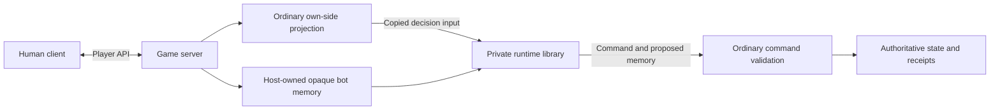

# Strategic bots as an embedded private runtime

Owner-approved architecture, revised 2026-10-27. This replaces the external bot
service approved on 2026-10-23. The private repository contains a library loaded
by the game server, not another server or network worker. Two scripted policies,
Shadow and Free Peoples, share modular mechanics. The legacy CPU remains separate
in [DEMO-MODE](DEMO-MODE.md). Neither strategic policy is ready for play yet.

## Product and ownership

- The operator installs the private runtime beside the game server. Public source,
  public game builds and human installers never contain private policies or DLLs.
- Players install only the ordinary client. The host requests CPU in the empty
  opposing room seat; normal Ready/Start, existing status/removal controls and
  multiple saved PvE games remain required. No extra service URL or bot setup UI.
- Policies are scripts, without an LLM/training service. They keep plans, notice
  opportunities, estimate probabilities and cover all accepted base/expansion
  mechanics. One strong level remains the target.
- Private code owns decisions, evaluations, hypothetical simulation and memory
  interpretation. The public host owns scheduling, projection, validation,
  authoritative RNG/state, receipts and persistence of opaque memory.
- This is implementation authorization, not release/deployment or proof of strength.

## Components and information boundary

The runtime gets exactly the game information legal for its assigned player:
current own-side PlayerView/options/decision, configuration, authorized visible
history, reports and supplied ordinary previews. It never gets a MatchState,
live engine/service/database object, observer perspective, opponent hand, hidden
orders or future RNG. Copies cross the boundary as versioned JSON, so public and
private pinned rules assemblies cannot accidentally share mutable state.
The host establishes information provenance before serialization. A matching
side field alone does not prove that an arbitrary DTO was safely projected.
Missing necessary nonsecret facts still require a reviewed shared-player contract;
in-process hosting does not unblock BOT-02 by exposing hidden continuations.

The runtime is trusted operator code in the same process. Assembly isolation and
an input-only API prevent accidental coupling; they are not an OS security
sandbox. The host never supplies privileged capabilities. Cooperative cancellation,
bounded work and bounded concurrent evaluations must be tested. A timeout cannot
safely force-abort arbitrary managed code; a stalled evaluation must not trigger
an unlimited series of new tasks.

## Modular configuration

Exactly two faction profiles select strategic objectives. There is no separate
bot class, executable or policy catalog entry for every expansion combination.
A normalized MatchConfiguration selects a shared ordered module set:

| Module | Enabled by / dependency |
| --- | --- |
| Base | Always |
| Fate, Lords, Kings | Their respective configuration flags |
| Council | Council and Lords |
| Dismay | Explicit flag, or the Lords + Kings default; requires both |
| Visible / sequential corruption | Respective variant and Kings |
| Removing ruler tokens | Variant, Lords + Kings + Dismay |
| New Cities | Variant and Fate |

The shared rules validate dependencies first. Module registration is not proof
of strategic coverage. Modules contribute candidate providers, valuations,
planning hooks and effect handling to the same two policies; explicit priorities
resolve overlapping mechanics. A disabled module cannot add choices or change
base valuation. Integration tests cover all 93 normalized legal configurations,
interaction cases and invalid combinations, not 93 independent bots.
The release configuration and accepted mechanic coverage gate actual readiness.

## Runtime boundary and room flow

The [runtime ABI](BOT-RUNTIME.md) defines a versioned describe/decide interface.
Inputs include an invocation ID, expected runtime/rules/content identities,
current own-side player information, history/reports/previews, random sampling
seed, work bound and optional opaque memory. Configuration is part of the current
player view. Outputs are one command proposal with proposed memory or a typed
no-decision/refusal. No runtime callback can commit a move or fetch a snapshot.

1. Host CPU admission reserves the empty opposite seat under the room lock.
2. The server checks the installed runtime, faction policy, enabled modules and
   accepted rules/content. Only supported policy coverage can acknowledge the
   current room version; configuration changes invalidate readiness.
3. The human uses existing Ready/Start. Starting binds a durable CPU assignment
   to the match/side and pinned runtime/policy version.
4. A server-owned scheduler reads pending bot-owned decisions and safely projects
   input outside the game mutation. Each seat has one active evaluation generation.
5. The server rechecks seat, generation, revision and decision under the normal
   mutation lock, validates the returned command with the normal engine, then
   persists its accepted result. A proposed move never authorizes itself.

Cancellation/removal and match deletion stop future work. CPU work cannot keep an
abandoned waiting room alive. Missing/incompatible runtime, unavailable policy or
failure preserves the current game/decision; never pass, forfeit dice or switch to
the demo policy automatically. Restart recovers pending CPU work without a human
refresh. No control/seat HTTP credential is required by the embedded runtime.
Previously implemented BOT-16 endpoints remain legacy, default-disabled code;
the external BOT-17 transport exists only on a local historical checkpoint branch.

## Strategic decisions and simulation

BOT-02 checkpoint (2026-11-05): [ordinary player rule facts](PLAYER-RULE-FACTS.md)
version 10 retains reviewed base/Fate/Lords/Council roots and adds Kings ordinary
phases/actions/paid steps, hand limits, Ruler die discard, Dismay and active
ordinary Eye-paid corruption choices. Shadow retains its already drawn tiles
separately from currently selectable tiles; FP receives no private draw identity.
Covered corruption tiles are independently sampled from the combined unknown
pool/attachment multiset under each sovereign's resistance. Known identities,
public resource uses and Fate exclusions remain exact. Each simulated actor gets
only its own ordinary projection; no live assignments, resolution stack or entropy
cross the runtime boundary.

Private `544de51` / runtime 0.2.14 uses rules 0.10.0 (public `432d71b`, 435 files),
Contracts 0.24.0 / content 1.0.26. Client `db7a837e` pins both public archives.
Full private verification passed **1,924 C# / 17 Python** cases, no skips, zero
build warnings/errors, dependency/boundary checks and local library publish.
The 108 added cases cover seven active-draw windows across six compositions and
both visibility modes, exact Eye payments, prior sequential-choice refusal, known
tile identities, thresholds, hidden permutations, invalid inputs and cancellation.

Public regression passed **2,246 C#** cases, no skips, including 94 new projection
and 14 real HTTP/restart/receipt-replay cases. The owned database was removed.
Ten package checks passed. Client **59 Unity EditMode** cases
passed, no skips; existing unrelated Unity warnings remain. The 72-file pinned
Markdown check passed. The BOT-13 PlayMode backend was not replaced or retested.

Bounded base/Fate walks retain 303 roots / 7,564 candidate checks. Across all 93
normalized configurations and 7,440 actual-command roots, reconstruction supports
**6,397**, up from 6,181, with **1,043 explicitly unsupported**. Candidates at accepted
roots also match authoritative legality. This is bounded coverage, not full games
or playing strength. Exact diagnostics and current early/later copy, reconstruction,
rollout/allocation/cancellation measurements remain private.

BOT-02 remains in progress; BOT-03 stays blocked on complete reconstruction.
Private runtime 0.2.68 now has source for the nested corruption decision, the
Palantir deck choice and its resulting Shadow excess-card discard after `The
West Has Failed`. These paths remain unbuilt and unverified. Other event/nested
corruption, suspended expansion Hunts, card/battle/effect-discard continuations
and full parity acceptance remain open. No production faction policy is
registered; `gameplayReady=false`.

### BOT-02 implementation checkpoint — relief battle aftermath (2026-11-06)

Rules 0.15.26 keeps the ActionBoundary v26 `Help Unlooked For` parent marker
through combat losses, defender retreat and the resulting Advance window. At
Advance, stronghold reconciliation has released surviving Free Peoples garrison
units to the field; the projection verifies the retained dice reduction against
those public field units. The public boundary/projection/relief test selection
passed **31/31**. Contracts 0.42.0 and public content 1.0.42 are unchanged.
Private reconstruction of this aftermath and full BOT-02 acceptance remain
pending; `gameplayReady=false`.

### BOT-02 implementation checkpoint — Help Unlooked For battle (2026-11-06)

Public commit `daffb48344c6feb7506695268f8159d3bf8a9502` advances Contracts to
0.42.0 / ActionBoundary v26, rules to 0.15.25 and public content to 1.0.42. The
boundary identifies the public `Help Unlooked For` parent event and paid face
while its Relief battle is active. The projection verifies the event program,
Free Peoples payment and public discard, the stronghold and opposing forces, and
the garrison based reduction to the besieging army's dice. It exposes no engine
frame or private combat card. Protocol and save schema are unchanged.

Public projection, boundary and relief tests passed **520**, with three skips.
Client commit `877f8021b6bcaa3ce2b79966d0f7baaf989110d0`
pins Contracts 0.42.0 and content 1.0.42; dependency fetch and the 72-file
server link check passed. Private commit `8ac075c` advances runtime 0.2.70 and
reconstructs the event parent and payment around both combat-card decisions and
the no-hit Stop return. Full private verification passed 2,199 C# and 17 Python
tests, with no skips and no build warnings or errors. BOT-02 remains in progress
and `gameplayReady=false`.

### BOT-02 implementation checkpoint — West Palantir excess discard (2026-11-06)

Private commit `d1154ac99c67d560ccc71c5c1481dc29b0f43ccc` advances the runtime to
0.2.68 and reconstructs Shadow's excess-card decision after `The West Has
Failed` returns from corruption, Palantir selects a deck, and one card is drawn.
ActionBoundary v25 carries the paid event and the drawn-card identity only in
Shadow's view, where that card is already in the hand. Rules emit the marker only
when the West/Palantir frames, committed deck selection and latest private/public
draw events agree. The runtime restores the completed Palantir child and
`ResumeEffect`, without replaying the draw or exposing the card to Free Peoples.
It accepts ordinary Event payment and the Kings Palantir Muster conversion.

Public commit `ee5f5a8315280844fbb94be5d5ac78f2fce9ad12` provides rules 0.15.22
(443 files; SHA-256
`32b3531d6bf66f85acb7b5e43033f498f8360212f6bd21a11788c774c78a4991`), Contracts
0.41.0 and content 1.0.41. Client commit
`91586f8bcfb9018e3c6dc1c2964aec26e2df544a` pins the packages; client document
links are pinned at `3b79a5033a3fc32feb5547ac75c04f28d6910dc8`. Public package
generation, client dependency pin/fetch, private rules bootstrap and static diff
checks passed. No tests or builds were run. This path is unverified and excluded
from the 6,397/7,440 bounded-root count. BOT-02 remains in progress and
`gameplayReady=false`. No push, release or deployment.

### BOT-02 implementation checkpoint — West Palantir deck choice (2026-11-06)

Private commit `ddd499569ebb8933f2615cff3d26571e60775811` advances the runtime to
0.2.67 and reconstructs the Palantir deck choice after the paid `The West Has
Failed` event returns from its Kings corruption procedure. ActionBoundary v24
marks only this exact parent-event/Palantir stack and carries the event identity
and paid face; the target remains in the owner's effect trail. Runtime reopens
the pinned choice without replaying the corruption or drawing a card. It retains
the earlier v23 marker's handling of a public-reaction cancellation and accepts
the Kings Palantir Muster conversion when validating Event payment.

Rules 0.15.21 from public commit
`a31fd541196efdca719dfd5ab4473cf263288252` contains 443 files (SHA-256
`c827957f64ed1cfc980241e5585ddf0b9c6200a475fce60d115e070cc533a2cf`), Contracts
0.40.0 and public content 1.0.40. Client commit
`bbfaeee3163f661d8fe2ee7bff96c376f82c7778` pins the packages. Public package
generation, the client dependency bootstrap and private 443-file rules bootstrap
passed; static diff checks passed. No tests or builds were run. This path is
unverified and excluded from the 6,397/7,440 bounded-root count. It does not
change BOT-02 acceptance or gameplay readiness. No push, release or deployment.

### BOT-02 implementation checkpoint — West corruption return (2026-11-06)

Private commit `febf037858e35f78a950dff7af7ad671f3895d13` advances the runtime to
0.2.66 and reconstructs the paid `The West Has Failed` continuation while its
Kings corruption draw or choice is pending. Public ActionBoundary v23 carries
the card, payment face and whether Palantir still has a draw pending after public
reactions. The runtime validates the public effect trail, resolving die, tile
facts and exact card program, then restores the parent event and corruption
continuation without replaying a draw or serializing engine frames.

The runtime pins rules 0.15.20 from public commit
`453b0da60fcebacc96684020d1c0632d67ff55bf` (443 files; SHA-256
`e115598d1c0ae4e4abade4d389aecd5c4aff7003af3fa8dd6fdea0f1ca0e3be2`),
Contracts 0.39.0 and public content 1.0.39. Client commit
`cded5e016d33f7adaea5731cd2424bd22227d2da` pins these packages; public peer
links are at `a592fb6`. `git diff --check`, pinned dependency archive/hash
inspection and the 443-file bootstrap integrity check passed. No tests or builds
were run. This source path is not included in the 6,397/7,440 bounded-root count
and does not change BOT-02 acceptance or gameplay readiness. No push, release or
deployment was performed.

### BOT-02 implementation checkpoint — outside companion journeys (2026-11-06)

Private commit `c8c2a7f` / runtime 0.2.61 pins rules 0.15.14 from this
repository's public source commit `96853b10fc42377d4df3ff12711a2712acf9b1f0`
(439 files; SHA-256
`89d782247b851b635b343698c7d0feab4b60fa76d492d0bf825fe280e607db67`). Public
ActionBoundary v18 now marks the paid outside-companion journey on Book of
Mazarbul (base), Fear! Fire! Foes!, and Book of Mazarbul (Fate), with exact
optional-movement limits and no route or resolution frame. The runtime rebuilds
these allowlisted programs and checks their following card effects against the
pinned engine. It also accepts a legal subset of projected Separation options
when no outside companion can move, then requires full player-view parity.

Focused public `CompanionJourneyProjectionTests` passed **14/14**. Full private
`bash scripts/verify.sh` passed **2,191 C# / 17 Python**, no skips, zero Release
warnings/errors, pinned dependency/boundary checks and local runtime publish.
The focused private journey tests passed **14/14**, including all three outside
journeys, empty movement, automatic card continuation, hidden Shadow invariance,
malformed facts and the Swifter no-outside-companion regression. The previously
failing bounded configuration walk passed **1/1**. Client commit
`5faa66460bd90ed789bbd8ece0692cf0145cb4ea` moves its server links to the 0.15.14
source; its 72-file Markdown link check passed. No client code, package, Unity
test or gameplay-ready status changed. BOT-02 remains in progress and
`gameplayReady=false`; battle, discard and nested-expansion roots remain open.
The latest 93-configuration bounded walks reconstructed **7,171/7,440** sampled
roots; the remaining **269** were explicit unsupported decisions. Candidate
legality matched the authoritative engine at every reconstructed root. The
largest unresolved areas remain reactions, Guide continuations, card effects
and battle advances; this sample is not exhaustive reachability.

### BOT-02 implementation checkpoint — direct paid-separation Guide (2026-11-06)

Rules source commit `990b15908665fb2d674a9fbe06aa61042e4c21c3` packages
`wotr-rules` 0.15.15, Contracts 0.35.0 and public content 1.0.35. ActionBoundary
v19 adds `FellowshipGuide` only for a direct paid Free Peoples companion
separation with a Guide decision remaining. It carries no frame, source history,
or selected private choice. Other public contexts now use boundary v19.

Private commit `2089347` / runtime 0.2.62 consumes the marker and rebuilds the
single Guide continuation from public companions, the resolving Character die
and the ordinary SelectGuide option. This change has not been built or tested;
it is not included in the prior 7,171/7,440 verified-root count. BOT-02 remains
in progress, gameplayReady=false, and no policy is registered. No client code,
release, deployment or push changed.

Rules source commit `c865bc0758677fecd032c45096696002b77de9cb` packages
`wotr-rules` 0.15.16 (441 files; SHA-256
`74f1e2e1bc0eaad3274ad6d24b43535e1feccbd30772199fb69d13fbfb103efb`). It
extends the same v19 projection to public Shadow reactions at
`fellowship.declared`, including a re-offer after an earlier public reaction
has been used. The projector checks exact remaining reaction identities and
public owner/source facts. Private commit `b6966fe` / runtime 0.2.63 rebuilds
these windows from public state and restores the visible response trail. Active
nested Hunt continuations are still omitted. The change has not been built or
tested and is not counted as accepted BOT-02 coverage.

Contracts 0.39.0 / content 1.0.39 / rules 0.15.20 is the current local source
checkpoint. ActionBoundary v23 marks the paid `The West Has Failed` parent event
while its Kings corruption choice is pending, retaining the public card, cost and
pending Palantir draw consequence. This follow-on flag handles its cancellation
by a public reaction. The runtime rebuilds the event continuation and returns
through the parent; the marker carries no tile choices or engine frames. Runtime
source is 0.2.66. This path is unverified and does not count toward BOT-02
acceptance or gameplay readiness.

Contracts 0.36.0 / content 1.0.36 / rules 0.15.17 is the declaration checkpoint
above. The preceding local rules change advanced Contracts to 0.37.0, public content
to 1.0.37 and ActionBoundary to v21. Rules 0.15.18 carries the selected
Companion for a Free Peoples Lure placement or Guide continuation after the
public elimination choice. Shadow receives no target identity from this marker.
The private runtime source advances to 0.2.65. This path is unverified and does
not count toward BOT-02 acceptance or gameplay readiness.

The v20 contract carries the public source IDs already committed in a declaration
reaction window and marks the active `Gates Are Closed` Hunt at its exact
parent/Hunt stack position. It also lets the existing Balrog declaration Hunt
retain earlier committed reactions. The route's deferred Fire and Shadow
obligation is retained so the normal declaration continuation runs after the
reaction chain. The private runtime source was 0.2.64 and rebuilds those decisions
from the public source list. This preceding change is unverified, does not count
toward the 7,171/7,440 baseline, and does not change BOT-02 acceptance or gameplay
readiness.

Implementation checkpoint (2026-10-26): the private runtime has an internal
bounded pure-engine kernel and constrained card partition sampler. Production
reconstruction is blocked on a reviewed mapping from player information/history
to rule continuations; the current view omits suspended returns and effect cursors.
Its observation-only candidate generator now covers military choices, character
and Fellowship travel, constrained/grouped effects, Council decisions and Ruler
recruitment/token payments. Separate-route army card events use a narrowly scoped
local rules check built from public board information. The private checkpoint
passed 664 C# and 9 Python cases, including bounded own-view execution walks over
all 93 normalized configurations and targeted expansion choices. Each configuration
walk ends at its 80-command cap; these are not completed games or acceptance of the
public behavioral inventory. Full reachable-decision coverage, validated fallback, simulation
battle/Hunt/card-chain parity and performance benchmarks remain pending. Neither
BOT-02 nor BOT-03 is accepted and no production policy is enabled.

The pure policy interface remains
`Decide(BotObservation, BotMemory, DecisionBudget)`: one current command, proposed
next memory and private diagnostics. Its input is built from copied ordinary player projections and authorized history,
not a reference to the live server's `MatchState` or persistence services.

Memory records the policy/schema version, accepted progress and remembered facts.
Keep one main plan and at most two supporting plans, each with objective, stages,
assigned forces, preferred resources, completion/abort conditions and progress.
Reservations influence value, never legal availability. Reassess after every
decision; immediate wins/losses or substantial opportunities can interrupt a plan,
while small score changes should not cause oscillation.

| Shadow plans | Free Peoples plans |
| --- | --- |
| Prepare Gondor, Rohan and northern campaigns; concentrate Leadership and forces | Defend valuable settlements, delay armies and preserve useful forces |
| Select victory targets and decide attacks, sieges and redirection | Advance, conceal and heal the Fellowship with sustainable corruption risk |
| Allocate Hunt resources and position Nazgul | Select Guides, separate companions and choose Hunt casualties by future value |
| Develop Minions and future action dice; protect Shadow victory sites | Develop Aragorn/Gandalf; recognize a realistic military countervictory |
| Corrupt sovereigns and exploit expansion abilities | Awaken/recover sovereigns and support the main plan with expansion abilities |

Generate concrete legal candidate costs, splits, routes, targets and continuations.
Value cards as events, combat commitments, retained resources and discards; optional
reactions and continuing multi-step actions require purposeful choices. Include
all base/expansion mechanics in the coverage ledger, with useful-use and justified
decline/retention cases where applicable.

The private runtime consumes a pinned build of the shared pure rules engine.
It constructs hypothetical worlds from its own knowledge and public content.
Unknown hands, decks and tiles are sampled consistently with that knowledge,
never copied from the true state. Hypothetical actors also see only their own
observations; future choices cannot depend on unrevealed information.

Use exact elementary dice distributions where tractable and sampled complete
battles/Hunts for combined effects. Report objective/capture probability, losses,
survivors, character exposure, resource cost and uncertainty. Distinguish winning
a round from taking a stronghold. Do not apply a universal attack-probability cutoff.
Use bounded lookahead toward two own actions and opposing replies, with lightweight
nonrecursive rollout policies. Late-game copying and simulation cost must be profiled.

Target difficult decisions normally within 3 seconds, with a 5-second computation
deadline and an already assessed legal candidate available. Measure host scheduling and
queue wait separately. Cancellation, bounded work units, fair scheduling and visible
no-candidate errors prevent unbounded work and silent stalls.

## Opaque memory and command recovery

The runtime has no storage or network module. It accepts prior private memory and
returns proposed next memory. The public host stores opaque versioned bytes per
match/side/profile; it neither interprets plans nor sends them to human clients,
replays, events or public diagnostics.

The [BOT-18 host](BOT-HOST.md) journals the exact proposed command/ID, prior decision/revision,
evaluation generation and proposed memory before committing. An accepted ordinary
receipt advances memory exactly once; stale/rejected/cancelled results never do.
Game state, receipt, accepted opaque memory and journal result commit in one
host-owned transaction; recovery resubmits the exact pending command first. Restart and a game-ending command
must leave no uncertain memory transition. Avoid a second private database or a
new bot network protocol. Runtime/policy/memory version upgrades require explicit
compatibility and migration; unsupported saved memory must not be silently reset.

## Builds, loading and acceptance

The private artifact is a library with pinned public rules dependencies. The game
server loads it from an operator-configured path in a separate assembly load
context; public builds need no private checkout. Only strings and framework types
cross the ABI. No private strategy, runtime binary or tests enter public packages.
The server remains available when the optional runtime is absent; CPU stays unready.

BOT-17 now owns the runtime contract, modular configuration and optional loader.
BOT-18 owns host scheduling, provenance, readiness and command/memory recovery.
[BOT-19 operations](BOT-OPERATIONS.md) implement integrity-checked private library
and separate symbol packages, bounded concurrency/work, host memory-pressure
gating, persistent draining and compatible upgrade/rollback. Operators use the
existing server executable; there is no bot service or player installation.
BOT-20 tests the real private runtime with the actual server/client.
BOT-02–BOT-11 retain reconstruction, candidates, risk, plans, faction policies,
cards and expansion behavior. BOT-13 implements minimal room UI and reuses existing
opponent presentation. The seated host uses Add CPU in the empty opposing seat’s
Remove slot; Take seat remains available. Joining / Ready / Unavailable occupy the
normal readiness line. Play vs CPU opens this room, and existing Ready/Start clicks
start saved PvE only after current-configuration acceptance. All PvE saves remain
in My games beside human games and earlier demos. Invitation retries preserve
request ID/version; authoritative roster changes resolve uncertainty. No private
bot package, service settings or extra board controls enter the client. BOT-14 combines all strategy/coverage/strength and integration gates.

Public loader tests use a clearly labelled policy-free fixture; private tests
exercise the actual runtime entrypoint. Full acceptance requires real faction
policies, all player-information parity surfaces, hidden-state permutations,
stale generation/command rejection, server restart around command/memory commit,
room races, readable opponent presentation and clean public/player artifacts.
No fixture, module selector or passing build establishes playing strength.

### BOT-02 implementation checkpoint — Kings chieftain replacement (2026-11-08)

Contracts 0.64.0 / ActionBoundary v48 and rules 0.15.50 mark a Kings chieftain's replacement
offer before the reveal (32 of 292 roots a six-seed walk left unsupported). BOT-02 is still
incomplete; no policy, push, release or deployment.

### BOT-02 implementation checkpoint — Return to Valinor (2026-11-08)

Contracts 0.63.0 / ActionBoundary v47 and rules 0.15.49 mark Return to Valinor's repeated
choices and losses (24 roots a six-seed walk left unsupported) and the Orderly Withdrawal
choice (14), and inspect a lone sovereign without a choice in the trail (22). BOT-02 is still incomplete; no
policy, push, release or deployment.

### BOT-02 implementation checkpoint — nested and follow-on event choices (2026-11-08)

Contracts 0.62.0 / ActionBoundary v46 and rules 0.15.48 mark Wisdom's nested inspection (20
of 565 roots a six-seed walk left unsupported), Madness and Horror (48) and the Guide chosen
after an event's separation (13). BOT-02 is still incomplete; no policy, push, release or
deployment.

### BOT-02 implementation checkpoint — Kings action closers (2026-11-08)

Contracts 0.61.0 / ActionBoundary v45 and rules 0.15.47 mark Denethor's Palantir of Anarion
after a Ruler-die draw (24 of 605 roots a six-seed walk left unsupported, with its discard),
the Kings corruption removal before an action completes (36) and the Mighty Attack choice
(12; 60 more roots follow it in the same battle). BOT-02 is still incomplete; no policy, push,
release or deployment.

### BOT-02 implementation checkpoint — the Sorcerer offer (2026-11-08)

Contracts 0.60.0 / ActionBoundary v44 and rules 0.15.46 mark the Witch-king's Sorcerer offer
after round one, the largest group (40 of 629) a six-seed walk left unsupported. BOT-02 is
still incomplete; no policy, push, release or deployment.

### BOT-02 implementation checkpoint — the Kings inspection (2026-11-08)

Contracts 0.59.0 / ActionBoundary v43 and rules 0.15.45 mark every step of the Kings
inspection card, whose six roots were spread over its three choices. BOT-02 is still
incomplete; no policy, push, release or deployment.

### BOT-02 implementation checkpoint — Stormcrow's figure loss (2026-11-08)

Contracts 0.58.0 / ActionBoundary v42 and rules 0.15.44 mark Stormcrow's last step, where
the event's opponent removes a figure of the struck nation: the 24 Kings roots that were the
largest group the wide walk still left unsupported. BOT-02 is still incomplete; no policy,
push, release or deployment.

### BOT-02 implementation checkpoint — the Heroic Death choice (2026-11-08)

Contracts 0.57.0 / ActionBoundary v41 and rules 0.15.43 mark the Heroic Death choice
itself, the 16 roots the wide walk still left in that family once v38 announced the hits
it cancels. They also mark special-attack losses in Kings games: a blanket Kings exclusion
had kept 14 Sudden Strike roots unmarked, although no Kings rule was involved. BOT-02 is still incomplete; no policy, push, release or deployment.

### BOT-02 implementation checkpoint — The Lidless Eye and an event's excess (2026-11-07)

Contracts 0.56.0 / ActionBoundary v40 and rules 0.15.42 mark The Lidless Eye's dice choice
and the stack-limit decision an event leaves before it completes; together 23 of the 139
roots the wide walk left unsupported. BOT-02 is still incomplete; no policy, push, release
or deployment.

### BOT-02 implementation checkpoint — every Onslaught card (2026-11-07)

Contracts 0.55.0 / ActionBoundary v39 and rules 0.15.41 review Onslaught by its printed
effect, as Relentless Assault and Great Host already were, so Misty Mountains and Orcs
Multiplying reconstruct like Uruk-hai. BOT-02 is still incomplete; no policy, push,
release or deployment.

### BOT-02 implementation checkpoint — announced battle cancellations (2026-11-07)

Contracts 0.54.0 / ActionBoundary v38 and rules 0.15.40 add each force's cancelled hits
to the `Battle` fact. Heroic Death's choice of how many hits a sacrifice cancels was the
one cancellation the runtime could not infer, and it blocked about 100 of the 285 roots
the wide walk left unsupported. BOT-02 is still incomplete; no policy, push, release or
deployment.

### BOT-02 implementation checkpoint — the Balrog event (2026-11-07)

Contracts 0.53.0 / ActionBoundary v37 and rules 0.15.39 mark the Balrog event's order
choice and the lone travel or army order it opens, and the Rage of the Dunlendings move.
The Balrog was the largest group, 60 roots, that the wider walk still left unsupported
without a new contract decision; Rage was 14 more, and 24 corruption attempts paid with a
Keeper Eye.
`DirectEventChoiceFamilyTests` covers all three decisions and refuses a swapped or extra
choice, a moved cursor or another army order. BOT-02 is still incomplete; no policy,
push, release or deployment.

### BOT-02 implementation checkpoint — Kings national cards and army events (2026-11-07)

Contracts 0.52.0 / ActionBoundary v36 and rules 0.15.38 mark the branch and nested
recruitment of the four Kings national cards, and the army movement or attack of every
`ArmyOrderStep` event. Together they were about 140 of the 600 roots the wider walk left
unsupported. `DirectEventChoiceFamilyTests` covers both and refuses altered frames.
BOT-02 is still incomplete; no policy, push, release or deployment.

### BOT-02 implementation checkpoint — event costs from a wider walk (2026-11-06)

A wider bot walk (two more seeds, 160 commands) found that rules offered Great Sorcery and
Use Balrog as ways to pay for an Army event, although they pay only for moving an army and
`EventRules.ValidCost` rejects them. A player in a Lords game saw a payment the server then
refused. Rules 0.15.37 offers only costs that the same validation accepts. No contract or
public content changes. BOT-02 is still incomplete; no policy, push, release or deployment.

### BOT-02 implementation checkpoint — Scouts, Relentless Assault and Great Host (2026-11-06)

Contracts 0.51.0 / ActionBoundary v35 and rules 0.15.36 mark the Scouts choice before the
roll, the voluntary losses of every Relentless Assault card and the Great Host loss.
`ReviewedCombatCards` qualifies a card by its single printed effect.
`BattleCardBoundaryTests` covers them and refuses altered frames. BOT-02 is still
incomplete; no policy, push, release or deployment.

### BOT-02 implementation checkpoint — event losses and separation (2026-11-06)

Contracts 0.50.0 / ActionBoundary v34 and rules 0.15.35 mark the losses left by The
Spirit of Mordor, Faramir's Rangers and Work of the Enemy, the separation that opens
Alone or There and Back, and Aid's companion journey. `DirectEventChoiceFamilyTests`
and `CompanionJourneyProjectionTests` cover them and refuse altered frames. Return to
Valinor stays unmarked, see the player rule facts. BOT-02 is still incomplete; no
policy, push, release or deployment.

### BOT-02 implementation checkpoint — event reaction windows and Nazgul travel (2026-11-06)

Contracts 0.49.0 / ActionBoundary v33 and rules 0.15.34 mark `event.played` and
`event.completed` for any directly paid event, and the Nazgul travel in Black Captain
and in the events that open with it. Spear of Terror applies to every Shadow Character
event and the Gandalf draw to every Free Peoples event paid with an Event die, so this
reaches much further than the bounded walk shows. `DirectEventChoiceFamilyTests` cover
both windows, the Palantir expectation and refusal of altered frames. BOT-02 is still
incomplete; no policy, push, release or deployment.

### BOT-02 implementation checkpoint — direct events reviewed by step type (2026-11-06)

Contracts 0.48.0 / ActionBoundary v32 and rules 0.15.33 replace the card list in
`DirectEventChoices` with a list of reviewed step types, marking 43 events. Each
listed step takes its candidates only from the public board and the event's own
earlier choices. `DirectEventChoiceFamilyTests` pins the exact event set, so any
addition is explicit, and covers first choices, automatic earlier steps and
recruitment in a chosen region. BOT-02 is still incomplete; no policy, push,
release or deployment.

### BOT-02 implementation checkpoint — direct first-choice events (2026-11-06)

Contracts 0.47.0 / ActionBoundary v31 and rules 0.15.32 extend `DirectEventChoice`
to the first choice of Celeborn's Galadhrim, The Spirit of Mordor, Faramir's Rangers, Men of Little
Villages, Work of the Enemy, Dwarves of the Iron Hills, Hill-Trolls, Many Kings to
the Service of Mordor, A New Power is Rising, Shadows on the Misty Mountains and
Horde from the East. Nothing before these choices selects or reveals
anything, and the engine runs every later step, including dice and losses.
`DirectEventChoices.IsReviewed` pins each card to its exact program. Public
`DirectEventChoiceFamilyTests` cover every card and refuse an altered cursor,
payment, public play or selection. BOT-02 is still incomplete; no policy, push,
release or deployment.

### BOT-02 implementation checkpoint — Ever at Your Service (2026-11-06)

Contracts 0.46.0 / ActionBoundary v30 and rules 0.15.31 extend `DirectEventChoice`
to both Ever at Your Service choices. The second marker requires the exact
program and cursor, the recorded ruler selection and that ruler's current region
and nation; a lone eligible ruler is the one case with no recorded selection.
The marker adds no field, frame, cursor or selection. Public `KingsServiceTests`
cover four legal cost / die combinations, the forced ruler, and refusal of an
altered cursor, payment, public play, ruler, region, nation or selection. BOT-02
is still incomplete; no policy, push, release or deployment.

### BOT-02 implementation checkpoint — direct event effect choice (2026-11-06)

Contracts 0.45.0 / ActionBoundary v29 and rules 0.15.30 mark only the first
recruit choice in Kindred of Glorfindel. The marker includes the visible card
and payment face only, and the server requires its exact top-level event
program, public discard, resolving die and current engine-generated choice
list. It does not serialize a frame or effect cursor. Other card programs remain
unmarked until their runtime path has its own reviewed reconstruction.

Public `Strategy04RecruitmentTests` passed 46 cases, including four legal cost /
die combinations and refusal of an altered cursor, payment or missing public
play. Package and private reconstruction checks remain in progress. BOT-02 is
still incomplete; no policy, push, release or deployment.

### BOT-02 implementation checkpoint — Fate Monsters event choices (2026-11-06)

Public source `a23cd410a8c0c2ea89ec185bfd047e65a93b602d` adds the rules 0.15.28
projection support for the exact `Monsters Roused` event continuation at
ActionBoundary v27. Contracts 0.43.0 exposes only the parent card, paid face and
selected East branch. The projection accepts the printed Muster or Event payment,
including compatible Army/Muster and Will of the West dice, while checking the
public discard, resolving Shadow die, committed trail and current legal choices.
No frame or effect cursor is exposed. Public boundary/Fate tests passed 373 with
8 integration tests skipped.

Private runtime commit `c114207` / 0.2.72 reconstructs the West selection and East
region choices, checks every candidate against engine legality and compares the
resulting Shadow view after each action. Client commit `5779958` pins Contracts
0.43.0/content 1.0.43 and server source `a23cd41`; its 72-file link check passed.
Full private verification passed 2,209 C# and 17 Python tests with no skips, zero
Release warnings/errors, and local package creation. BOT-02 remains incomplete;
other effect choices, characters, battles and full sampled-decision parity remain
open. `gameplayReady=false`; no policy, push, release or deployment.
